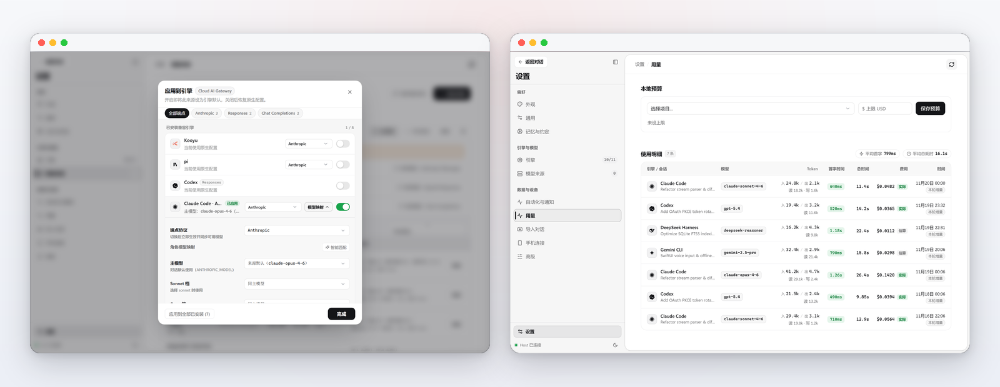
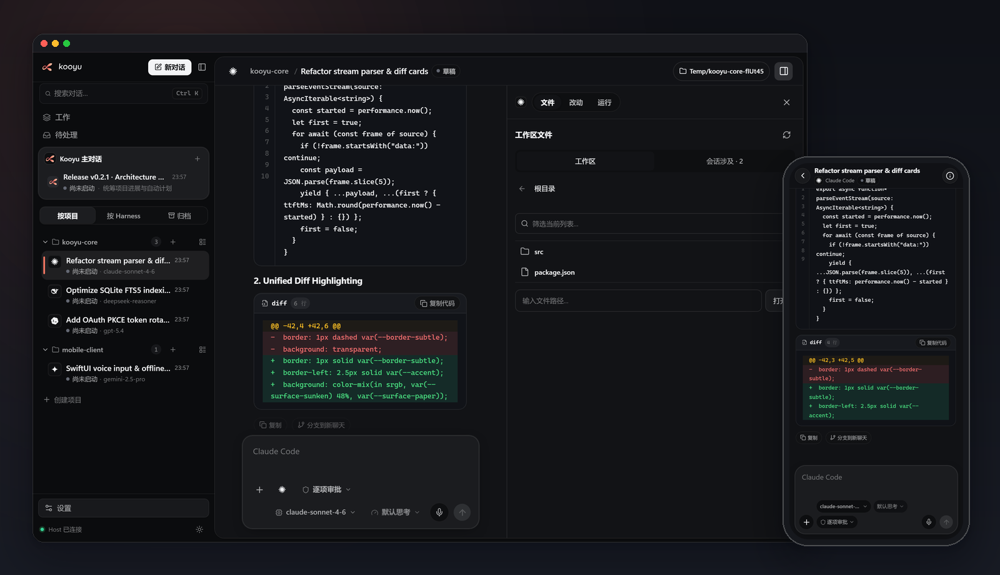
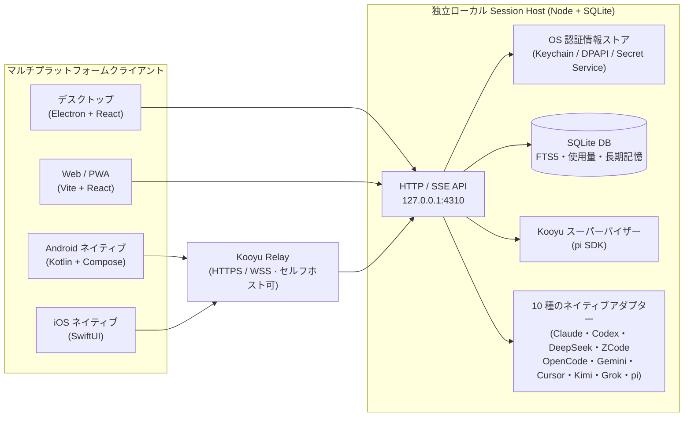

<div align="center">

<picture>
  <source media="(prefers-color-scheme: dark)" srcset="brand/icons/kooyu-app-dark.svg" />
  <source media="(prefers-color-scheme: light)" srcset="brand/icons/kooyu-app.svg" />
  
</picture>

<br />

<picture>
  <source media="(prefers-color-scheme: dark)" srcset="brand/logos/kooyu-wordmark-white.svg" />
  <source media="(prefers-color-scheme: light)" srcset="brand/logos/kooyu-wordmark.svg" />
  
</picture>

<h3>10 種類以上の AI コーディングエージェントを統合するローカルファースト・マルチプラットフォームワークベンチ</h3>

<p>
  ネイティブのコーディングハーネス、マルチプロトコル対応のモデルプロバイダー、ロール別モデルマッピング、使用量・レイテンシ台帳を 1 つの独立ローカル Session Host で一元管理し、Desktop・Android・iOS・Web からシームレスに連携できます。
</p>

<p>
  <a href="https://github.com/sh2001sh/Kooyu/releases">
    
  </a>
  <a href="https://github.com/sh2001sh/Kooyu/actions/workflows/native-apps.yml">
    
  </a>
  
  <a href="LICENSE">
    
  </a>
</p>

<p>
  <a href="README.md">English</a> ·
  <a href="README.zh-CN.md">简体中文</a> ·
  <strong>日本語</strong>
</p>

<p>
  <a href="#-ダウンロード">ダウンロード</a> ·
  <a href="#-主な特徴">主な特徴</a> ·
  <a href="#-対応エンジン">対応エンジン</a> ·
  <a href="#-インストール手順">インストール</a> ·
  <a href="#-モバイルペアリング">モバイル連携</a> ·
  <a href="#-ソースからビルド">ソースビルド</a>
</p>

<br />

<picture>
  <source media="(prefers-color-scheme: dark)" srcset="docs/assets/dark-workspace.png" />
  <source media="(prefers-color-scheme: light)" srcset="docs/assets/hero-showcase.png" />
  
</picture>

</div>

---

## ✨ 主な特徴

- **10 種類以上のネイティブエンジンを 1 つの画面で統合** — **Claude Code**、**Codex**、**DeepSeek Harness**、**ZCode**、**OpenCode**、**Gemini CLI**、**Cursor**、**Kimi Code**、**Grok Build**、**pi** と直接対話できるほか、内蔵の **Kooyu スーパーバイザー**によるプロジェクト横断の自動化・継続実行にも対応。
- **独立・永続ローカル Session Host** — Node + SQLite の独立 Host（`127.0.0.1:4310`）上で稼働。ウィンドウを閉じてもシステムトレイに常駐し、UI を終了しても実行中のエージェントや承認待ちタスクは中断されません。
- **プロバイダー統合・プロトコル切替・ロールマッピング** — OpenAI 互換（`Chat Completions` / `Responses`）や `Anthropic Messages` エンドポイントを一度登録するだけで `models.dev` からモデル仕様を自動同期。**Claude Code の 5 スロット・ロール別モデルマッピング**（デフォルト / Haiku / Sonnet / Opus / サブエージェント）を含め、グローバル CLI 設定を汚さずセッション単位で安全に適用できます。
- **Apple HIG 準拠のネイティブ・マルチプラットフォーム体験** — デスクトップは **Electron + React/TypeScript**、Android は **Kotlin / Jetpack Compose**、iOS は **SwiftUI**、さらに Web/PWA も提供。5 種類のテーマパレット、ライト/ダーク対応、行番号付きコードカード、Unified Diff ハイライト、`Ctrl/⌘+K` コマンドパレット、スプリット型ファイルインスペクターを搭載。
- **プロジェクト別チャット選択インポート & 多言語 UI** — ローカルの各エンジン履歴をスキャンし、プロジェクト単位で必要な会話だけを選択してインポート可能。**日本語 / English / 简体中文** の即時切替とデバイス間同期に対応。
- **マルチプラットフォーム音声入力** — デスクトップ/Web では Web Speech API と Host 側の Whisper / OpenAI 互換文字起こしのデュアルエンジン、Android では `SpeechRecognizer`、iOS では `SFSpeechRecognizer` をネイティブサポート。
- **使用量分析 & レイテンシ台帳** — プロジェクト・エンジン・モデルごとのトークン数、キャッシュヒット、推定コスト、予算管理に加え、ターンごとの **初回応答時間（TTFT）** と **合計所要時間** を可視化。
- **アプリ内ソフトウェアアップデート** — **設定 → 一般 → ソフトウェアアップデート** から安定版（Stable）またはプレビュー版（Preview）を確認し、`SHA256SUMS.txt` を自動検証した上でデスクトップ／Android のインストーラーを起動できます。

<div align="center">
  
  <br />
  <sub>左：プロバイダー適用モーダル（プロトコル切替と Claude Code ロール別マッピング） · 右：使用量分析と TTFT・所要時間台帳</sub>
</div>

<details>
<summary><strong>ライトモード / ダークモードのワークスペースを見る</strong></summary>
<br />
<p align="center">
  
  
</p>
</details>

---

## 🤖 対応エンジン

`PATH` 上の CLI とインストール済みデスクトップアプリを自動検出し、ネイティブのセッション ID・権限・認証境界を保ったまま連携します。

| エンジン | 役割 | プロトコル / ランタイム | 独立プロバイダー紐付け | 自動検出 |
| :--- | :--- | :--- | :---: | :---: |
| **Kooyu** | 内蔵スーパーバイザー | 組込 `pi` SDK | ✅ | 内蔵 |
| **Claude Code** | ネイティブハーネス | Native CLI / Agent SDK | ✅（5 スロット Role Mapping + Anthropic / Chat ゲートウェイ） | ✅ |
| **Codex** | ネイティブハーネス | `codex app-server` | ✅（OpenAI Responses） | ✅ |
| **DeepSeek Harness** | ネイティブハーネス | ネイティブ RPC / CLI | ✅ | ✅ |
| **ZCode** | ネイティブハーネス | ネイティブ CLI / 同梱ランタイム | ✅ | ✅ |
| **OpenCode** | ネイティブハーネス | Headless HTTP + SSE Server | ✅ | ✅ |
| **Gemini CLI** | ネイティブハーネス | ACP | ✅（ローカル Google → Chat ゲートウェイ内蔵） | ✅ |
| **Cursor** | ネイティブハーネス | ACP（`agent`） | ネイティブ認証のみ | ✅ |
| **Kimi Code** | ネイティブハーネス | ネイティブ Server API / ACP | ✅ | ✅ |
| **Grok Build** | ネイティブハーネス | ACP / ネイティブ CLI | ✅ | ✅ |
| **pi** | スタンドアロンハーネス | `pi` SDK / CLI | ✅ | 内蔵 |

> 詳細は [docs/harness-catalog.md](docs/harness-catalog.md) および [docs/provider-configuration.md](docs/provider-configuration.md) を参照してください。

---

## 📦 ダウンロード

全プラットフォーム向けのビルド済みインストーラーは [**GitHub Releases**](https://github.com/sh2001sh/Kooyu/releases) に自動公開されます。

### 最新ビルド — `v0.2.1`（[`preview-0.2.1-10`](https://github.com/sh2001sh/Kooyu/releases/tag/preview-0.2.1-10)）

| プラットフォーム | アーキテクチャ / 形式 | ダウンロード |
| :--- | :--- | :--- |
| **Windows** | x64 インストーラー（`.exe`） | [Kooyu-Setup-0.2.1.exe](https://github.com/sh2001sh/Kooyu/releases/download/preview-0.2.1-10/Kooyu-Setup-0.2.1.exe) |
| **macOS** | Apple Silicon M1–M4（`.dmg` / `.zip`） | [Kooyu-0.2.1-arm64.dmg](https://github.com/sh2001sh/Kooyu/releases/download/preview-0.2.1-10/Kooyu-0.2.1-arm64.dmg) · [ZIP](https://github.com/sh2001sh/Kooyu/releases/download/preview-0.2.1-10/Kooyu-0.2.1-arm64-mac.zip) |
| **macOS** | Intel x64（`.dmg` / `.zip`） | [Kooyu-0.2.1.dmg](https://github.com/sh2001sh/Kooyu/releases/download/preview-0.2.1-10/Kooyu-0.2.1.dmg) · [ZIP](https://github.com/sh2001sh/Kooyu/releases/download/preview-0.2.1-10/Kooyu-0.2.1-mac.zip) |
| **Linux** | x64（`.AppImage` / `.deb`） | [Kooyu-0.2.1.AppImage](https://github.com/sh2001sh/Kooyu/releases/download/preview-0.2.1-10/Kooyu-0.2.1.AppImage) · [kooyu_0.2.1_amd64.deb](https://github.com/sh2001sh/Kooyu/releases/download/preview-0.2.1-10/kooyu_0.2.1_amd64.deb) |
| **Android** | ユニバーサル APK（`.apk`） | [Kooyu-0.2.1-android-debug.apk](https://github.com/sh2001sh/Kooyu/releases/download/preview-0.2.1-10/Kooyu-0.2.1-android-debug.apk) |
| **iOS** | Apple Silicon シミュレーター（`.zip`） | [Kooyu-0.2.1-ios-simulator.zip](https://github.com/sh2001sh/Kooyu/releases/download/preview-0.2.1-10/Kooyu-0.2.1-ios-simulator.zip) |
| **チェックサム** | SHA-256 マニフェスト | [SHA256SUMS.txt](https://github.com/sh2001sh/Kooyu/releases/download/preview-0.2.1-10/SHA256SUMS.txt) |

---

## 🚀 インストール手順

### Windows

1. **`Kooyu-Setup-0.2.1.exe`** をダウンロードして実行します。
2. デスクトップ版は未署名のため、Windows SmartScreen の警告が表示された場合は **「詳細情報 → 実行」** を選択してください（詳細は [docs/windows-installation.md](docs/windows-installation.md)）。

### macOS

1. Apple Silicon は **`Kooyu-0.2.1-arm64.dmg`**、Intel Mac は **`Kooyu-0.2.1.dmg`** を開き、**Kooyu.app** を **Applications** へドラッグします。
2. Apple 公証前のビルドのため、初回起動前にターミナルで隔離属性を解除してください：
   ```bash
   xattr -cr /Applications/Kooyu.app
   ```

### Linux

- **AppImage**：
  ```bash
  chmod +x Kooyu-0.2.1.AppImage
  ./Kooyu-0.2.1.AppImage
  ```
- **Debian / Ubuntu（`.deb`）**：
  ```bash
  sudo apt install ./kooyu_0.2.1_amd64.deb
  ```

### Android

1. **`Kooyu-0.2.1-android-debug.apk`** をダウンロードし、「提供元不明のアプリのインストール」を許可してインストールします。
2. CI ビルドは同一の署名鍵を維持するため、新バージョンをそのまま上書きアップデートできます。

### iOS

- リリース同梱の `Kooyu-0.2.1-ios-simulator.zip` は Apple Silicon Mac の iOS シミュレーター向けです（`xcrun simctl install booted Kooyu.app`）。
- 実機 iPhone / iPad へのインストールは Xcode でご自身の署名チームを設定してビルドしてください（[apps/ios/README.md](apps/ios/README.md)）。

### チェックサム検証（SHA-256）

```bash
# macOS / Linux
shasum -a 256 -c SHA256SUMS.txt --ignore-missing
```

```powershell
# Windows PowerShell
Get-FileHash .\Kooyu-Setup-0.2.1.exe -Algorithm SHA256
```

### アプリ内アップデート

**設定 → 一般 → ソフトウェアアップデート** から **安定版（Stable）** または **プレビュー版（Preview）** を選択し、`SHA256SUMS.txt` 検証付きで最新ビルドへ更新できます。

---

## 📱 モバイルペアリング

ポート開放や VPN 設定なしで、スマートフォンからデスクトップ Host へ安全に接続できます：

1. デスクトップ側で **設定 → デバイス → ペアリングコードを生成** をクリック。
2. `relay.kooyu.app`（または `deploy/kodo-relay/` でセルフホストした Relay）へ自動接続。
3. Android / iOS アプリ内の QR スキャナー（または標準カメラから Web/PWA）で読み取るだけで接続完了。
4. 招待コードは 2 分間・1 回限り有効。デバイストークンはハッシュ保存（30 日間有効）され、デスクトップからいつでも失効できます。

---

## 🧱 アーキテクチャ



---

## 🛠️ ソースからビルド

### 動作要件

- **Node.js `>= 24.13.0`** / **npm `11+`**
- 対応するいずれかのコーディングハーネス CLI（または Kooyu 内で API プロバイダーを設定）

### 開発と起動

```bash
git clone https://github.com/sh2001sh/Kooyu.git
cd Kooyu
npm ci
npm run build

# デスクトップアプリ起動
npm run start:desktop

# Web ワークベンチのみ起動 (http://127.0.0.1:4310)
npm run start:host
```

### パッケージビルド

```bash
# デスクトップインストーラー生成 (release/desktop/)
npm run package:desktop -- --publish never

# Android APK (JDK 17 + Android SDK 36)
cd apps/android && ./gradlew testDebugUnitTest lintDebug assembleDebug

# iOS シミュレーター (macOS + Xcode 16 + XcodeGen)
cd apps/ios && xcodegen generate
xcodebuild -project Kooyu.xcodeproj -scheme Kooyu -destination 'generic/platform=iOS Simulator' CODE_SIGNING_ALLOWED=NO build
```

---

## 🔒 セキュリティとプライバシー

- **ローカルファースト設計** — 会話履歴・記憶・使用量データはすべてローカルの SQLite に保存され、Host は既定で `127.0.0.1` のみで待機します。
- **OS ネイティブのシークレット保管** — API キーや OAuth トークンは OS 認証情報ストア（Keychain / Windows 資格情報マネージャー / Secret Service）に安全に保管されます。
- **既存 CLI 設定を非破壊で保護** — プロバイダー紐付けやモデルマッピングはセッション単位で分離注入され、`~/.claude` や `~/.codex` などの既存設定を上書きしません。

---

## 📄 ライセンス

[**MIT License**](LICENSE) のもとで公開されています。サードパーティのライセンス・帰属表記は [`third-party/`](third-party/runtime-dependencies.md) および [`docs/upstream.md`](docs/upstream.md) を参照してください。
