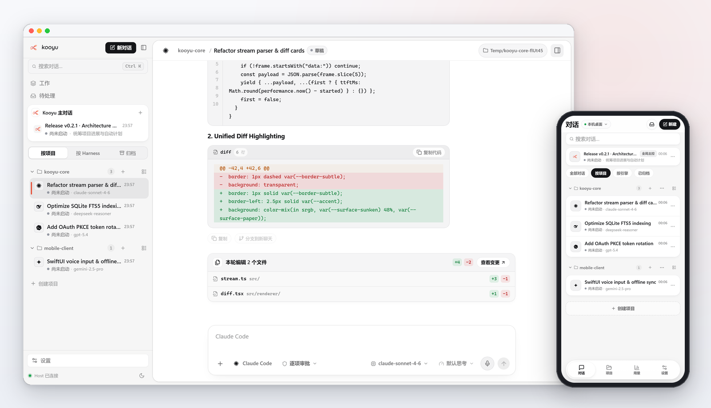
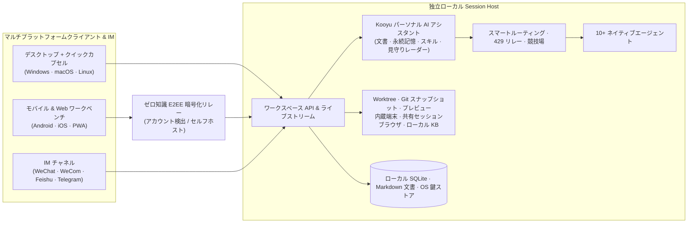

<div align="center">

<picture>
  <source media="(prefers-color-scheme: dark)" srcset="brand/icons/kooyu-app-dark.svg" />
  <source media="(prefers-color-scheme: light)" srcset="brand/icons/kooyu-app.svg" />
  
</picture>

<br />

<picture>
  <source media="(prefers-color-scheme: dark)" srcset="brand/logos/kooyu-wordmark-white.svg" />
  <source media="(prefers-color-scheme: light)" srcset="brand/logos/kooyu-wordmark.svg" />
  
</picture>

<h3>すべてのコーディングエンジンを操る、ローカルファーストのパーソナル AI アシスタント</h3>

<p>
  <strong>Claude Code</strong>、<strong>Codex</strong>、<strong>DeepSeek</strong>、<strong>Gemini CLI</strong>、<strong>OpenCode</strong>、<strong>Cursor</strong>、<strong>ZCode</strong>、<strong>Kimi Code</strong> などの開発エンジンをひとつのパーソナル AI アシスタントに統合。スマートルーティング・制限時自動リレー、隔離 Worktree 競技場、ローカル永続記憶、ゼロトークン見守りを備え、デスクトップ・Web・iOS・Android・IM からいつでも制御できます。
</p>

<p>
  <a href="https://kooyu.app">
    
  </a>
  <a href="https://github.com/sh2001sh/Kooyu/releases">
    
  </a>
  <a href="https://github.com/sh2001sh/Kooyu/actions/workflows/native-apps.yml">
    
  </a>
  
  <a href="LICENSE">
    
  </a>
</p>

<p>
  <a href="README.md">English</a> ·
  <a href="README.zh-CN.md">简体中文</a> ·
  <strong>日本語</strong>
</p>

<p>
  <a href="#-主な特徴">主な特徴</a> ·
  <a href="#-対応エンジン">対応エンジン</a> ·
  <a href="#-クイックスタートとダウンロード">ダウンロード</a> ·
  <a href="#-インストール手順">インストール</a> ·
  <a href="#-マルチデバイスe2ee-連携">リモート連携</a> ·
  <a href="#-ソースからビルド">ソースビルド</a>
</p>

<br />

<picture>
  <source media="(prefers-color-scheme: dark)" srcset="docs/assets/dark-workspace.png" />
  <source media="(prefers-color-scheme: light)" srcset="docs/assets/hero-showcase.png" />
  
</picture>

</div>

---

## ✨ 主な特徴

### マルチ Harness 指揮とエンジニアリング基盤
- **1 つの主控で 10+ コーディングエンジンを統括** — **Claude Code**、**Codex**、**DeepSeek Harness**、**Gemini CLI**、**OpenCode**、**ZCode**、**Cursor**、**Kimi Code**、**Grok Build**、**pi** と直接対話でき、複雑な要件は内蔵の **Kooyu スーパーバイザー**へ委譲可能。実装＋別エンジンレビュー、並列分割、CI ガード、深掘り調査などのプレイブックを搭載。
- **スマートルーティング & 429 レート制限自動リレー（`ROUTING.md`）** — タスク種別に応じて最適なエンジンを自動選択。`429` やクォータ上限に達した場合、進捗と差分をまとめて次の予備エンジンへシームレスに引き継ぎます。
- **マルチエンジン競技場（Multi-Harness Arena）** — 2〜3 種類のエンジンへ隔離 Git Worktree 上で同一課題を並列出題。実 `git diff` とテストコマンド（`checkCommand`）によるスコアカードを比較し、勝者ブランチをワンクリック採用できます。
- **無痕 Git チェックポイント & ワンクリック PR 交付** — 隠し参照（`refs/kooyu/checkpoints/*`）へ追跡・未追跡ファイルのスナップショットを保存し、`git log` や stash を汚さず即座に復元可能（復元前の保護スナップショット自動作成）。Hunk 単位の差分確認からマージ・PR 作成まで完結します。

### 使うほどあなたに馴染むパーソナル AI アシスタント
- **ローカルワークスペース文書と永続記憶** — `SOUL.md`、`USER.md`、`MEMORY.md`、`RULES.md`、`HEARTBEAT.md`、`AGENTS.md`、`ROUTING.md` をターンごとにホットリロード。Desktop / Web / Android / iOS の設定画面から直接編集できます。
- **全端末対応の確認カードとルール学習** — 重要な判断時は構造化カードで確認。「今後も自動適用」を選ぶと `RULES.md` へ即座に保存され、次回から反映されます。
- **ベクトル DB 不要のローカル知識ベース & 日次記憶蒸留** — 手元の Obsidian Vault や `docs/` を読み取り専用マウントし、`relativePath:line` 単位で正確に検索。日次ログからの経験抽出も決定論的に実行し、承認後に長期記憶へ統合します。
- **クロスエンジン・スキル蓄積（5世代復元）& オフラインレポート** — 成功ワークフローをバージョン付きスキルとして保存し、`~/.agents/skills/` 経由で他エンジンとも共有可能。厳格なオフライン CSP 付きの構造化レポート（`show_page`）も生成できます。
- **ゼロトークン事前チェック & 稼働レーダー** — 自動化タスクはローカル事前スクリプト（`checkScript`）を先に実行し、異常がない間は **0 トークン**でスキップ。スタック検知や `NO_REPLY` による静音ターン制御も搭載。

### 快適なデスクトップ体験と全端末 E2EE 連携
- **グローバル起動カプセル（`Alt+Space` / `Cmd+Shift+K`）** — どのアプリ作業中でもショートカット一つでフローティング入力を呼び出し、クリップボード内容をそのまま Kooyu へ送信可能。
- **ライブプレビュー・内蔵 PTY 端末・ログイン共有管理ブラウザ** — プレビューのコンソールエラーを即座にエージェントへ連携。管理 Chromium でログインした Cookie は安全にローカル保存（`0600`）され、後続タスク間で自動共有されます。
- **ゼロ知識 E2EE 同期 & IM 承認** — Kooyu アカウント（[kooyu.app](https://kooyu.app)）による PC 自動検出、iOS / Android の QR・ログイン両対応、音声通話・スクショ注釈、**WeChat・WeCom・Feishu・Telegram** からの承認に対応。
- **統合モデルハブ & 透明なコスト台帳** — 既存 CLI 設定を汚さずに 5 ロールモデル割り当て（Claude Code 対応）を一元管理し、トークン量・概算コスト・初回応答時間（TTFT）を可視化。

<div align="center">
  
  <br />
  <sub>左：統合モデルハブとエンジン別ロール割り当て · 右：プロジェクト・エンジン・モデル別の使用量・コスト・TTFT 台帳</sub>
</div>

<details>
<summary><strong>ライトモード / ダークモードのワークスペースを見る</strong></summary>
<br />
<p align="center">
  
  
</p>
</details>

---

## 🤖 対応エンジン

インストール済みの CLI ツールやデスクトップアプリを自動検出し、各エンジンのネイティブ履歴・権限・ログイン状態を保ったまま連携します。

| エンジン | 役割 | カスタムプロバイダー対応 | 自動検出 |
| :--- | :--- | :---: | :---: |
| **Kooyu** | 内蔵パーソナル AI アシスタント & スーパーバイザー | ✅ | 内蔵 |
| **Claude Code** | ネイティブエージェント | ✅（5 スロットロール割当） | ✅ |
| **Codex** | ネイティブエージェント | ✅ | ✅ |
| **DeepSeek Harness** | ネイティブエージェント | ✅ | ✅ |
| **Gemini CLI** | ネイティブエージェント | ✅ | ✅ |
| **OpenCode** | ネイティブエージェント | ✅ | ✅ |
| **ZCode** | ネイティブエージェント | ✅ | ✅ |
| **Cursor** | ネイティブエージェント | ネイティブ認証 | ✅ |
| **Kimi Code** | ネイティブエージェント | ✅ | ✅ |
| **Grok Build** | ネイティブエージェント | ✅ | ✅ |
| **pi** | スタンドアロンエージェント | ✅ | 内蔵 |

> 詳細は [docs/harness-catalog.md](docs/harness-catalog.md) および [docs/provider-configuration.md](docs/provider-configuration.md) を参照してください。

---

## 📦 クイックスタートとダウンロード

### CLI で今すぐ起動

```bash
npx kooyu@latest
```

### ネイティブインストーラー

全プラットフォーム向けインストーラーは [**GitHub Releases**](https://github.com/sh2001sh/Kooyu/releases) および [**kooyu.app/download**](https://kooyu.app/download) から取得できます。

| プラットフォーム | アーキテクチャ / 形式 | ダウンロード |
| :--- | :--- | :--- |
| **Windows** | x64 インストーラー（`.exe`） | [GitHub Releases](https://github.com/sh2001sh/Kooyu/releases) |
| **macOS** | Apple Silicon M1–M4 / Intel x64（`.dmg` / `.zip`） | [GitHub Releases](https://github.com/sh2001sh/Kooyu/releases) |
| **Linux** | x64（`.AppImage` / `.deb`） | [GitHub Releases](https://github.com/sh2001sh/Kooyu/releases) |
| **Android** | ユニバーサル APK（`.apk`） | [GitHub Releases](https://github.com/sh2001sh/Kooyu/releases) |
| **iOS** | Apple Silicon シミュレーター（`.zip`） / Xcode ビルド | [GitHub Releases](https://github.com/sh2001sh/Kooyu/releases) |
| **Web / CLI** | ローカル Host + ブラウザワークベンチ | `npx kooyu@latest` |

---

## 🚀 インストール手順

- **Windows**：`Kooyu-Setup-<version>.exe` を実行（SmartScreen が表示された場合は「詳細情報 → 実行」、詳細は [docs/windows-installation.md](docs/windows-installation.md)）。起動後は **`Alt + Space`** でクイックカプセルを呼び出せます。
- **macOS**：`.dmg` を開いて `Kooyu.app` を Applications へ配置し、初回起動前に `xattr -cr /Applications/Kooyu.app` を実行。起動後は **`Cmd + Shift + K`** でクイックカプセルを呼び出せます。
- **Linux**：`chmod +x Kooyu-*.AppImage && ./Kooyu-*.AppImage` または `sudo apt install ./kooyu_*_amd64.deb`。
- **Android / iOS**：Android は APK をインストールして QR またはアカウントで接続。iOS 実機ビルドは [apps/ios/README.md](apps/ios/README.md) を参照してください。

---

## 📱 マルチデバイス・E2EE 連携

ポート開放や VPN 設定なしで、別の PC、[Web ワークベンチ](https://kooyu.app/account)、Android・iOS、IM から安全に接続できます：

1. ホスト PC を Kooyu アカウントに紐付けるか、**設定 → デバイス → ペアリングコードを生成** で QR コードを発行します。
2. すべての通信はエンドツーエンド暗号化（E2EE）され、新規端末の接続はホスト PC での明示承認が必須です。
3. セルフホスト構成は `deploy/` のテンプレートおよび [docs/mobile-relay.md](docs/mobile-relay.md)・[docs/self-hosted-operations.md](docs/self-hosted-operations.md) を参照してください。

---

## 🧱 アーキテクチャ



---

## 🛠️ ソースからビルド

```bash
git clone https://github.com/sh2001sh/Kooyu.git
cd Kooyu
npm ci
npm run build

# デスクトップアプリ起動
npm run start:desktop

# Web ワークベンチのみ起動 (http://127.0.0.1:4310)
npm run start:host
```

### データディレクトリと環境変数

| OS | 既定の Host データディレクトリ |
| :--- | :--- |
| **Windows** | `%LOCALAPPDATA%\Kooyu\host` |
| **macOS** | `~/Library/Application Support/Kooyu/host` |
| **Linux** | `${XDG_DATA_HOME:-~/.local/share}/Kooyu/host` |

> 環境変数は `KOOYU_*`（`KOOYU_DATA_DIR`、`KOOYU_HOST_PORT`、`KOOYU_HOST_URL`、`KOOYU_RELAY_ORIGIN`、`KOOYU_QUICK_CAPTURE_SHORTCUT`）を既定とし、既存の `Kodo/host` ディレクトリや `KODO_*` 環境変数も自動互換で引き継ぎます。

---

## 🔒 セキュリティとプライバシー

- **ローカルファースト設計** — コード、会話履歴、長期記憶、マウント知識ベース、使用量データはすべてローカル端末に保存され、Host は既定で `127.0.0.1` のみで待機します。
- **OS ネイティブのシークレット保管** — API キーや OAuth トークンは OS 認証情報ストア（`Kooyu` サービス）に保管され、事前チェックやテスト実行時は機密環境変数を自動除外します。
- **既存 CLI 設定を非破壊で保護** — プロバイダー設定やモデルマッピングはセッション単位で分離適用され、`~/.claude` や `~/.codex` などの既存設定を上書きしません。
- **段階的なリモート権限管理** — ローカル MCP や IM 認証情報の管理はホスト本機のみに限定され、対話ターミナルやリモート Git Push は明示的に許可されたデバイスのみ利用できます。

---

## 📄 ライセンス

[**MIT License**](LICENSE) のもとで公開されています。公式サイト：[https://kooyu.app](https://kooyu.app) · サードパーティ表記：[`third-party/runtime-dependencies.md`](third-party/runtime-dependencies.md)
