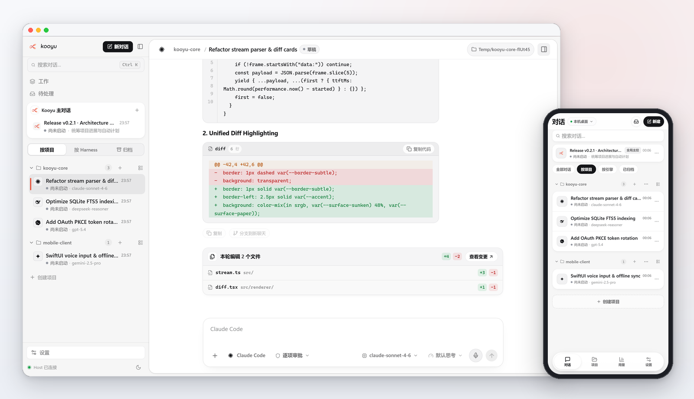
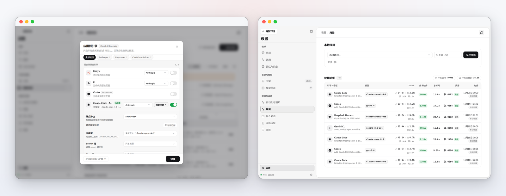
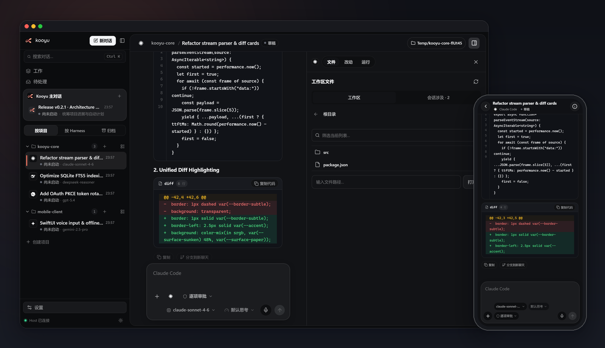
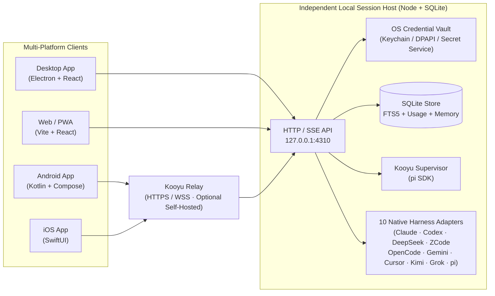

<div align="center">

<picture>
  <source media="(prefers-color-scheme: dark)" srcset="brand/icons/kooyu-app-dark.svg" />
  <source media="(prefers-color-scheme: light)" srcset="brand/icons/kooyu-app.svg" />
  
</picture>

<br />

<picture>
  <source media="(prefers-color-scheme: dark)" srcset="brand/logos/kooyu-wordmark-white.svg" />
  <source media="(prefers-color-scheme: light)" srcset="brand/logos/kooyu-wordmark.svg" />
  
</picture>

<h3>Local-First, Multi-Platform Workspace for 10+ AI Coding Agents</h3>

<p>
  Organize projects, orchestrate native coding harnesses, route custom model providers, track latency &amp; spend, and stay connected from Desktop, Android, iOS, or Web — all backed by one durable local Session Host.
</p>

<p>
  <a href="https://github.com/sh2001sh/Kooyu/releases">
    
  </a>
  <a href="https://github.com/sh2001sh/Kooyu/actions/workflows/native-apps.yml">
    
  </a>
  
  <a href="LICENSE">
    
  </a>
</p>

<p>
  <strong>English</strong> ·
  <a href="README.zh-CN.md">简体中文</a> ·
  <a href="README.ja.md">日本語</a>
</p>

<p>
  <a href="#-downloads">Downloads</a> ·
  <a href="#-highlights">Highlights</a> ·
  <a href="#-supported-engines">Supported Engines</a> ·
  <a href="#-installation--setup">Installation</a> ·
  <a href="#-mobile-pairing">Mobile Pairing</a> ·
  <a href="#-build-from-source">Build from Source</a>
</p>

<br />

<picture>
  <source media="(prefers-color-scheme: dark)" srcset="docs/assets/dark-workspace.png" />
  <source media="(prefers-color-scheme: light)" srcset="docs/assets/hero-showcase.png" />
  
</picture>

</div>

---

## ✨ Highlights

- **One Workspace for 10+ Coding Harnesses** — Chat directly with **Claude Code**, **Codex**, **DeepSeek Harness**, **ZCode**, **OpenCode**, **Gemini CLI**, **Cursor**, **Kimi Code**, **Grok Build**, and **pi**, or delegate multi-session workflows to the built-in **Kooyu** supervisor agent.
- **Durable Local Session Host** — Runs an independent Node + SQLite Host (`127.0.0.1:4310`). Closing the desktop window hides to the system tray; quitting the UI never interrupts running agent turns, schedules, or approvals.
- **Unified Provider Hub, Endpoint Routing & Role Mapping** — Configure OpenAI-compatible (`Chat Completions` / `Responses`) and `Anthropic Messages` endpoints once, auto-sync model metadata from `models.dev`, and bind per engine (including **5-slot Claude Code role mapping**: default, Haiku, Sonnet, Opus, and subagent) without mutating your global CLI config files.
- **Native Multi-Platform Experience** — Built with **Electron + React/TypeScript** on desktop, **Kotlin / Jetpack Compose** on Android, **SwiftUI** on iOS, and responsive Web/PWA — featuring 5 curated palettes, Light/Dark/System themes, IDE-style code cards with line numbers, unified diff coloring, `Ctrl/⌘+K` Command Palette, and a docked split file inspector.
- **Selective Conversation Import & Multi-Language UI** — Scan local projects across engines and selectively import only the historical conversations you want into Kooyu, with instant `English` / `简体中文` / `日本語` switching synced across paired devices.
- **Multi-Platform Voice Input** — Dictate prompts hands-free with dual-engine Web Speech API + Host Whisper/OpenAI-compatible transcription fallback on Desktop/Web, native `SpeechRecognizer` on Android, and `SFSpeechRecognizer` on iOS.
- **Usage Analytics & Latency Ledger** — Track token volume, cache hits, cost estimates, budgets, and per-turn **TTFT (Time to First Token)** & **Total Duration** across projects, engines, and models.
- **Built-In Software Updater** — Check Stable or Preview releases inside **Settings → General → Software Update**, verify `SHA256SUMS.txt` integrity automatically, and hand off directly to the native Desktop or Android installer.

<div align="center">
  
  <br />
  <sub>Left: Unified Provider "Apply To" modal with endpoint protocol tabs &amp; Claude Code role mapping · Right: Usage &amp; Latency Ledger with TTFT and total duration</sub>
</div>

<details>
<summary><strong>Preview Light &amp; Dark Workspaces Side by Side</strong></summary>
<br />
<p align="center">
  
  
</p>
</details>

---

## 🤖 Supported Engines

Kooyu auto-discovers both `PATH` CLIs and installed desktop applications, while keeping native session IDs, permissions, and auth boundaries transparent.

| Engine | Role | Protocol / Runtime | Isolated Provider Binding | Desktop Auto-Discovery |
| :--- | :--- | :--- | :---: | :---: |
| **Kooyu** | Built-in Supervisor Agent | Embedded `pi` SDK | ✅ | Built-in |
| **Claude Code** | Native Coding Harness | Native CLI / Agent SDK | ✅ (5-slot Role Mapping + Anthropic / Chat Gateway) | ✅ |
| **Codex** | Native Coding Harness | `codex app-server` | ✅ (OpenAI Responses) | ✅ |
| **DeepSeek Harness** | Native Coding Harness | Native RPC / CLI | ✅ | ✅ |
| **ZCode** | Native Coding Harness | Native CLI / Bundled Runtime | ✅ | ✅ |
| **OpenCode** | Native Coding Harness | Headless HTTP + SSE Server | ✅ | ✅ |
| **Gemini CLI** | Native Coding Harness | ACP | ✅ (Built-in Google → Chat Gateway) | ✅ |
| **Cursor** | Native Coding Harness | ACP (`agent`) | Native account only | ✅ |
| **Kimi Code** | Native Coding Harness | Native Server API / ACP | ✅ | ✅ |
| **Grok Build** | Native Coding Harness | ACP / Native CLI | ✅ | ✅ |
| **pi** | Standalone Coding Harness | `pi` SDK / CLI | ✅ | Built-in |

> See [docs/harness-catalog.md](docs/harness-catalog.md) and [docs/provider-configuration.md](docs/provider-configuration.md) for detailed protocol capabilities and custom `installations.json` overrides.

---

## 📦 Downloads

Pre-built installers for all platforms are published automatically to [**GitHub Releases**](https://github.com/sh2001sh/Kooyu/releases).

### Latest Build — `v0.2.1` ([`preview-0.2.1-10`](https://github.com/sh2001sh/Kooyu/releases/tag/preview-0.2.1-10))

| Platform | Architecture / Format | Download |
| :--- | :--- | :--- |
| **Windows** | x64 Installer (`.exe`) | [Kooyu-Setup-0.2.1.exe](https://github.com/sh2001sh/Kooyu/releases/download/preview-0.2.1-10/Kooyu-Setup-0.2.1.exe) |
| **macOS** | Apple Silicon M1–M4 (`.dmg` / `.zip`) | [Kooyu-0.2.1-arm64.dmg](https://github.com/sh2001sh/Kooyu/releases/download/preview-0.2.1-10/Kooyu-0.2.1-arm64.dmg) · [ZIP](https://github.com/sh2001sh/Kooyu/releases/download/preview-0.2.1-10/Kooyu-0.2.1-arm64-mac.zip) |
| **macOS** | Intel x64 (`.dmg` / `.zip`) | [Kooyu-0.2.1.dmg](https://github.com/sh2001sh/Kooyu/releases/download/preview-0.2.1-10/Kooyu-0.2.1.dmg) · [ZIP](https://github.com/sh2001sh/Kooyu/releases/download/preview-0.2.1-10/Kooyu-0.2.1-mac.zip) |
| **Linux** | x64 (`.AppImage` / `.deb`) | [Kooyu-0.2.1.AppImage](https://github.com/sh2001sh/Kooyu/releases/download/preview-0.2.1-10/Kooyu-0.2.1.AppImage) · [kooyu_0.2.1_amd64.deb](https://github.com/sh2001sh/Kooyu/releases/download/preview-0.2.1-10/kooyu_0.2.1_amd64.deb) |
| **Android** | Universal APK (`.apk`) | [Kooyu-0.2.1-android-debug.apk](https://github.com/sh2001sh/Kooyu/releases/download/preview-0.2.1-10/Kooyu-0.2.1-android-debug.apk) |
| **iOS** | Apple Silicon Simulator (`.zip`) | [Kooyu-0.2.1-ios-simulator.zip](https://github.com/sh2001sh/Kooyu/releases/download/preview-0.2.1-10/Kooyu-0.2.1-ios-simulator.zip) |
| **Checksums** | SHA-256 Manifest | [SHA256SUMS.txt](https://github.com/sh2001sh/Kooyu/releases/download/preview-0.2.1-10/SHA256SUMS.txt) |

> Check the [Releases page](https://github.com/sh2001sh/Kooyu/releases) for newer releases as they ship.

---

## 🚀 Installation & Setup

### Windows

1. Download **`Kooyu-Setup-0.2.1.exe`** and run the installer.
2. Because desktop builds are currently unsigned, Windows SmartScreen may display *"Windows protected your PC"* — click **More info → Run anyway** to continue (see [docs/windows-installation.md](docs/windows-installation.md)).
3. Launch **Kooyu** from the Start Menu. The installer preserves your local data across upgrades.

### macOS

1. Download **`Kooyu-0.2.1-arm64.dmg`** (Apple Silicon) or **`Kooyu-0.2.1.dmg`** (Intel), open it, and drag **Kooyu.app** into **Applications**.
2. Because macOS builds are not yet Apple-notarized, clear the quarantine flag once before first launch:
   ```bash
   xattr -cr /Applications/Kooyu.app
   ```
3. Launch **Kooyu** from Applications.

### Linux

- **AppImage**:
  ```bash
  chmod +x Kooyu-0.2.1.AppImage
  ./Kooyu-0.2.1.AppImage
  ```
- **Debian / Ubuntu (`.deb`)**:
  ```bash
  sudo apt install ./kooyu_0.2.1_amd64.deb
  ```

### Android

1. Download **`Kooyu-0.2.1-android-debug.apk`** on your phone and allow **"Install unknown apps"** when prompted.
2. All official CI builds preserve the same upgrade signing certificate, so future APKs install cleanly over existing versions without losing paired device credentials.
3. Open **Kooyu** and scan the QR code from your desktop app (**Settings → Devices**).

### iOS

- The release `Kooyu-0.2.1-ios-simulator.zip` runs on Apple Silicon Mac iOS Simulators (`xcrun simctl install booted Kooyu.app`).
- To install on a physical iPhone or iPad, build with your own Apple Developer signing team via Xcode — see [apps/ios/README.md](apps/ios/README.md).

### Verify Downloads (SHA-256)

```bash
# macOS / Linux
shasum -a 256 -c SHA256SUMS.txt --ignore-missing
```

```powershell
# Windows PowerShell
Get-FileHash .\Kooyu-Setup-0.2.1.exe -Algorithm SHA256
```

### In-App Updates

Open **Settings → General → Software Update** (or **Check for Updates…** in the desktop tray/app menu):
- Choose **Stable** (`v*` releases) or **Preview** (`preview-*` builds from `main`).
- Kooyu fetches GitHub Releases, verifies the downloaded installer against `SHA256SUMS.txt`, and launches the native upgrade flow on Desktop and Android.

---

## 📱 Mobile Pairing

Kooyu mobile apps (Android, iOS, and Web/PWA) connect to your Desktop Host securely over HTTPS/WSS — no port forwarding, VPN, or manual tunnel setup required:

1. On your computer, open **Settings → Devices → Generate Pairing Code**.
2. Kooyu connects automatically to `relay.kooyu.app` (or your own self-hosted Relay from `deploy/kodo-relay/`).
3. Scan the QR code inside the Android/iOS Kooyu app (or with your phone camera for Web/PWA).
4. Pairing invites are single-use (2-minute expiry); device tokens are stored hashed with 30-day expiry and can be revoked anytime from Desktop.

> Want full self-hosting? See [docs/mobile-relay.md](docs/mobile-relay.md) and [docs/self-hosted-operations.md](docs/self-hosted-operations.md).

---

## 🧱 Architecture



### Repository Layout

| Path | Description |
| :--- | :--- |
| `apps/desktop` | Electron desktop shell, tray lifecycle, native updater & mic permissions |
| `apps/web` | React + TypeScript workbench UI, Theme Studio, Voice Input, Playwright UI tests |
| `apps/android` | Native Android app (Kotlin / Jetpack Compose / Material 3 / APK self-updater) |
| `apps/ios` | Native iOS app (Swift 6 / SwiftUI / XcodeGen) |
| `packages/host` | Independent Node Session Host, SQLite store, Harness adapters, Provider gateway, Updater & Voice API |
| `packages/protocol` | Shared Zod schemas & TypeScript protocol types across clients and Host |
| `packages/platform` | Cross-platform paths, host discovery, and OS utilities |
| `services/relay` | Lightweight HTTPS/WSS mobile pairing relay server |
| `deploy/` | Dockerfiles, Compose stacks, Caddy & systemd templates for self-hosting |
| `brand/` | Production Kooyu SVG logos, icons, and design tokens |
| `docs/` | Architecture, harness catalog, provider routing, mobile relay & release docs |

---

## 🛠️ Build from Source

### Prerequisites

- **Node.js `>= 24.13.0`** and **npm `11+`**
- At least one supported coding harness CLI / desktop app installed locally (or configure an API Provider inside Kooyu)

### Run Locally

```bash
git clone https://github.com/sh2001sh/Kooyu.git
cd Kooyu
npm ci
npm run build
```

- **Start Desktop App** (auto-starts or reuses the independent Session Host):
  ```bash
  npm run start:desktop
  ```
- **Start Web Workbench in Browser** (`http://127.0.0.1:4310`):
  ```bash
  npm run start:host
  # Or hot-reload frontend against the local Host:
  npm run dev:web
  ```

### Package Installers

```bash
# Desktop installer for current OS (outputs to release/desktop/)
npm run package:desktop -- --publish never

# Android APK (requires JDK 17 + Android SDK 36)
cd apps/android && ./gradlew testDebugUnitTest lintDebug assembleDebug

# iOS Simulator (macOS + Xcode 16 + XcodeGen)
cd apps/ios && xcodegen generate
xcodebuild -project Kooyu.xcodeproj -scheme Kooyu -destination 'generic/platform=iOS Simulator' CODE_SIGNING_ALLOWED=NO build
```

### Run Verification Suites

```bash
npm run lint
npm run format:check
npm run typecheck
npm test              # Host unit & integration suite (500+ tests)
npm run test:relay    # Relay security tests
npm run test:platform # Host discovery & launcher tests
npm run test:ui       # Full Playwright UI regression suite (160+ tests)
```

### Data Directories & Environment Variables

| OS | Default Host Data Directory |
| :--- | :--- |
| **Windows** | `%LOCALAPPDATA%\Kodo\host` |
| **macOS** | `~/Library/Application Support/Kodo/host` |
| **Linux** | `${XDG_DATA_HOME:-~/.local/share}/Kodo/host` |

> Internal storage paths, package names, and `KODO_*` environment variables (`KODO_DATA_DIR`, `KODO_HOST_PORT`, `KODO_HOST_URL`) preserve backwards compatibility with existing installations.

---

## 🔒 Security & Privacy

- **Local-First by Default** — Conversation history, usage logs, and project settings stay on your machine in SQLite. The Host listens on `127.0.0.1` only.
- **OS Secret Storage** — API keys and OAuth tokens are stored in your operating system credential store (Windows Credential Manager, macOS Keychain, Linux Secret Service), never written into plain-text project repositories.
- **No Global Config Clobbering** — Provider bindings are injected per isolated session without overwriting `~/.claude`, `~/.codex`, or other native CLI configs.

---

## 📄 License & Attributions

Released under the [**MIT License**](LICENSE).

- Upstream `pi` runtime & SDK notices: [docs/upstream.md](docs/upstream.md)
- Runtime dependencies & SDK terms: [third-party/runtime-dependencies.md](third-party/runtime-dependencies.md)
- `models.dev` catalog notice: [third-party/models.dev/NOTICE.md](third-party/models.dev/NOTICE.md)
- Craft Agents token extraction boundary: [third-party/craft-agents/EXTRACTION.md](third-party/craft-agents/EXTRACTION.md)
