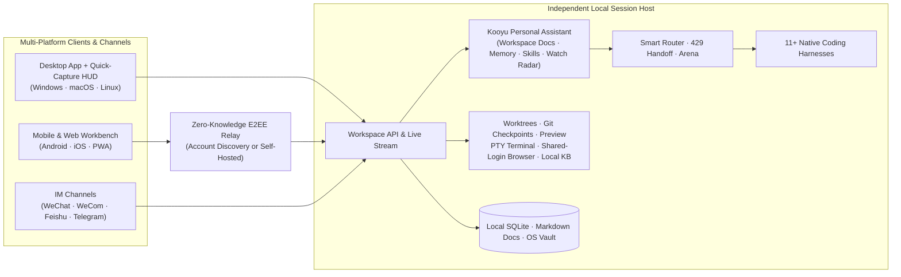

<div align="center">

<picture>
  <source media="(prefers-color-scheme: dark)" srcset="brand/icons/kooyu-app-dark.svg" />
  <source media="(prefers-color-scheme: light)" srcset="brand/icons/kooyu-app.svg" />
  
</picture>

<br />

<picture>
  <source media="(prefers-color-scheme: dark)" srcset="brand/logos/kooyu-wordmark-white.svg" />
  <source media="(prefers-color-scheme: light)" srcset="brand/logos/kooyu-wordmark.svg" />
  
</picture>

<h3>Your Local-First Personal AI Assistant Commanding Every Coding Harness</h3>

<p>
  Unify <strong>Claude Code</strong>, <strong>Codex</strong>, <strong>DeepSeek</strong>, <strong>Gemini CLI</strong>, <strong>Google Antigravity</strong>, <strong>OpenCode</strong>, <strong>Cursor</strong>, <strong>ZCode</strong>, <strong>Kimi Code</strong>, and more under one personal AI assistant. Route tasks intelligently, race engines side-by-side in isolated Git worktrees, keep persistent local memory and zero-token background watches, and approve from Desktop, Web, iOS, Android, or IM — while your code, memory, and keys stay strictly on your own machine.
</p>

<p>
  <a href="https://kooyu.app">
    
  </a>
  <a href="https://www.npmjs.com/package/kooyu">
    
  </a>
  <a href="https://github.com/sh2001sh/Kooyu/releases/latest">
    
  </a>
  <a href="https://github.com/sh2001sh/Kooyu/actions/workflows/native-apps.yml">
    
  </a>
  
  <a href="LICENSE">
    
  </a>
</p>

<p>
  🌐 <strong>Official Website</strong>: <a href="https://kooyu.app"><strong>https://kooyu.app</strong></a> ·
  <a href="https://kooyu.app/download">Downloads</a> ·
  <a href="https://kooyu.app/docs">Docs</a> ·
  <a href="https://kooyu.app/account">Web Workbench</a> ·
  <a href="CHANGELOG.md">Changelog</a>
</p>

<p>
  <strong>English</strong> ·
  <a href="README.zh-CN.md">简体中文</a> ·
  <a href="README.ja.md">日本語</a>
</p>

<p>
  <a href="#-quick-start--downloads">Terminal &amp; Downloads</a> ·
  <a href="#-highlights">Highlights</a> ·
  <a href="#-supported-harnesses">Supported Harnesses</a> ·
  <a href="#-installation--setup">Installation</a> ·
  <a href="#-cross-device--e2ee-sync">Cross-Device Sync</a> ·
  <a href="#-build-from-source">Build from Source</a>
</p>

<br />

<picture>
  <source media="(prefers-color-scheme: dark)" srcset="docs/assets/dark-workspace.png" />
  <source media="(prefers-color-scheme: light)" srcset="docs/assets/hero-showcase.png" />
  
</picture>

</div>

---

## ✨ Highlights

### Multi-Harness Orchestration & Engineering Moat
- **One Supervisor, 11+ Coding Harnesses** — Chat directly with **Claude Code**, **Codex**, **DeepSeek Harness**, **Gemini CLI**, **Google Antigravity**, **OpenCode**, **ZCode**, **Cursor**, **Kimi Code**, **Grok Build**, and **pi**, or delegate complex goals to the built-in **Kooyu Supervisor**. Launch ready-made **Playbooks** (implement & cross-review, parallel split, CI/test guard, deep research) and step in or hand back control with one click.
- **Smart Routing & Seamless 429 Quota Handoff (`ROUTING.md`)** — Route tasks automatically to the best available Harness by intent and local availability. When an engine hits HTTP `429`, rate limits, or subscription exhaustion, Kooyu packages live progress and workspace context for seamless fallback handoff to the next engine in your chain.
- **Multi-Harness Arena** — Pit 2–3 Harnesses against the same tough problem in parallel isolated Git worktrees, run real `git diff` + test/benchmark commands (`checkCommand`), inspect the side-by-side scorecard, and accept the winning branch with one click.
- **Zero-Pollution Git Checkpoints & One-Click Git / PR Delivery** — Capture instant tracked + untracked snapshots in hidden refs (`refs/kooyu/checkpoints/*`) without touching your branch, stash, or `git log` (with automatic pre-restore safety snapshots). Review diffs hunk-by-hunk, merge safely, or open Pull Requests right inside your workspace.

### Self-Evolving Personal AI Assistant
- **Managed Local Brain & Workspace Docs** — Customize Kooyu's persona, preferences, long-term memory, approval rules, watch routines, engineering playbook, and routing strategy via hot-reloaded local Markdown docs (`SOUL.md`, `USER.md`, `MEMORY.md`, `RULES.md`, `HEARTBEAT.md`, `AGENTS.md`, `ROUTING.md`) editable directly in Desktop, Web, Android, and iOS Settings.
- **Interactive Decision Cards & Rule Learning** — Before risky or ambiguous actions, Kooyu surfaces structured multi-option decision cards across all four platforms. Choosing *"Approve & remember"* automatically writes durable rules into `RULES.md` and hot-reloads on the next turn.
- **Zero-Vector Local Knowledge Base & Memory Distillation** — Mount local Obsidian vaults or project `docs/` directories read-only for deterministic CJK-normalized full-text search down to exact `relativePath:line` citations — zero vector DBs, zero embedding costs. Deterministic daily memory consolidation distills recurring patterns from daily logs into user-approved proposals.
- **Cross-Harness Skill Sedimentation & Offline Reports** — Turn proven workflows into versioned skills with 5-version rollback, secret/traversal guards, and optional sharing to `~/.agents/skills/` for reuse across Claude Code, Codex, Gemini CLI, and OpenCode. Generate offline-safe themed HTML briefs (`show_page`) with strict CSP.
- **Zero-Token Preflight Automations & Health Radar** — Run local shell preflight scripts (`checkScript`) with stripped ambient secrets so quiet checks cost **0 LLM tokens**; wake Kooyu or notify you only on real hits. Built-in Harness Health Radar watches for stalled sessions and suppresses idle noise via `NO_REPLY`.

### Everyday Frictionless Workspace & Cross-Device Reach
- **Global Quick-Capture HUD (`Alt+Space` / `Cmd+Shift+K`)** — Summon a floating frameless capsule from any desktop app, pre-filled with your clipboard text and Harness selector, to dispatch directly to Kooyu without breaking flow.
- **Live Preview, Built-in Terminal & Shared-Login Browser** — Preview web apps side-by-side (feeding console errors straight back to your agent), open real PTY terminals, and visually take over a managed Chromium browser whose signed-in cookies persist safely across tasks (`0600` local store).
- **Zero-Knowledge E2EE Multi-Device Sync & IM Channels** — Connect via **Kooyu Account** ([kooyu.app](https://kooyu.app)) across Desktop & Web Workbench, pair **iOS / Android** native apps via QR or account login, talk hands-free with **Voice Conversations**, annotate screenshots, and approve tasks directly from **WeChat, WeCom, Feishu, or Telegram**.
- **Unified Model Hub & Transparent Usage Ledger** — Configure model providers once (including **Claude Code** 5-role slot mapping) without overwriting native CLI configs. Track per-project token spend, budgets, and time-to-first-token (TTFT) latency at a glance.

<div align="center">
  
  <br />
  <sub>Left: Unified Model Provider Hub with per-engine role mapping · Right: Project usage, spend, and TTFT speed ledger</sub>
</div>

<details>
<summary><strong>Preview Light &amp; Dark Workspaces Side by Side</strong></summary>
<br />
<p align="center">
  
  
</p>
</details>

---

## 🤖 Supported Harnesses

Kooyu automatically discovers your installed CLI tools and desktop coding apps while preserving each engine's native session history, permissions, and account login.

| Harness | Role | Custom Provider Support | Auto-Discovery |
| :--- | :--- | :---: | :---: |
| **Kooyu** | Built-in Personal Assistant & Supervisor | ✅ | Built-in |
| **Claude Code** | Native Coding Agent | ✅ (5-slot Role Mapping) | ✅ |
| **Codex** | Native Coding Agent | ✅ | ✅ |
| **DeepSeek Harness** | Native Coding Agent | ✅ | ✅ |
| **Gemini CLI** | Native Coding Agent | ✅ | ✅ |
| **Google Antigravity** | Native Coding Agent (`agy acp`) | Native account (Dedicated proxy) | ✅ |
| **OpenCode** | Native Coding Agent | ✅ | ✅ |
| **ZCode** | Native Coding Agent | ✅ | ✅ |
| **Cursor** | Native Coding Agent | Native account | ✅ |
| **Kimi Code** | Native Coding Agent | ✅ | ✅ |
| **Grok Build** | Native Coding Agent | ✅ | ✅ |
| **pi** | Standalone Coding Agent | ✅ | Built-in |

> See [docs/harness-catalog.md](docs/harness-catalog.md) and [docs/provider-configuration.md](docs/provider-configuration.md) for detailed capability matrices and custom installation overrides.

---

## 📦 Quick Start & Downloads

> 🌐 **Official Website & Download Hub**: **[https://kooyu.app](https://kooyu.app)** · **[kooyu.app/download](https://kooyu.app/download)** · **[kooyu.app/docs](https://kooyu.app/docs)**

### ⚡ Terminal / CLI Installation (Requires Node.js `>= 24.13.0`)

Run Kooyu's local Host + Web Workbench directly from your terminal on Windows, macOS, or Linux — no desktop installer required:

```bash
# 1. Instant one-off run (always uses latest release)
npx kooyu@latest

# 2. Or install globally as the `kooyu` command
npm install -g kooyu@latest
kooyu

# 3. Try the latest preview channel
npx kooyu@next
# or: npm install -g kooyu@next
```

Common CLI commands & headless server setup:

```bash
kooyu --port 4310                    # Custom port (default: 4310)
kooyu --data-dir ./kooyu-data        # Custom persistent data directory
kooyu account login                  # Bind this machine to your kooyu.app account for remote access
kooyu account logout                 # Unbind this machine from your account
kooyu --help                         # View all flags & options
```

Open **`http://127.0.0.1:4310`** in your browser once started. See [docs/npm-package.md](docs/npm-package.md) for managed browser (`playwright install chromium`) and HTTPS binding options.

### 💻 Native Desktop & Mobile Installers (GitHub Releases)

Pre-built installers for all platforms are published automatically to [**GitHub Releases (Latest)**](https://github.com/sh2001sh/Kooyu/releases/latest) and available on [**kooyu.app/download**](https://kooyu.app/download).

| Platform | Architecture / Format | Download |
| :--- | :--- | :--- |
| **Windows** | x64 Installer (`.exe`) | [Latest Release](https://github.com/sh2001sh/Kooyu/releases/latest) |
| **macOS** | Apple Silicon M1–M4 & Intel x64 (`.dmg` / `.zip`) | [Latest Release](https://github.com/sh2001sh/Kooyu/releases/latest) |
| **Linux** | x64 (`.AppImage` / `.deb`) | [Latest Release](https://github.com/sh2001sh/Kooyu/releases/latest) |
| **Android** | Universal APK (`.apk`) | [Latest Release](https://github.com/sh2001sh/Kooyu/releases/latest) |
| **iOS** | Apple Silicon Simulator (`.zip`) / Source Build | [Latest Release](https://github.com/sh2001sh/Kooyu/releases/latest) |
| **Web / CLI** | Local Host + Browser Workbench | `npx kooyu@latest` |

> Use built-in updates (**Settings → General → Software Update**) to check, download with automatic SHA-256 verification, launch the installer (or reveal the downloaded package), and switch between **Stable** and **Preview** channels.

---

## 🚀 Installation & Setup

### Windows

1. Download **`Kooyu-Setup-<version>.exe`** from [GitHub Releases](https://github.com/sh2001sh/Kooyu/releases/latest) and run the installer.
2. Because desktop builds are currently unsigned, Windows SmartScreen may display *"Windows protected your PC"* — click **More info → Run anyway** (see [docs/windows-installation.md](docs/windows-installation.md)).
3. Press **`Alt + Space`** anywhere after launch to summon the Kooyu Quick-Capture HUD. Upgrading automatically preserves your local data and settings.

### macOS

1. Download the Apple Silicon (`arm64.dmg`) or Intel (`.dmg`) build and drag **Kooyu.app** into **Applications**.
2. Because macOS builds are not yet Apple-notarized, clear quarantine once before first launch:
   ```bash
   xattr -cr /Applications/Kooyu.app
   ```
3. Press **`Cmd + Shift + K`** anywhere after launch to summon the Quick-Capture HUD.

### Linux

```bash
# AppImage
chmod +x Kooyu-*.AppImage
./Kooyu-*.AppImage

# Debian / Ubuntu (.deb)
sudo apt install ./kooyu_*_amd64.deb
```

### Android & iOS

- **Android**: Install `Kooyu-*-android-debug.apk` (consistent upgrade signing key preserves paired hosts across updates). Sign in with your Kooyu account or scan the QR code from Desktop (**Settings → Devices**).
- **iOS**: Run `Kooyu-*-ios-simulator.zip` on Apple Silicon Simulators (`xcrun simctl install booted Kooyu.app`), or build for physical devices via Xcode — see [apps/ios/README.md](apps/ios/README.md).

### Verify Downloads (SHA-256)

```bash
# macOS / Linux
shasum -a 256 -c SHA256SUMS.txt --ignore-missing
```

```powershell
# Windows PowerShell
Get-FileHash .\Kooyu-Setup-1.0.1.exe -Algorithm SHA256
```

---

## 📱 Cross-Device & E2EE Sync

Stay in command from another Desktop, [Web Workbench](https://kooyu.app/account), Android, iOS, or IM — with zero port forwarding or VPN:

1. **Account Discovery (Desktop & Web)**: Sign in to your Kooyu account on your host computer, then sign in from any browser or secondary computer to discover and request authorized access.
2. **Instant QR Pairing (iOS & Android)**: Open **Settings → Devices → Generate Pairing Code** and scan with the native app. Invites expire after 2 minutes and are single-use.
3. **Zero-Knowledge E2EE**: All prompts, diffs, and approvals are encrypted end-to-end between your devices. Every new device must be explicitly approved on the host computer and can be revoked anytime.
4. **Full Self-Hosting**: Run both the Host and Relay on your own server with templates in `deploy/` — see [docs/mobile-relay.md](docs/mobile-relay.md) and [docs/self-hosted-operations.md](docs/self-hosted-operations.md).

---

## 🧱 Architecture



### Repository Layout

| Path | Description |
| :--- | :--- |
| `apps/desktop` | Electron shell, tray daemon lifecycle, Global Quick-Capture HUD, remote pairing & updater |
| `apps/web` | Cross-platform workbench UI, Git/PR delivery, decision cards, live preview, terminal & Playwright tests |
| `apps/android` | Native Android app (Kotlin / Jetpack Compose / Material 3 / APK updater) |
| `apps/ios` | Native iOS app (Swift / SwiftUI / XcodeGen) |
| `packages/host` | Local Session Host, memory & agent docs, skill sedimentation, local KB, routing/arena, Git checkpoints, managed browser, IM & provider hub |
| `packages/protocol` | Shared protocol schemas and TypeScript contracts across all clients and Host |
| `packages/platform` | Cross-platform data directories (`Kooyu/host` with legacy `Kodo/host` fallback), host discovery & OS utilities |
| `services/relay` | Lightweight self-hostable HTTPS/WSS E2EE pairing & offline mailbox relay |
| `deploy/` | Docker, Compose, Caddy, and systemd templates for self-hosting |
| `brand/` | Kooyu SVG logos, app icons, and design tokens |
| `docs/` | Architecture, harness catalog, provider setup, self-hosting & release guides |

---

## 🛠️ Build from Source

### Prerequisites

- **Node.js `>= 24.13.0`** and **npm `11+`**
- At least one supported coding agent installed locally (or configure an API provider inside Kooyu)

### Run Locally

```bash
git clone https://github.com/sh2001sh/Kooyu.git
cd Kooyu
npm ci
npm run build
```

- **Start Desktop App** (auto-starts or reuses the independent Session Host):
  ```bash
  npm run start:desktop
  ```
- **Start Web Workbench in Browser** (`http://127.0.0.1:4310`):
  ```bash
  npm run start:host
  # Or hot-reload frontend against the local Host:
  npm run dev:web
  ```

### Package Installers

```bash
# Desktop installer for current OS (outputs to release/desktop/)
npm run package:desktop -- --publish never

# Android APK (requires JDK 17 + Android SDK 36)
cd apps/android && ./gradlew testDebugUnitTest lintDebug assembleDebug

# iOS Simulator (macOS + Xcode 16 + XcodeGen)
cd apps/ios && xcodegen generate
xcodebuild -project Kooyu.xcodeproj -scheme Kooyu -destination 'generic/platform=iOS Simulator' CODE_SIGNING_ALLOWED=NO build
```

### Run Verification Suites

```bash
npm run lint
npm run format:check
npm run typecheck
npm test              # Host unit & integration suite
npm run test:relay    # Relay security & mailbox tests
npm run test:platform # Host discovery & launcher tests
npm run test:ui       # Playwright UI regression suite
```

### Data Directories & Environment Variables

| OS | Default Host Data Directory |
| :--- | :--- |
| **Windows** | `%LOCALAPPDATA%\Kooyu\host` |
| **macOS** | `~/Library/Application Support/Kooyu/host` |
| **Linux** | `${XDG_DATA_HOME:-~/.local/share}/Kooyu/host` |

> Primary environment variables use the `KOOYU_*` prefix (`KOOYU_DATA_DIR`, `KOOYU_HOST_PORT`, `KOOYU_HOST_URL`, `KOOYU_RELAY_ORIGIN`, `KOOYU_QUICK_CAPTURE_SHORTCUT`). Existing legacy `Kodo/host` directories, OS Keychain `"Kodo"` entries, and `KODO_*` environment variables remain transparently supported for zero-breakage upgrades.

---

## 🔒 Security & Privacy

- **Local-First by Default** — Your codebase, conversation history, persistent memory, mounted knowledge roots, and usage records stay on your own machine. The Host listens on loopback (`127.0.0.1`) only.
- **OS Secret Storage & Clean Subprocess Env** — API keys and OAuth tokens are stored in your OS credential vault (`Kooyu` service in Windows Credential Manager, macOS Keychain, or Linux Secret Service). Preflight scripts and Arena check commands run with ambient host secrets stripped.
- **Non-Destructive Engine Integration** — Custom model providers and role mappings are isolated per session without overwriting `~/.claude`, `~/.codex`, or your other CLI configurations.
- **Explicit Remote Permissions** — Sensitive actions like local MCP servers, IM credentials, interactive terminals, and remote Git push are strictly gated behind local-only or explicit device delegation controls.

---

## 📄 License & Attributions

Released under the [**MIT License**](LICENSE).

- Official Website & Docs: [https://kooyu.app](https://kooyu.app)
- Runtime dependencies & third-party licenses: [third-party/runtime-dependencies.md](third-party/runtime-dependencies.md)
- Model catalog attribution: [third-party/models.dev/NOTICE.md](third-party/models.dev/NOTICE.md)
- Design token attribution: [third-party/craft-agents/EXTRACTION.md](third-party/craft-agents/EXTRACTION.md)

## Community & Links / 友情链接

- [LINUX DO](https://linux.do) - 新的理想型社区 (Where possible begins)
