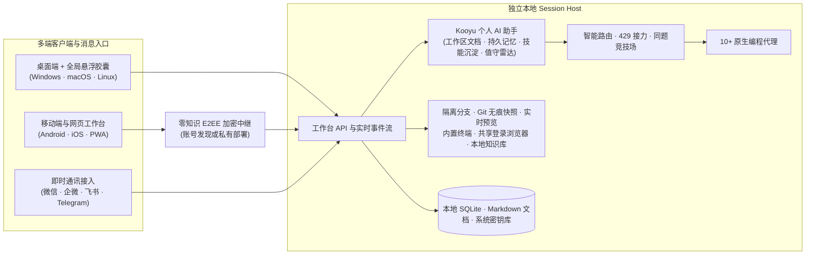

<div align="center">

<picture>
  <source media="(prefers-color-scheme: dark)" srcset="brand/icons/kooyu-app-dark.svg" />
  <source media="(prefers-color-scheme: light)" srcset="brand/icons/kooyu-app.svg" />
  
</picture>

<br />

<picture>
  <source media="(prefers-color-scheme: dark)" srcset="brand/logos/kooyu-wordmark-white.svg" />
  <source media="(prefers-color-scheme: light)" srcset="brand/logos/kooyu-wordmark.svg" />
  
</picture>

<h3>掌控全部编程引擎的本地优先个人 AI 助手</h3>

<p>
  将 <strong>Claude Code</strong>、<strong>Codex</strong>、<strong>DeepSeek</strong>、<strong>Gemini CLI</strong>、<strong>OpenCode</strong>、<strong>Cursor</strong>、<strong>ZCode</strong>、<strong>Kimi Code</strong> 等多款编程 Harness 收归同一私人 AI 助手。支持智能路由与限流无感接力、隔离分支同题竞技场、本地持久记忆与零 Token 定时值守，并可随时通过桌面端、网页工作台、iOS / Android 与微信/飞书/Telegram 拍板接管——所有代码、记忆与密钥始终留在你自己的设备。
</p>

<p>
  <a href="https://kooyu.app">
    
  </a>
  <a href="https://www.npmjs.com/package/kooyu">
    
  </a>
  <a href="https://github.com/sh2001sh/Kooyu/releases/latest">
    
  </a>
  <a href="https://github.com/sh2001sh/Kooyu/actions/workflows/native-apps.yml">
    
  </a>
  
  <a href="LICENSE">
    
  </a>
</p>

<p>
  🌐 <strong>官方网站</strong>：<a href="https://kooyu.app"><strong>https://kooyu.app</strong></a> ·
  <a href="https://kooyu.app/download">下载中心</a> ·
  <a href="https://kooyu.app/docs">在线文档</a> ·
  <a href="https://kooyu.app/account">网页工作台</a> ·
  <a href="CHANGELOG.md">更新日志</a>
</p>

<p>
  <a href="README.md">English</a> ·
  <strong>简体中文</strong> ·
  <a href="README.ja.md">日本語</a>
</p>

<p>
  <a href="#-快速开始与下载">终端安装与下载</a> ·
  <a href="#-核心特性">核心特性</a> ·
  <a href="#-支持的编程引擎">支持引擎</a> ·
  <a href="#-各平台安装说明">安装指南</a> ·
  <a href="#-全端接力与-e2ee-连接">全端连接</a> ·
  <a href="#-从源码构建">源码构建</a>
</p>

<br />

<picture>
  <source media="(prefers-color-scheme: dark)" srcset="docs/assets/dark-workspace.png" />
  <source media="(prefers-color-scheme: light)" srcset="docs/assets/hero-showcase.png" />
  
</picture>

</div>

---

## ✨ 核心特性

### 多 Harness 统一编排与工程护城河
- **一个主控，统筹 10+ 编程引擎** — 可直接与 **Claude Code**、**Codex**、**DeepSeek Harness**、**Gemini CLI**、**OpenCode**、**ZCode**、**Cursor**、**Kimi Code**、**Grok Build**、**pi** 对话，也可把复杂任务交给内置 **Kooyu 主控助手**统一拆解。内置多套**工作剧本**（实现+跨引擎审查、并行拆分、测试与 CI 守卫、深度调研），实时查看进度卡片，一键下钻接管或交还主控。
- **智能路由与 429 限流自动接力（`ROUTING.md`）** — 按任务类型与本机可用引擎自动路由最佳 Harness；当某一引擎触发 HTTP `429`、速率限制或订阅配额耗尽时，Kooyu 自动汇总当前进展与工作区改动，无感移交备用链中的下一个引擎续跑。
- **多引擎同题竞技场（Multi-Harness Arena）** — 面对核心性能或重构难题，一键在 2～3 组隔离 Git Worktree 中向不同引擎并行派发同一任务，自动运行真实 `git diff` 与测试/基准命令（`checkCommand`）输出记分卡，一键采纳胜出方案。
- **无痕 Git Checkpoints（「后悔药」时间轴）与一键 PR 交付** — 通过独立临时索引将已追踪与未追踪文件快照写入隐藏引用 `refs/kooyu/checkpoints/*`，零 `git log` / stash 污染，回滚前自动保留安全点；配合逐块 Hunk Diff 审查与工作台内直接合入 / 发 PR，大胆并发零心理负担。

### 越用越懂你的自进化个人 AI 助手
- **受管工作区大脑与本地持久记忆** — 通过热加载本地文档（`SOUL.md`、`USER.md`、`MEMORY.md`、`RULES.md`、`HEARTBEAT.md`、`AGENTS.md`、`ROUTING.md`）完整掌控助手人格、偏好、记忆、行为规则、值守计划与路由策略，桌面端、Web、Android、iOS 均可直接查看编辑。
- **四端结构化决策卡与偏好学习** — 高风险或存在多方案抉择时，Kooyu 在桌面/Web/Android/iOS 弹出交互式决策卡；勾选「记住此偏好，以后自动执行」即可直接沉淀至 `RULES.md` 并于下一轮即时生效。
- **零向量本地知识库直检与每日记忆蒸馏** — 只读挂载本机 Obsidian 笔记库或项目 `docs/` 目录，基于康熙部首归一与中英文加权检索直接定位 `relativePath:line` 精确行切片，无需外置向量库与 Embedding 费用；每日自动从日志提炼候选经验提案，经你确认后并入长期记忆或工程手册。
- **跨引擎技能沉淀（5 版回滚）与离线研报** — 将跑通的工作流一键沉淀为版本化技能（内置密钥与路径穿越防线、保留 5 个历史版本随时回滚），并可同步分发至 `~/.agents/skills/` 供 Claude Code / Codex / Gemini / OpenCode 共享复用；支持生成严格离线 CSP 保护的主题化交互研报（`show_page`）。
- **零 Token 预检值守与引擎健康雷达** — 定时自动化支持先跑本地脱敏预检脚本（`checkScript`），无异常静默跳过（**0 Token 消耗**），仅命中告警时推送或唤醒助手；内置引擎卡死巡检与 `NO_REPLY` 安静回合收敛。

### 顺手的桌面入口与全端安全协同
- **全局快捷键悬浮胶囊（`Alt+Space` / `Cmd+Shift+K`）** — 在桌面任意应用中一键呼出无边框悬浮胶囊，自动带入剪贴板内容并支持选择引擎，直发 Kooyu 主对话。
- **实时预览、内置终端与共享登录态受管浏览器** — 同屏实时预览 Web 项目（控制台报错一键回传修复）、打开交互式 PTY 终端，并支持可视化接管受管 Chromium 完成登录，登录态 Cookie 按域加密落盘（`0600`）并在后续任务间自动同步复用。
- **零知识 E2EE 全端协同与 IM 接入** — 支持通过 **Kooyu 账号**（[kooyu.app](https://kooyu.app)）在桌面端与网页工作台自动发现并连接电脑，**iOS / Android** 原生 App 支持扫码与账号登录双通道；同时支持语音实时通话、截图画圈批注以及**微信、企业微信、飞书、Telegram** 消息审批。
- **统一模型中心与透明用量账本** — 一次配置模型来源与多角色槽位（完整支持 **Claude Code** 五角色映射），绝不污染原生 CLI 全局配置；按项目、引擎与模型清晰统计 Token、费用与首字响应耗时（TTFT）。

<div align="center">
  
  <br />
  <sub>左：统一模型中心与引擎角色映射 · 右：按项目、引擎与模型统计的用量、费用与首字延迟账单</sub>
</div>

<details>
<summary><strong>展开对比浅色 / 深色双模式工作台</strong></summary>
<br />
<p align="center">
  
  
</p>
</details>

---

## 🤖 支持的编程引擎

Kooyu 自动发现本机已安装的 CLI 工具与桌面编程应用，完整保留各引擎的原生会话历史、权限模式与账号登录状态。

| 引擎 | 角色定位 | 自定义模型来源 | 自动发现安装 |
| :--- | :--- | :---: | :---: |
| **Kooyu** | 内置个人 AI 助手与主控编排 | ✅ | 内置 |
| **Claude Code** | 原生编程代理 | ✅（五槽位角色映射） | ✅ |
| **Codex** | 原生编程代理 | ✅ | ✅ |
| **DeepSeek Harness** | 原生编程代理 | ✅ | ✅ |
| **Gemini CLI** | 原生编程代理 | ✅ | ✅ |
| **OpenCode** | 原生编程代理 | ✅ | ✅ |
| **ZCode** | 原生编程代理 | ✅ | ✅ |
| **Cursor** | 原生编程代理 | 原生账号 | ✅ |
| **Kimi Code** | 原生编程代理 | ✅ | ✅ |
| **Grok Build** | 原生编程代理 | ✅ | ✅ |
| **pi** | 独立编程代理 | ✅ | 内置 |

> 详细能力矩阵与自定义入口路径配置见 [docs/harness-catalog.md](docs/harness-catalog.md) 与 [docs/provider-configuration.md](docs/provider-configuration.md)。

---

## 📦 快速开始与下载

> 🌐 **官方网站与下载中心**：**[https://kooyu.app](https://kooyu.app)** · **[kooyu.app/download](https://kooyu.app/download)** · **[kooyu.app/docs](https://kooyu.app/docs)**

### ⚡ 终端安装与一键启动（需要 Node.js `>= 24.13.0`）

支持在 Windows、macOS 与 Linux 终端中直接启动 Kooyu 本地 Host 与 Web 工作台，无需下载桌面安装包，也适合无头服务器部署：

```bash
# 1. 免安装一键启动（始终运行最新正式版）
npx kooyu@latest

# 2. 全局安装为本地 kooyu 命令
npm install -g kooyu@latest
kooyu

# 3. 体验最新预览版通道（next）
npx kooyu@next
# 或全局安装预览版：npm install -g kooyu@next
```

常用终端参数与远程账号绑定：

```bash
kooyu --port 4310                    # 指定本地端口（默认 4310）
kooyu --data-dir ./kooyu-data        # 指定持久化数据目录
kooyu account login                  # 绑定 Kooyu 账号，供 kooyu.app 网页工作台与手机远程发现连接
kooyu account logout                 # 解绑当前主机账号
kooyu --help                         # 查看全部命令与参数说明
```

启动后在浏览器打开终端输出的地址（默认 **`http://127.0.0.1:4310`**）即可使用。受管浏览器（`npx playwright@1.56.1 install chromium`）与远程 HTTPS 监听配置详见 [docs/npm-package.md](docs/npm-package.md)。

### 💻 各平台原生安装包

所有平台安装包均由 GitHub Actions 自动构建并发布至 [**GitHub Releases（最新正式版）**](https://github.com/sh2001sh/Kooyu/releases/latest)，也可直接前往官网 [**kooyu.app/download**](https://kooyu.app/download) 下载。

| 平台 | 架构 / 格式 | 下载地址 |
| :--- | :--- | :--- |
| **Windows** | x64 安装程序（`.exe`） | [最新正式版](https://github.com/sh2001sh/Kooyu/releases/latest) |
| **macOS** | Apple Silicon M1–M4 / Intel x64（`.dmg` / `.zip`） | [最新正式版](https://github.com/sh2001sh/Kooyu/releases/latest) |
| **Linux** | x64（`.AppImage` / `.deb`） | [最新正式版](https://github.com/sh2001sh/Kooyu/releases/latest) |
| **Android** | 通用安装包（`.apk`） | [最新正式版](https://github.com/sh2001sh/Kooyu/releases/latest) |
| **iOS** | Apple Silicon 模拟器包（`.zip`） / 源码签名构建 | [最新正式版](https://github.com/sh2001sh/Kooyu/releases/latest) |
| **Web / CLI** | 本地 Host + 浏览器工作台 | `npx kooyu@latest` |

> 在软件内打开 **设置 → 通用 → 软件更新** 即可一键检查、自动校验 SHA-256、拉起安装程序（或打开安装包目录），并在 **正式版** 与 **预览版** 通道间自由切换。

---

## 🚀 各平台安装说明

### Windows

1. 前往 [GitHub Releases](https://github.com/sh2001sh/Kooyu/releases/latest) 下载并运行 **`Kooyu-Setup-<version>.exe`**。
2. 由于桌面安装包暂未配置商业代码签名证书，首次运行若弹出 Windows SmartScreen 提示，点击 **「更多信息 → 仍要运行」** 即可（详见 [docs/windows-installation.md](docs/windows-installation.md)）。
3. 启动后可在任意界面按 **`Alt + Space`** 呼出全局悬浮胶囊；覆盖安装新版会自动保留本地历史对话与配置数据。

### macOS

1. 下载对应芯片架构的 `.dmg`（Apple Silicon 选 `arm64`，Intel 选 x64），打开后将 **Kooyu.app** 拖入 **应用程序（Applications）**。
2. 因尚未配置 Apple 开发者公证，首次打开前在终端执行一次隔离属性清理：
   ```bash
   xattr -cr /Applications/Kooyu.app
   ```
3. 启动后可在任意界面按 **`Cmd + Shift + K`** 呼出全局悬浮胶囊。

### Linux

```bash
# AppImage
chmod +x Kooyu-*.AppImage
./Kooyu-*.AppImage

# Debian / Ubuntu (.deb)
sudo apt install ./kooyu_*_amd64.deb
```

### Android 与 iOS

- **Android**：下载安装 `Kooyu-*-android-debug.apk`（保持一致的升级签名证书，后续新版可直接覆盖升级不丢配对），打开后可登录 Kooyu 账号或扫描桌面二维码连接。
- **iOS**：`Kooyu-*-ios-simulator.zip` 供 Apple Silicon Mac 的 iOS 模拟器直接运行；真机安装请使用自有 Apple 开发者账号在 Xcode 中签名构建，详见 [apps/ios/README.md](apps/ios/README.md)。

### 校验安装包完整性（SHA-256）

```bash
# macOS / Linux
shasum -a 256 -c SHA256SUMS.txt --ignore-missing
```

```powershell
# Windows PowerShell
Get-FileHash .\Kooyu-Setup-1.0.0.exe -Algorithm SHA256
```

---

## 📱 全端接力与 E2EE 连接

无需公网 IP、端口转发或 VPN，几秒即可通过网页工作台、手机 App 或另一台电脑远程连接你的主机：

1. **账号发现（桌面端 & 网页工作台）**：在工作电脑绑定 Kooyu 账号后，登录 [kooyu.app/account](https://kooyu.app/account) 或另一台桌面端即可安全发现并发起授权连接。
2. **扫码秒连（iOS & Android）**：在宿主机桌面端打开 **设置 → 手机连接 → 生成配对码**，用原生 App 扫码即可建立连接（2 分钟单次有效）。
3. **零知识端到端加密**：中继仅转发密文，所有对话、代码 Diff 与审批指令均在设备端加解密；每台新设备连接均须宿主机显式点击批准，随时一键撤销。
4. **私有化部署**：如需完全自托管，可使用 `deploy/` 中的 Docker / Caddy / systemd 模板部署自有 Host 与中继，详见 [docs/mobile-relay.md](docs/mobile-relay.md) 与 [docs/self-hosted-operations.md](docs/self-hosted-operations.md)。

---

## 🧱 系统架构



### 仓库目录结构

| 目录 | 说明 |
| :--- | :--- |
| `apps/desktop` | Electron 桌面外壳、托盘常驻、全局悬浮胶囊 HUD、远程连接与自动更新 |
| `apps/web` | 跨端工作台界面、决策卡、Git/PR 交付、实时预览、内置终端与 Playwright 测试 |
| `apps/android` | Android 原生应用（Kotlin / Jetpack Compose / Material 3 / APK 升级） |
| `apps/ios` | iOS 原生应用（Swift / SwiftUI / XcodeGen） |
| `packages/host` | 独立本地 Session Host、工作区文档与记忆蒸馏、技能沉淀、本地知识库、智能路由/竞技场、Git 快照、受管浏览器、IM 与模型中心 |
| `packages/protocol` | 前后端及移动端共享的协议 Schema 与 TypeScript 类型定义 |
| `packages/platform` | 跨平台目录规范（默认 `Kooyu/host`，兼容旧版 `Kodo/host`）、Host 发现与系统工具 |
| `services/relay` | 可私有化部署的轻量 E2EE 连接与离线加密信箱中继服务 |
| `deploy/` | Host 与中继服务的 Docker、Compose、Caddy 与 systemd 部署模板 |
| `brand/` | Kooyu 正式 SVG Logo、应用图标与设计 Token |
| `docs/` | 架构设计、引擎矩阵、模型配置、自部署与发布指南 |

---

## 🛠️ 从源码构建

### 环境要求

- **Node.js `>= 24.13.0`** 与 **npm `11+`**
- 本地安装任意支持的编程代理 CLI / 桌面应用（或在 Kooyu 内直接配置 API 模型来源）

### 本地开发与运行

```bash
git clone https://github.com/sh2001sh/Kooyu.git
cd Kooyu
npm ci
npm run build
```

- **启动桌面端**（自动拉起或复用独立 Host）：
  ```bash
  npm run start:desktop
  ```
- **仅启动本地 Web 工作台**（访问 `http://127.0.0.1:4310`）：
  ```bash
  npm run start:host
  # 或启动前端热更新（自动连接本机 Host）：
  npm run dev:web
  ```

### 打包各端安装包

```bash
# 打包当前操作系统的桌面安装包（产物输出至 release/desktop/）
npm run package:desktop -- --publish never

# 构建 Android APK（需 JDK 17 + Android SDK 36）
cd apps/android && ./gradlew testDebugUnitTest lintDebug assembleDebug

# 构建 iOS 模拟器包（需 macOS + Xcode 16 + XcodeGen）
cd apps/ios && xcodegen generate
xcodebuild -project Kooyu.xcodeproj -scheme Kooyu -destination 'generic/platform=iOS Simulator' CODE_SIGNING_ALLOWED=NO build
```

### 运行测试与检查

```bash
npm run lint
npm run format:check
npm run typecheck
npm test              # Host 单元与集成测试
npm run test:relay    # 中继服务安全与信箱测试
npm run test:platform # Host 发现与启动器测试
npm run test:ui       # Playwright 全量 UI 回归测试
```

### 数据目录与环境变量

| 操作系统 | 默认 Host 数据目录 |
| :--- | :--- |
| **Windows** | `%LOCALAPPDATA%\Kooyu\host` |
| **macOS** | `~/Library/Application Support/Kooyu/host` |
| **Linux** | `${XDG_DATA_HOME:-~/.local/share}/Kooyu/host` |

> 环境变量默认使用 `KOOYU_*` 前缀（`KOOYU_DATA_DIR`、`KOOYU_HOST_PORT`、`KOOYU_HOST_URL`、`KOOYU_RELAY_ORIGIN`、`KOOYU_QUICK_CAPTURE_SHORTCUT`）。已存在的旧版 `Kodo/host` 数据目录、钥匙串 `"Kodo"` 条目与 `KODO_*` 环境变量均自动向后兼容，无感平滑升级。

---

## 🔒 安全与隐私

- **本地优先架构** — 代码、对话历史、长期记忆、挂载知识库与用量账单均保存在本机，Host 默认仅监听回环地址 `127.0.0.1`。
- **系统级密钥托管与子进程脱敏** — API Key 与 OAuth 凭据存入操作系统凭据库（Windows 凭据管理器、macOS 钥匙串、Linux Secret Service，服务名 `Kooyu`）；预检脚本与竞技场测试命令自动剥离宿主机敏感环境变量。
- **不污染全局原生配置** — 自定义模型来源与角色映射仅按会话隔离生效，不会改写 `~/.claude`、`~/.codex` 等本机原生 CLI 配置。
- **分级远程权限控制** — 本地 MCP、IM 凭据管理仅限本机操作；交互式终端与远端 Git 推送默认关闭，须在本机显式授予指定设备后方可使用。

---

## 📄 开源协议与致谢

本项目采用 [**MIT License**](LICENSE) 开源协议。

- 官方网站与文档：[https://kooyu.app](https://kooyu.app)
- 运行依赖与第三方开源许可：[third-party/runtime-dependencies.md](third-party/runtime-dependencies.md)
- 模型目录数据声明：[third-party/models.dev/NOTICE.md](third-party/models.dev/NOTICE.md)
- 设计变量来源说明：[third-party/craft-agents/EXTRACTION.md](third-party/craft-agents/EXTRACTION.md)
