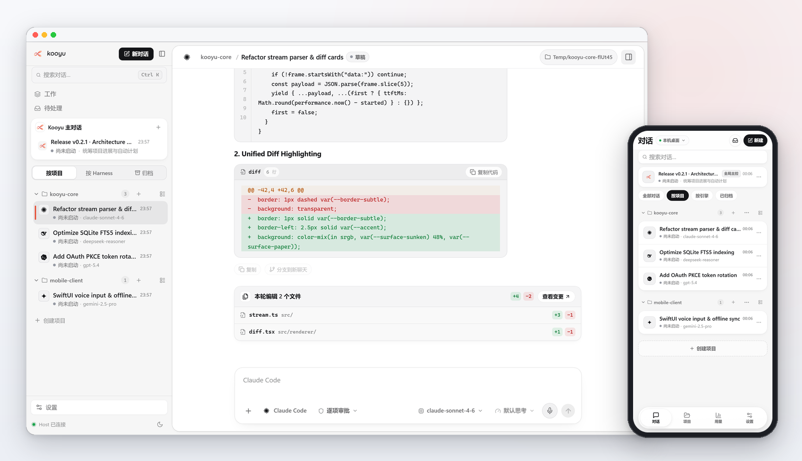
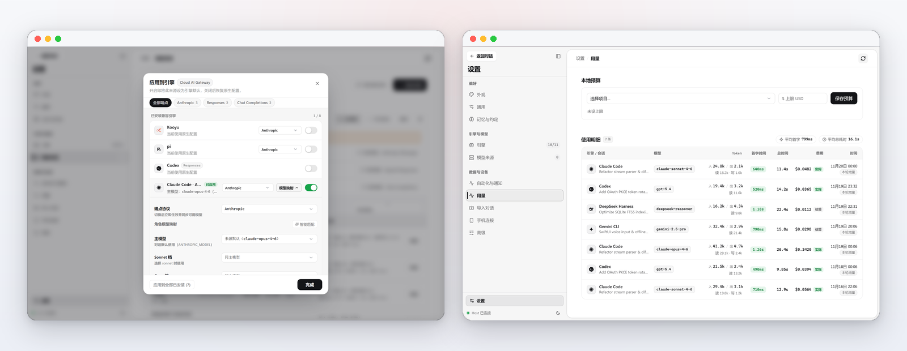
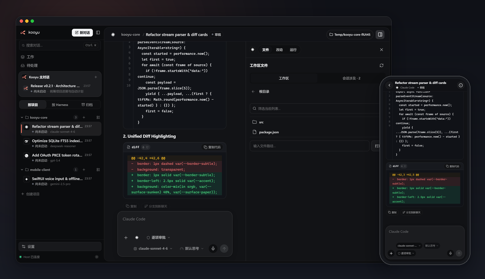
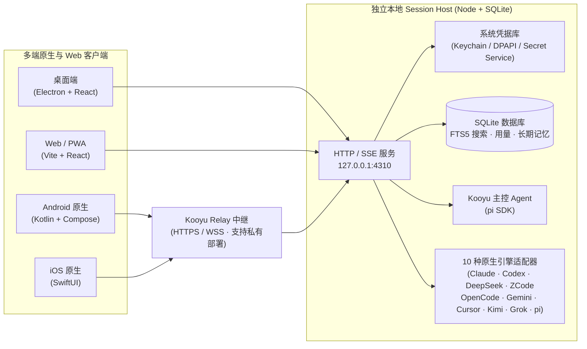

<div align="center">

<picture>
  <source media="(prefers-color-scheme: dark)" srcset="brand/icons/kooyu-app-dark.svg" />
  <source media="(prefers-color-scheme: light)" srcset="brand/icons/kooyu-app.svg" />
  
</picture>

<br />

<picture>
  <source media="(prefers-color-scheme: dark)" srcset="brand/logos/kooyu-wordmark-white.svg" />
  <source media="(prefers-color-scheme: light)" srcset="brand/logos/kooyu-wordmark.svg" />
  
</picture>

<h3>本地优先、跨平台的 AI 编程代理统一工作台</h3>

<p>
  在一个界面中统一管理 10+ 原生编程引擎、多协议模型来源与角色映射、用量与耗时账单，并通过独立本地 Session Host 实现 Desktop、Android、iOS 与 Web 无缝协作。
</p>

<p>
  <a href="https://github.com/sh2001sh/Kooyu/releases">
    
  </a>
  <a href="https://github.com/sh2001sh/Kooyu/actions/workflows/native-apps.yml">
    
  </a>
  
  <a href="LICENSE">
    
  </a>
</p>

<p>
  <a href="README.md">English</a> ·
  <strong>简体中文</strong> ·
  <a href="README.ja.md">日本語</a>
</p>

<p>
  <a href="#-下载安装">下载安装</a> ·
  <a href="#-核心特性">核心特性</a> ·
  <a href="#-支持的编程引擎">支持引擎</a> ·
  <a href="#-各平台安装说明">安装指南</a> ·
  <a href="#-手机扫码连接">手机配对</a> ·
  <a href="#-从源码构建">源码构建</a>
</p>

<br />

<picture>
  <source media="(prefers-color-scheme: dark)" srcset="docs/assets/dark-workspace.png" />
  <source media="(prefers-color-scheme: light)" srcset="docs/assets/hero-showcase.png" />
  
</picture>

</div>

---

## ✨ 核心特性

- **统一调度 10+ 原生编程引擎** — 直接与 **Claude Code**、**Codex**、**DeepSeek Harness**、**ZCode**、**OpenCode**、**Gemini CLI**、**Cursor**、**Kimi Code**、**Grok Build**、**pi** 对话，或由内置的 **Kooyu 主控 Agent** 跨项目统筹调度与自动续接。
- **独立持久化 Session Host** — 采用解耦的 Node + SQLite 本地 Host（`127.0.0.1:4310`）。关闭桌面窗口自动最小化至托盘；即便退出界面，后台任务、定时计划与原生会话也不会中断。
- **统一模型来源、端点协议路由与角色映射** — 一次配置 OpenAI 兼容（`Chat Completions` / `Responses`）与 `Anthropic Messages` 端点，自动从 `models.dev` 同步上下文窗口与能力参数；通过「应用到引擎」弹窗为每个引擎独立绑定端点和模型（完整支持 **Claude Code 五槽位角色模型映射**：主模型 / Haiku / Sonnet / Opus / 子代理），绝不改写本机全局 CLI 配置。
- **原生多端体验与 Apple HIG 极简设计** — 桌面端基于 **Electron + React/TypeScript**，Android 基于 **Kotlin / Jetpack Compose**，iOS 基于 **SwiftUI**，同时保留 Web/PWA。内置 5 套精选配色与深浅外观、带独立行号的 IDE 级代码块、Unified Diff 逐行高亮、`Ctrl/⌘+K` 命令面板与停靠式工作区文件检查器。
- **按项目选择性导入对话 & 多语言实时切换** — 扫描本机各引擎历史会话，自由勾选指定项目中的单条或多条对话导入 Kooyu；支持 **简体中文 / English / 日本語** 多端实时切换并自动同步。
- **多端语音输入** — 桌面/Web 端支持浏览器实时语音识别 + Host Whisper/OpenAI 兼容转写双引擎；Android 原生 `SpeechRecognizer` 与 iOS 原生 `SFSpeechRecognizer` 开箱即用。
- **用量洞察与耗时明细账单** — 按项目、引擎、模型统计 Token、缓存命中、费用与本地预算，并完整记录每轮对话的 **首字时间（TTFT）** 与 **总耗时**。
- **软件内一键检查更新** — 在 **设置 → 通用 → 软件更新** 中支持切换「正式版 / 预览版」通道，自动校验 `SHA256SUMS.txt` 并拉起桌面安装程序或 Android 原生升级安装器。

<div align="center">
  
  <br />
  <sub>左：模型来源「应用到引擎」弹窗（多协议端点切换与 Claude Code 角色映射） · 右：用量分析与首字时间/总耗时明细</sub>
</div>

<details>
<summary><strong>展开对比浅色 / 深色双模式工作台</strong></summary>
<br />
<p align="center">
  
  
</p>
</details>

---

## 🤖 支持的编程引擎

Kooyu 自动扫描系统 `PATH` 中的 CLI 与标准桌面安装目录，完整保留各引擎的原生会话 ID、权限语义与登录状态。

| 引擎 | 定位 | 原生协议 / 运行时 | 隔离 Provider 绑定 | 自动发现安装 |
| :--- | :--- | :--- | :---: | :---: |
| **Kooyu** | 产品主控 Agent | 内置 `pi` SDK | ✅ | 内置 |
| **Claude Code** | 原生编程引擎 | Native CLI / Agent SDK | ✅（五槽位角色映射 + Anthropic / Chat 网关） | ✅ |
| **Codex** | 原生编程引擎 | `codex app-server` | ✅（OpenAI Responses） | ✅ |
| **DeepSeek Harness** | 原生编程引擎 | 原生 RPC / CLI | ✅ | ✅ |
| **ZCode** | 原生编程引擎 | 原生 CLI / 随包运行时 | ✅ | ✅ |
| **OpenCode** | 原生编程引擎 | 无头 HTTP + SSE 服务 | ✅ | ✅ |
| **Gemini CLI** | 原生编程引擎 | ACP | ✅（内置 Google → Chat 本地网关） | ✅ |
| **Cursor** | 原生编程引擎 | ACP（`agent`） | 仅原生账号 | ✅ |
| **Kimi Code** | 原生编程引擎 | 原生 Server API / ACP | ✅ | ✅ |
| **Grok Build** | 原生编程引擎 | ACP / 原生 CLI | ✅ | ✅ |
| **pi** | 独立编程引擎 | `pi` SDK / CLI | ✅ | 内置 |

> 更多协议能力与自定义 `installations.json` 入口覆盖说明，见 [docs/harness-catalog.md](docs/harness-catalog.md) 与 [docs/provider-configuration.md](docs/provider-configuration.md)。

---

## 📦 下载安装

所有平台安装包均由 GitHub Actions 自动构建并发布到 [**GitHub Releases**](https://github.com/sh2001sh/Kooyu/releases)。

### 最新构建 — `v0.2.1`（[`preview-0.2.1-10`](https://github.com/sh2001sh/Kooyu/releases/tag/preview-0.2.1-10)）

| 平台 | 架构 / 格式 | 下载地址 |
| :--- | :--- | :--- |
| **Windows** | x64 安装程序（`.exe`） | [Kooyu-Setup-0.2.1.exe](https://github.com/sh2001sh/Kooyu/releases/download/preview-0.2.1-10/Kooyu-Setup-0.2.1.exe) |
| **macOS** | Apple Silicon M1–M4（`.dmg` / `.zip`） | [Kooyu-0.2.1-arm64.dmg](https://github.com/sh2001sh/Kooyu/releases/download/preview-0.2.1-10/Kooyu-0.2.1-arm64.dmg) · [ZIP](https://github.com/sh2001sh/Kooyu/releases/download/preview-0.2.1-10/Kooyu-0.2.1-arm64-mac.zip) |
| **macOS** | Intel x64（`.dmg` / `.zip`） | [Kooyu-0.2.1.dmg](https://github.com/sh2001sh/Kooyu/releases/download/preview-0.2.1-10/Kooyu-0.2.1.dmg) · [ZIP](https://github.com/sh2001sh/Kooyu/releases/download/preview-0.2.1-10/Kooyu-0.2.1-mac.zip) |
| **Linux** | x64（`.AppImage` / `.deb`） | [Kooyu-0.2.1.AppImage](https://github.com/sh2001sh/Kooyu/releases/download/preview-0.2.1-10/Kooyu-0.2.1.AppImage) · [kooyu_0.2.1_amd64.deb](https://github.com/sh2001sh/Kooyu/releases/download/preview-0.2.1-10/kooyu_0.2.1_amd64.deb) |
| **Android** | 通用安装包（`.apk`） | [Kooyu-0.2.1-android-debug.apk](https://github.com/sh2001sh/Kooyu/releases/download/preview-0.2.1-10/Kooyu-0.2.1-android-debug.apk) |
| **iOS** | Apple Silicon 模拟器包（`.zip`） | [Kooyu-0.2.1-ios-simulator.zip](https://github.com/sh2001sh/Kooyu/releases/download/preview-0.2.1-10/Kooyu-0.2.1-ios-simulator.zip) |
| **校验清单** | SHA-256 哈希文件 | [SHA256SUMS.txt](https://github.com/sh2001sh/Kooyu/releases/download/preview-0.2.1-10/SHA256SUMS.txt) |

> 后续新版本请直接访问 [Releases 页面](https://github.com/sh2001sh/Kooyu/releases) 或在软件内一键检查更新。

---

## 🚀 各平台安装说明

### Windows

1. 下载并运行 **`Kooyu-Setup-0.2.1.exe`**。
2. 由于桌面安装包暂未购买商业代码签名证书，首次运行可能弹出 Windows SmartScreen 提示，点击 **「更多信息 → 仍要运行」** 即可（详见 [docs/windows-installation.md](docs/windows-installation.md)）。
3. 覆盖安装新版会自动保留本地历史对话与配置数据。

### macOS

1. Apple Silicon 芯片下载 **`Kooyu-0.2.1-arm64.dmg`**，Intel 芯片下载 **`Kooyu-0.2.1.dmg`**，打开后将 **Kooyu.app** 拖入 **应用程序（Applications）** 文件夹。
2. 因尚未配置 Apple 开发者公证，首次打开前在终端执行一次隔离属性清理：
   ```bash
   xattr -cr /Applications/Kooyu.app
   ```
3. 随后即可正常启动 Kooyu。

### Linux

- **AppImage**：
  ```bash
  chmod +x Kooyu-0.2.1.AppImage
  ./Kooyu-0.2.1.AppImage
  ```
- **Debian / Ubuntu（`.deb`）**：
  ```bash
  sudo apt install ./kooyu_0.2.1_amd64.deb
  ```

### Android

1. 在手机下载 **`Kooyu-0.2.1-android-debug.apk`** 并按提示允许「安装未知来源应用」。
2. 官方 CI 始终保持固定调试签名证书，后续新版本可直接覆盖升级，不会丢失已配对设备凭据。
3. 打开 App 后点击「扫描桌面二维码」即可连接电脑。

### iOS

- 发布包中的 `Kooyu-0.2.1-ios-simulator.zip` 供 Apple Silicon Mac 的 iOS 模拟器直接运行（`xcrun simctl install booted Kooyu.app`）。
- 如需安装到真机 iPhone / iPad，请使用自己的 Apple 开发者账号在 Xcode 中构建签名，详见 [apps/ios/README.md](apps/ios/README.md)。

### 校验安装包完整性（SHA-256）

```bash
# macOS / Linux
shasum -a 256 -c SHA256SUMS.txt --ignore-missing
```

```powershell
# Windows PowerShell
Get-FileHash .\Kooyu-Setup-0.2.1.exe -Algorithm SHA256
```

### 软件内自动更新

在桌面端（或托盘菜单「检查更新…」）与移动端打开 **设置 → 通用 → 软件更新**：
- 支持自由切换 **正式版**（`v*` 标签）或 **预览版**（`preview-*` 自动构建）通道。
- 下载完成后自动核对 `SHA256SUMS.txt`，校验通过后一键唤起桌面安装器或 Android 系统安装界面。

---

## 📱 手机扫码连接

无需公网 IP、端口转发、VPN 或手动配置隧道，三步即可在手机上实时查看会话、发消息、审批操作：

1. 在电脑端打开 **设置 → 手机连接 → 生成配对码**。
2. 桌面 Host 自动通过 HTTPS/WSS 接入 `relay.kooyu.app`（也支持部署自有 Relay，见 `deploy/kodo-relay/`）。
3. 使用 Android / iOS 客户端扫码（或手机系统相机扫码打开 Web/PWA）即可完成配对。
4. 配对邀请码 2 分钟内单次有效；设备 Token 仅以哈希保存（30 天有效），随时可在桌面端一键撤销授权。

> 详细原理与私有化部署方案见 [docs/mobile-relay.md](docs/mobile-relay.md) 与 [docs/self-hosted-operations.md](docs/self-hosted-operations.md)。

---

## 🧱 系统架构



### 仓库目录结构

| 目录 | 说明 |
| :--- | :--- |
| `apps/desktop` | Electron 桌面外壳、系统托盘、原生更新器与麦克风权限集成 |
| `apps/web` | React + TypeScript 工作台前端、外观工作室、语音输入与 Playwright UI 测试 |
| `apps/android` | Android 原生应用（Kotlin / Jetpack Compose / Material 3 / APK 升级） |
| `apps/ios` | iOS 原生应用（Swift 6 / SwiftUI / XcodeGen） |
| `packages/host` | 独立 Node Session Host、SQLite 存储、引擎适配器、Provider 网关、更新与语音服务 |
| `packages/protocol` | 前后端及移动端共享的 Zod Schema 与 TypeScript 协议定义 |
| `packages/platform` | 跨平台目录规范、Host 发现机制与系统工具 |
| `services/relay` | 轻量级 HTTPS/WSS 移动端配对中继服务 |
| `deploy/` | Host 与 Relay 的 Docker、Compose、Caddy 与 systemd 部署模板 |
| `brand/` | Kooyu 正式 SVG Logo、应用图标与设计 Token |
| `docs/` | 架构设计、引擎矩阵、Provider 配置、移动中继与发布文档 |

---

## 🛠️ 从源码构建

### 环境要求

- **Node.js `>= 24.13.0`** 与 **npm `11+`**
- 本地安装任意支持的编程引擎 CLI / 桌面客户端（或在 Kooyu 内直接配置 API Provider）

### 本地开发与运行

```bash
git clone https://github.com/sh2001sh/Kooyu.git
cd Kooyu
npm ci
npm run build
```

- **启动 Electron 桌面端**（自动拉起或复用独立 Host）：
  ```bash
  npm run start:desktop
  ```
- **仅启动本地 Web 工作台**（访问 `http://127.0.0.1:4310`）：
  ```bash
  npm run start:host
  # 或启动 Vite 前端热更新（自动连接本机 Host）：
  npm run dev:web
  ```

### 打包各端安装包

```bash
# 打包当前操作系统的桌面安装包（产物输出至 release/desktop/）
npm run package:desktop -- --publish never

# 构建 Android APK（需 JDK 17 + Android SDK 36）
cd apps/android && ./gradlew testDebugUnitTest lintDebug assembleDebug

# 构建 iOS 模拟器包（需 macOS + Xcode 16 + XcodeGen）
cd apps/ios && xcodegen generate
xcodebuild -project Kooyu.xcodeproj -scheme Kooyu -destination 'generic/platform=iOS Simulator' CODE_SIGNING_ALLOWED=NO build
```

### 运行测试与检查

```bash
npm run lint
npm run format:check
npm run typecheck
npm test              # Host 单元与集成测试（500+ 用例）
npm run test:relay    # Relay 安全回归测试
npm run test:platform # Host 发现与启动器测试
npm run test:ui       # Playwright 全量 UI 回归测试（160+ 用例）
```

### 数据目录与环境变量

| 操作系统 | 默认 Host 数据目录 |
| :--- | :--- |
| **Windows** | `%LOCALAPPDATA%\Kodo\host` |
| **macOS** | `~/Library/Application Support/Kodo/host` |
| **Linux** | `${XDG_DATA_HOME:-~/.local/share}/Kodo/host` |

> 为兼容既有数据，内部存储目录、npm 包名及 `KODO_*` 环境变量（`KODO_DATA_DIR`、`KODO_HOST_PORT`、`KODO_HOST_URL`）保持向后兼容。

---

## 🔒 安全与隐私

- **本地优先架构** — 所有对话记录、记忆与用量账单均保存在本机 SQLite，Host 默认仅监听回环地址 `127.0.0.1`。
- **系统级密钥托管** — API Key 与 OAuth 凭据存入操作系统凭据库（Windows 凭据管理器、macOS 钥匙串、Linux Secret Service），绝不明文落盘至项目目录。
- **不污染全局原生配置** — 自定义 Provider 与角色模型映射仅按会话隔离注入，不会覆盖 `~/.claude`、`~/.codex` 等用户本机原生配置。

---

## 📄 开源协议与致谢

本项目采用 [**MIT License**](LICENSE) 开源协议。

- 上游 `pi` 运行时与 SDK 说明：[docs/upstream.md](docs/upstream.md)
- 运行依赖与第三方 SDK 条款：[third-party/runtime-dependencies.md](third-party/runtime-dependencies.md)
- `models.dev` 模型目录声明：[third-party/models.dev/NOTICE.md](third-party/models.dev/NOTICE.md)
- Craft Agents 设计变量提取边界：[third-party/craft-agents/EXTRACTION.md](third-party/craft-agents/EXTRACTION.md)
