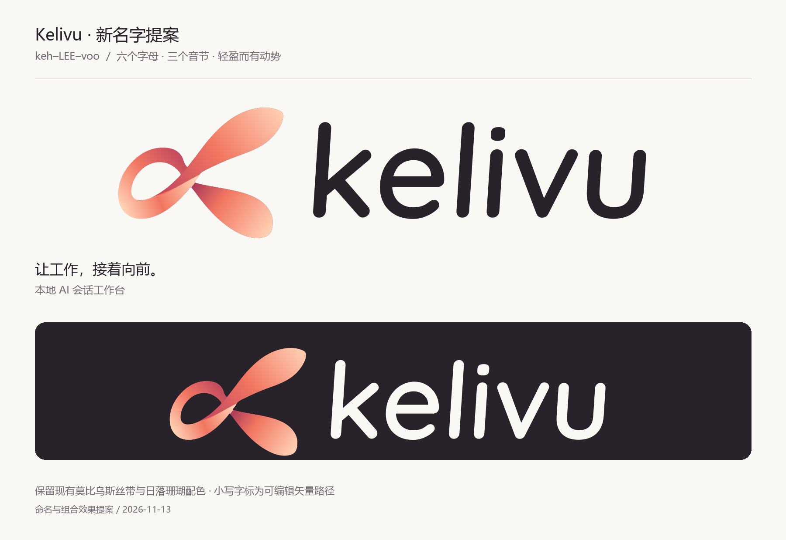

# Kelivu · 新名字提案

本轮推荐：**Kelivu**。此目录是命名提案和字标组合，不代表名称已注册或产品已经更名。

- 建议读音：`keh-LEE-voo`，重音在第二音节；六个字母，三个音节，没有辅音连缀。
- 视觉写法：正文中用 `Kelivu`，品牌字标用小写 `kelivu`。
- 命名气质：轻盈、温暖、易接近，同时适合开发者工具与后续产品延展。
- 品牌主张：让工作，接着向前。
- 图形：继续使用现有莫比乌斯丝带；珊瑚色、轮廓与渐变均保留原样。
- 字标：Quicksand 590、约 3.7° 轻微前倾、逐对调整字距，全部转为路径。

## 文件

- [浅色背景组合 SVG](kelivu-logo.svg) / [透明 PNG](kelivu-logo.png)
- [深色背景组合 SVG](kelivu-logo-dark.svg) / [透明 PNG](kelivu-logo-dark.png)
- [独立字标 SVG](kelivu-wordmark.svg)
- [独立图形 SVG](kelivu-mark.svg)

## 初筛记录

2026-11-13 对 `Kelivu`、`Kelivu software OR AI OR app OR company` 等组合进行公开网页初筛，返回结果中没有识别出明确的同名 AI/软件品牌；存在构拟语言词表、OCR 字典等非品牌命中。这是有限检索，不能视为没有其他使用者或已完成名称清查。

同日对 `kelivu.com` 的 Verisign 官方 RDAP 查询返回 HTTP 404，没有返回注册记录。原始查询地址、时间和状态保存在 [screening.json](screening.json)。此状态不保证注册商最终可注册性或售价，未购买或预订任何域名，尚未完成商标及近似名称检索。

备选观察项 `Kovinu` 和 `Keluvu` 的对应 `.com` 查询也未返回注册记录；本轮只为首选 Kelivu 制作正式字标提案。

## 验证与重建

四个 SVG 均检查可解析、没有内嵌图片或 text 节点；组合 PNG 具备透明通道；独立图形与现有正式图形按字节比较一致。原有正式素材和应用源码未更名。字体来源与许可见 [Quicksand](../../fonts/Quicksand)。

重建：在项目根目录运行 `python scripts/build-kelivu-proposal.py`。该命令只生成本提案目录并重新查询 RDAP。
