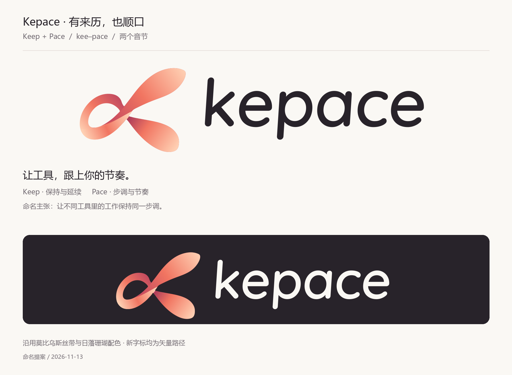

# Kepace · 有明确来历的名字

推荐名：**Kepace**。建议读音 `KEE-pace`，/kiːpeɪs/，两个音节。

## 为什么叫这个

Kepace 是将 **Keep + Pace** 缩合而成的品牌造词：保留 K 开头及完整的 pace，将 keep 缩短为 Ke。这是有意设计的拼写，不是现成英语单词，也不宣称是唯一自然读音。

Cambridge Dictionary 将 **keep pace** 解释为与某人或某事物以相同速度行进或发展。正式词义可查原始来源：https://dictionary.cambridge.org/us/dictionary/english/keep-pace 。

基于这一来源，品牌想表达：**让不同工具里的工作保持同一步调，让工具跟上你的节奏。** 这句话属于品牌对词义的延伸，不是字典原文翻译。

它对应产品围绕项目组织不同原生工具会话的定位，同时把节奏的控制权交给用户。这里没有承诺所有会话已经具备自动共享上下文或无缝互相接管能力。

品牌短句：**让工具，跟上你的节奏。**

## 视觉与文件

沿用现有莫比乌斯丝带、日落珊瑚配色和推荐的轻微前倾字标风格。四个 SVG 全部为路径，不依赖字体或嵌入位图。独立标志与原始正式素材按字节验证一致。

- [浅色背景组合 SVG](kepace-logo.svg) / [透明 PNG](kepace-logo.png)
- [深色背景组合 SVG](kepace-logo-dark.svg) / [透明 PNG](kepace-logo-dark.png)
- [独立字标 SVG](kepace-wordmark.svg)
- [独立标志 SVG](kepace-mark.svg)

字体及 OFL 许可来源见 [Quicksand](../../fonts/Quicksand)。

## 初筛状态

2026-11-13 已执行精确名称、名称加 AI/software 的公开网页初筛，以及 Verisign 官方 `.com` RDAP 查询。具体注册记录查询状态和时间见 [screening.json](screening.json)。HTTP 404 表示本次查询没有返回注册记录，不保证注册商最终可注册性、售价或商标可用性。

此目录为推荐命名提案，未购买域名、未完成商标及近似名称清查，也未将应用源码或现有正式资产更名。

重建：`python scripts/build-kepace-proposal.py`。
