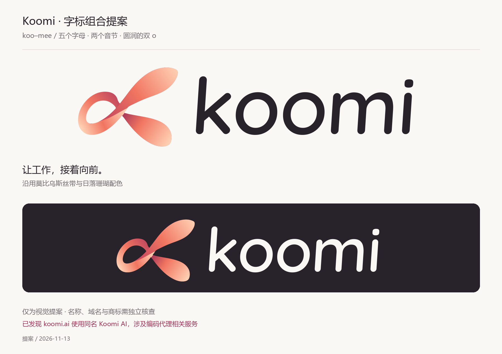

# Koomi · 字标与域名提案

用户提出采用 Koomi，并考虑 `koomiai.com` 或 `koomi-ai.com`。本目录为可审阅的视觉与域名提案，保留现有正式资产，不代表名称已完成清查或产品已经更名。

## 命名与字标

建议读音 `koo-mee`，五个字母、两个音节。双 o 延续 Kodo 的圆润节奏，也适合已有的柔和丝带图形。Koomi 可以作为前一轮 Kumi 的品牌化拼写，但不是日语 組（くみ）的标准罗马字；不能宣称 Koomi 本身就是一个意为组合的日语单词。

- [浅色背景横版 SVG](koomi-logo.svg) / [透明 PNG](koomi-logo.png)
- [深色背景横版 SVG](koomi-logo-dark.svg) / [透明 PNG](koomi-logo-dark.png)
- [独立字标 SVG](koomi-wordmark.svg) / [独立图形 SVG](koomi-mark.svg)

字标基于 Quicksand 590、轻微前倾与逐对调整的字距，全部转成路径；字体与许可见 [Quicksand](../../fonts/Quicksand)。独立图形按字节核对与既有正式图形一致。

## 域名比较

从输入、口述和展示的便利性看，优先 `koomiai.com`；`koomi-ai.com` 包含连字符，口述和记忆需要多一个信息点。两者均不构成对同名品牌冲突的解决。

2026-11-13 查询时，两者的 Verisign 官方 RDAP 均返回 HTTP 404，没有返回注册记录，详见 [screening.json](screening.json)。这不是注册商售价或结算可用性的保证，未购买或预订域名。

## 已发现的相邻领域同名

`https://koomi.ai/` 官网公开使用 Koomi AI 名称，自述将客服、用户反馈与通过 Multica 派发给编码代理的任务连接起来，站内包含 Claude/Codex 提示信息。用户已明确回复该网站不是自己的网站。

定位与本地会话工作台存在差异，但位于相邻的 AI/软件领域，且 Koomi AI 名称完全相同。该观察没有验证其经营主体或商标权属，也不构成侵权结论；需要进一步清查后才能正式定名。

重建字标：`python scripts/build-name-study.py --name Koomi`。域名查询记录为查询当时快照，不随视觉重建更新。
