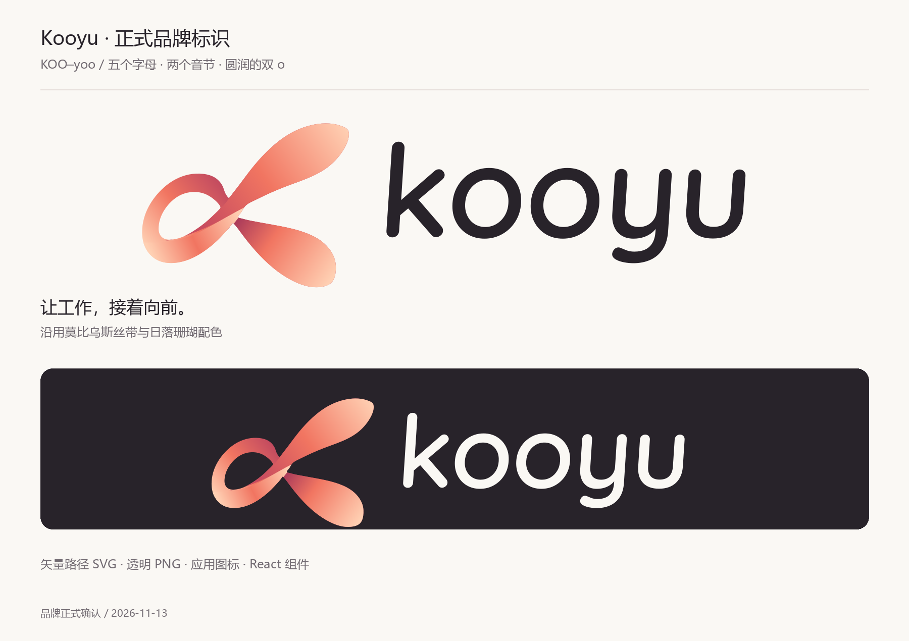

# Kooyu · 已确认品牌

用户于 2026-11-13 明确确认正式名称为 **Kooyu**。建议读音 KOO-yoo（库尤），正文使用 Kooyu，图形字标使用小写 kooyu。

保留原有莫比乌斯丝带图形与日落珊瑚配色。字标延续 Quicksand 590、圆润收笔、轻微前倾与光学字距，已经转为矢量路径。

正式素材请从 [brand/assets](../../assets/README.md) 取用；本目录提供命名阶段与确认后的组合展示。品牌定义见 [identity.json](../../identity.json)。

- [正式横版 SVG](../../assets/svg/kooyu-logo.svg)
- [正式独立字标 SVG](../../assets/svg/kooyu-wordmark.svg)
- [正式素材包](../../kooyu-brand-assets.zip)
- [命名与域名初筛记录](screening.json)

名称以 Kuyu 为灵感作品牌化改写；不宣称 Kooyu 是一个现成的土耳其语单词。正式域名尚未选定或注册；记录中的注册局查询是当时快照，不是结算可用性或价格承诺。

软件窗口、托盘、网页标题、PWA、界面文案与产品主 agent 身份已同步。为保持旧会话、原生 ID、凭据与配置兼容，内部旧技术键保留。原始六张产品生图仍为 Kodo 历史稿，不作为 Kooyu 最新标识来源。

重建正式素材：python scripts/build-coral-brand.py。重建本目录预览：python scripts/build-name-study.py --name Kooyu。刷新 ZIP：python scripts/package-brand.py。
