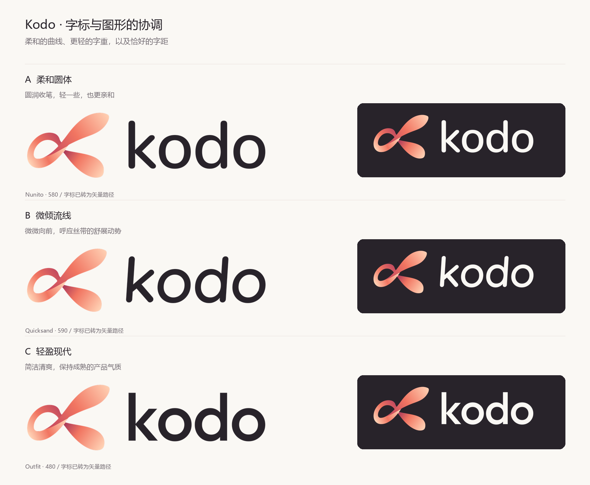

# Kodo · 字标协调探索

保留已选定的「灵动回环」标志与日落珊瑚配色，调整小写 `kodo` 的字形、字重和字距。

| 方向 | 字体与处理 | 感受 |
| --- | --- | --- |
| A · 柔和圆体 | Nunito 580，直立 | 圆润、亲和 |
| B · 微倾流线 | Quicksand 590，约 3.7° 前倾 | 轻盈、流动，呼应丝带动势 |
| C · 轻盈现代 | Outfit 480，直立 | 简洁、清爽 |

当前推荐 B，已同步至 [横版 SVG](../assets/svg/kodo-logo.svg)、[独立字标](../assets/svg/kodo-wordmark.svg) 和素材包。B 为推荐修订，尚未收到用户对 B 的最终选择。

每版均包含浅色背景组合、深色背景组合、独立字标 SVG 与透明 PNG，分别位于 [a-soft](a-soft)、[b-flow](b-flow)、[c-modern](c-modern)。字标全部转为矢量路径，不依赖安装字体；原字体及 OFL 许可在 [fonts](../fonts)。调整参数记录于 [options.json](options.json)，当前推荐项记录于 [wordmark-selection.json](../wordmark-selection.json)。

重建对照：`python scripts/compare-wordmarks.py`。重建正式素材：`python scripts/build-coral-brand.py`。更新下载包：`python scripts/package-brand.py`。
