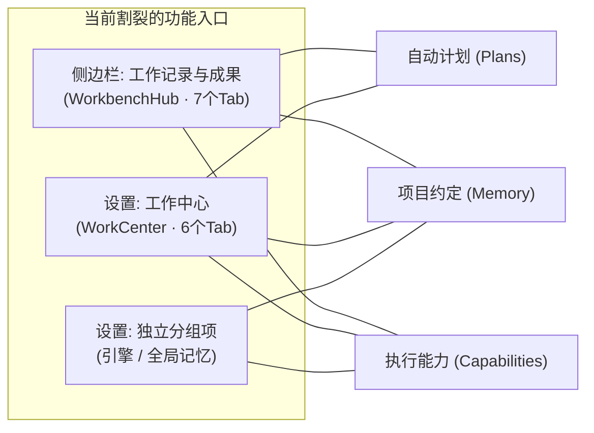

# Kooyu 多端现状审计与 Apple HIG 风格前端重构设计方案

> **日期**：2026-11-18  
> **覆盖范围**：桌面端（`apps/desktop` + `apps/web`）、Web 移动端/PWA（`apps/web <=760px`）、Android 原生端（`apps/android` Jetpack Compose）、iOS/iPadOS 原生端（`apps/ios` SwiftUI）  
> **核心目标**：全面审视当前多端架构、使用逻辑、界面逻辑与功能合理性；吸收 **Apple Human Interface Guidelines (iOS 18/26 & macOS Sequoia)** 及头部同类产品（ChatGPT、Claude / Claude Code、Linear Mobile、Craft Agents、Things 3）的布局结构与设计语言，对前端进行系统性降噪优化，并**彻底重构移动端前端布局结构**。

---

## 一、项目多端现状全景盘点

当前项目采用 **“单一独立本地宿主（Node Session Host + SQLite）+ 四套客户端界面壳”** 的架构。上一轮迭代（2026-11-17）已完成基础色彩 Token 对齐（`tokens.css` 与 `Theme.kt` 的 Warm Daylight / Obsidian Carbon + 落日珊瑚色）及大文件代码拆分，但**信息架构（IA）、多端导航拓扑与移动端空间布局仍停留在“把桌面高密度控制台硬塞进小屏”的状态**。

### 1.1 四端工程与真实状态矩阵

| 端侧形态 | 源码目录与技术栈 | 连接与运行方式 | 当前界面完成度与核心瓶颈 |
| :--- | :--- | :--- | :--- |
| **桌面工作台**<br>(Windows / macOS / Linux) | `apps/desktop` (Electron)<br>`apps/web` (React + TS + 模块化 CSS) | 本地 Loopback 直连独立 Host；关窗隐藏托盘，任务后台续跑 | 双栏框架与弹簧曲线已就位；但存在**双工作中心功能重叠**、顶栏+状态栏+底栏常驻元素过多、主画布缺少 macOS 悬浮岛层次感。 |
| **Web 移动端 / PWA**<br>(手机浏览器远程入口) | `apps/web` (`@media (max-width: 760px)`) | 扫码经 `relay.kooyu.app` HTTPS/WSS 配对，共用桌面同一套 React DOM | **结构最混乱**：同时存在顶部汉堡抽屉（`☰`）与底部 4-Tab 栏，导航语义与原生端完全分裂；对话页顶栏标题被挤剩 4 个字，Composer 单行挤入 6 个小按钮。 |
| **Android 原生端**<br>(手机 / 平板 / 折叠屏) | `apps/android`<br>(Kotlin + Jetpack Compose / M3) | 扫码获取 Bearer Token（Keystore 加密），前台轮询 + 独立前台服务 SSE 提醒 | 模拟器 38+ 页面跑通；但**底栏 Tab 优先级倒置**、新建会话 BottomSheet 垂直堆叠 **5 层胶囊**、检查器与设置页残留大量 Material 线框表单（`OutlinedTextField` + 保存按钮）及默认配色。 |
| **iOS / iPadOS 原生端**<br>(iPhone / iPad) | `apps/ios`<br>(SwiftUI + Swift 6, iOS 17+) | Keychain 存储设备凭据，VisionKit 扫码，APNs 推送源码已接入 | 采用 `TabView` + `NavigationSplitView`，原生控件质感优于 Android；但同样存在**底栏入口错配**（低频“用量/模型来源”霸占一级 Tab，“项目/工作成果”藏进搜索栏旁 `⋯` 菜单），且待 macOS/Xcode 真机编译验收。 |

---

## 二、深度诊断：使用逻辑、界面逻辑与功能合理性评估

结合各端源码（`main.tsx`、`WorkbenchHub.tsx`、`WorkCenter.tsx`、`KooyuApp.kt`、`DraftSessionSheet.kt`、`InspectorSheet.kt`、`KooyuApp.swift`）及实机验收截图逐帧比对，当前项目在**使用逻辑、功能组织、界面布局**三个维度存在五大结构性问题：

### 2.1 跨端导航拓扑“三套标准”，移动端一级入口优先级严重倒置

对比当前三套移动端入口的一级导航结构：

| 维度 | Web 移动端 (`apps/web <=760px`) | Android 原生端 (`apps/android`) | iOS 原生端 (`apps/ios`) | 诊断结论 |
| :--- | :--- | :--- | :--- | :--- |
| **底部一级 Tab** | `主控` \| `收件箱` \| `会话` \| `配置` | `对话` \| `用量` \| `来源` \| `设置` | `对话` \| `用量` \| `模型来源` \| `设置` | **三端不一致，且原生端把低频后台配置当成高频主入口** |
| **顶部左/右入口** | 左 `☰` 汉堡抽屉 + 右 `+` | Logo + 设备胶囊 + 收件箱小图标 + `+ 新建` | Logo + 设备胶囊 + 铃铛图标 + `+`（另有搜索旁 `⋯`） | **顶栏元素高达 4~5 个，极度拥挤** |
| **工作与成果入口** | 藏在 `☰` 抽屉内 | 沉在会话列表最底部（需滚到底才能看见） | 藏在搜索框右侧 `⋯` 二级菜单中 | **核心产出物（Goal/Artifact/计划）无稳定一级入口** |

**为什么这套使用逻辑不合理？**
1. **严重违背移动端使用场景频率（80/20 法则倒置）**：
   - 用户在手机上打开 Kooyu 的核心诉求是：**① 处理阻塞的权限审批/回答 Agent 提问（收件箱）**、**② 查看运行进展并随时发指令/紧急叫停（对话）**、**③ 验收交付成果与管理定时任务（工作）**。
   - 而 **`模型来源（Provider API 配置）`** 属于“配置一次用半年”的超低频运维动作，**`用量统计`** 属于低频查阅动作。当前 Android 与 iOS 却让 `用量` 和 `来源` 占据了 **50% 的黄金底部拇指热区**，反而把最高频的 `收件箱（待处理审批）` 缩成顶栏右上角一个 `20dp` 小图标，把 `工作与成果` 埋进列表最底部或 `⋯` 菜单。
2. **Web 移动端“汉堡抽屉 + 底部 Tab 栏”双重导航冲突（Apple HIG 明确反模式）**：
   - Web 移动端既有底部 4-Tab（`主控 | 收件箱 | 会话 | 配置`），又在左上角放了 `☰` 抽屉按钮。点开 `☰` 时，`pages.css` 直接隐藏整个会话列表（`.sidebar[data-nav-open="true"] .sidebar__list { display: none; }`），弹出一个半空的 288px 侧滑抽屉，里面再次重复出现 `待处理通知` 和 `设置`！
   - 更困惑的是底栏同时存在 **`主控`** 与 **`会话`** 两个 Tab：而在 `会话` 页顶部本就已经置顶了 `Kooyu 主对话` L0 卡片；切换到 `主控` Tab 看到的依然是几乎一模一样的树形框架，造成强烈的认知迷航。

---

### 2.2 功能情况评估：“双工作中心”与“三处记忆/三处能力”重叠

从产品底层能力来看，Kooyu 的核心功能边界（**10 种原生 Harness 直连 + Kooyu 主对话跨会话统筹 + 离线独立 Host 可靠投递 + 审批与预算护栏**）非常扎实且极具差异化竞争力。**但前端功能暴露方式出现了明显的功能膨胀与模块重叠**：



1. **两个“工作中心”互相打架**：
   - 主侧边栏有 **`工作记录与成果` (`WorkbenchHub.tsx`)**，内含 **7 个 Tab**：`工作记录 | 成果 | 自动计划 | 项目概览 | 项目约定 | 执行能力 | 常用任务`。
   - 进入 `设置` 后又有一个 **`工作中心` (`WorkCenter.tsx`)**，内含 **6 个 Tab**：`计划 | 应用与授权 | 项目记忆 | 执行环境 | 通知 | 运行与核对`。
   - 用户想建一个定时计划或改一条项目记忆时，根本分不清该去侧边栏的“工作记录与成果”还是去设置里的“工作中心”。
2. **同一概念散落三处**：
   - **记忆（Memory）**：散落在 `WorkbenchHub → 项目约定`、`WorkCenter → 项目记忆`、`Settings → 全局记忆` 三处。
   - **能力与环境（Capabilities/Engines）**：散落在 `WorkbenchHub → 执行能力`、`WorkCenter → 执行环境`、`Settings → 引擎` 三处。
3. **桌面重操作未针对移动端做优雅降级**：
   - 移动端把 Windows/macOS 宿主机的绝对路径（如 `E:\sh\Coding\agent-harness\.local\verification\...`）原样渲染在窄屏卡片与面包屑中，既破坏视觉美感又毫无移动端可读性。

---

### 2.3 移动端界面布局“五大结构性失衡”（源码与实测截图实证）

#### 失衡一：对话页顶部“四层叠床架屋”，软键盘弹起后阅读区几乎清零
在 `390×844` 手机视口下，当前对话页顶部垂直堆叠了多达 **3~4 层固定栏**：
1. **`chat-header` (60px)**：右侧硬塞了 4 个 `44×44px` 图标按钮（`[项目成果]`、`[文件改动]`、`[运行时间线]`、`[更多⋯]`），占去 **184px** 宽度，加上左侧返回键，留给中间面包屑与会话标题的宽度不足 130px——导致实测截图中标题被截断成 **`文件... / 手机 UI ...`** 仅剩 4 个字可读！
2. **常驻 `runtime-bar` (36px)**：哪怕是一个刚刚创建、完全没发过消息的空白会话，顶部也永远挂着三个灰色胶囊 **`[● 尚未启动] [原生未连接] [自动继续未启用]`**。在 Apple 设计语言中，“一切处于默认静止态”时根本不应展示三枚消极状态标签来制造视觉噪音。
3. **子代理双行导航栏 (`agent-navigation`, ~84px)**：一旦产生子代理，顶部再插入一行可关闭 Tab 栏 **外加** 第二行控制条（`<  >  全部子代理 (3)  收起`）。
4. **`TodoPanel` 任务清单（默认 `open` 展开）**：再占去 100~160px。
> **后果**：当用户在手机上点开输入框弹出软键盘（占高约 300~340px）时，顶部 Chrome + 底部 Composer 夹击之下，**中间对话消息可视高度不足 120px（不到 3 行字）**。

#### 失衡二：底部 Composer 控件过载、触控热区违规与高危按钮裸露
- **单行 6 控件挤压**：Web 移动端 `.composer-toolbar` 在一行内塞入 `[+ 附件]`、`[引擎图标]`、`[盾牌权限]`、`[模型名 ▾]`、`[思考强度 ▾]`、`[↑ 发送]` 6 个交互元素；为了塞下它们，`pages.css` 将按钮强行缩小至 **`32×32px`**（第 444–453 行），直接违反 Apple HIG **`44×44pt` 最小触控热区铁律**，极易误触。
- **高危操作无条件常驻裸露**：在 `Composer.tsx` 第 502–513 行，输入框正下方无条件常驻渲染 **`■ 停止并暂停托管`** 按钮——即使当前会话处于 `尚未启动` 或 `空闲` 状态、且压根没有开启自动托管！这不仅浪费宝贵的底部安全区高度，还给用户造成“有什么东西正在后台失控运行”的错觉。

#### 失衡三：新建对话“表单化堆叠”，违背直觉式开聊体验
- **Android `DraftSessionSheet.kt`**：在 `ModalBottomSheet` 中从上到下堆叠了 **标题栏 + `项目`横向胶囊栏 + `Harness`横向胶囊栏 + `快速开始`横向胶囊栏 + `模型/思考/权限/附件`横向胶囊栏 + 多行输入框**（共 **6 层垂直结构、4 条水平滚动条**！）。在手机半屏抽屉中连续出现 4 条各自独立横向滚动的药丸条，视觉碎片化严重；软键盘一旦自动聚焦弹起（第 134 行 `focus.requestFocus()`），上半部分配置区直接被顶出可视区。
- **Web 移动端 `DraftWorkspace.tsx`**：把项目选择器、长目录路径选择器、本机节点标签、`创建会话` 按钮全部塞进顶栏，实测截图中全部截断为 `📁 项目主对话... ▾ / C:\U... ▾ 🖥 本`。

#### 失衡四：检查器与设置页充满“传统后台 CRUD 表单感”
- 在 Android `InspectorSheet.kt`（第 186–204 行）与 `SettingsScreen.kt` 中，会话标题、项目范围、工作目录、权限模式全部采用厚重的 **Material `OutlinedTextField` 浮动切口线框** 垂直排列，底部再配一个纯黑实心 **`[保存基础配置]`** 按钮，下方紧接着又是另一个 **`[应用模型更新]`** 按钮——同一个半屏面板里出现两个独立的表单提交按钮！
- `DevicesScreen`（`SettingsScreen.kt` 第 83–101 行）仍混用 `MaterialTheme.colorScheme.primaryContainer` 默认配色，且关于页硬编码了错误的 `Version 1.2.1`（实际工程为 `0.2.1`），缺少桌面与 iOS 已有的 `执行引擎` 与 `全局记忆` 入口。

#### 失衡五：Android 底部悬浮胶囊 Dock 视觉厚重且横向排版拥挤
- `KooyuDock`（`GlassBars.kt` 第 168–208 行）使用 `62.dp` 高的通栏大胶囊，内部 4 个 Tab 采用 **图标与文字左右并排 (`Row`)**。在小屏手机（360dp 宽）或开启系统大字体时，4 组左右并排的图标+文字极易折行或紧贴描边，远不如 Apple 原生 Tab Bar 或 iOS 26 紧凑悬浮胶囊自然优雅。

---

## 三、标杆研究：Apple HIG 设计语言与头部竞品拆解

要打造真正具有“果味（Apple-grade Craftsmanship）”的 AI 编程与多代理工作台，绝不是简单把圆角改大或加上毛玻璃，而是要贯彻 **Apple Human Interface Guidelines (iOS 18 / iOS 26 Liquid Glass & macOS Sequoia)** 的底层空间秩序，并结合同类标杆产品的最佳实践。

### 3.1 Apple HIG 四大核心设计法则转译

| Apple HIG 核心原则 | 内涵提炼 | 对 Kooyu 前端的直接重构指导 |
| :--- | :--- | :--- |
| **1. Deference（内容谦让，Chrome 退后）** | UI 框架不应与内容争抢注意力；默认状态应保持静默，只有变化、异常或正在运行的事实才值得浮现。 | **废除常驻 `runtime-bar` 与空闲态 `停止并暂停托管`**。当会话空闲且未托管时，界面只有清爽的标题与输入舱；仅当处于 `运行中 / 等待确认 / 离线 / 托管激活` 时，才以轻量动态胶囊（Live Pill）优雅浮现。 |
| **2. Clarity & Hierarchy（清晰层级与渐进披露）** | 首屏只放 90% 场景必用的主操作；次高频参数收进二级 Popover / Sheet，杜绝满屏平铺开关。 | **Composer 做极致减法**：主输入条只留 `[+]`（展开附件/权限/工作区面板）、`[模型·思考胶囊]` 与 `[发送/停止圆钮]` 三个锚点；彻底消灭单行 6 控件挤压。 |
| **3. Depth & Translucent Materials（空间景深与材质分层）** | 用微妙的半透明毛玻璃（Materials）、内缩分组卡片（Inset Grouped）与桌面悬浮纸面岛（Split View Canvas）表达前后层级，而非粗黑分割线。 | **桌面端**落地真正的 macOS Sequoia **内缩圆角悬浮主画布**；**移动端**对话流延伸至顶栏与底栏背后，顶底采用渐进毛玻璃模糊；所有属性页统一为 **iOS Inset Grouped 无框键值列表**（点击即改即存，消灭“保存按钮”）。 |
| **4. Ergonomics & Fluidity（拇指热区与物理连续性）** | 所有触控目标严格 `>= 44×44pt`；禁止汉堡抽屉与底栏混用；弹窗遵循 `.medium` / `.large` 档位与下拉手势关闭。 | **移动端统一底部 4-Tab 架构**，彻底移除汉堡菜单；新建对话从“多层弹窗”改为 **零阻力全屏直入式起草页**；所有面板支持手势下滑与预测性返回。 |

### 3.2 同类产品与头部竞品布局结构精髓拆解

1. **ChatGPT (iOS & macOS App) —— 极简对话与零阻力新建标杆**
   - **布局亮点**：打开即聊，点击新建**绝不弹出配置表单**，而是直接清空主画布并聚焦输入框；顶部导航栏正中央仅放一枚 **`ChatGPT 4o ▾`** 轻量按钮（点击弹出原生 Menu/Sheet 切换模型或引擎）；输入框左侧仅 **1 个 `[+]` 圆钮** 聚合文件、相机与工具开关。
   - **借鉴点**：将 Kooyu 移动端繁琐的 `DraftSessionSheet` 改造为 **ChatGPT 式直入起草态**——顶部一枚引擎/模型切换胶囊 + 一枚自动继承的项目胶囊，底部极简输入框，一秒开聊。

2. **Claude App & Claude Code Remote —— 温暖纸张阅读感与内联审批标杆**
   - **布局亮点**：采用温暖米白纸面（Warm Paper）与高可读性衬线/无衬线混排；AI 回答无气泡直接排布于纸面，思考过程（`Extended Thinking`）收拢为极度克制的单行折叠块；远程终端权限请求以高辨识度内联卡片呈现，支持展开查看完整命令/Diff 并在拇指区一键批准。
   - **借鉴点**：保留并提纯 Kooyu 现有的 Warm Daylight 纸感色板；重构移动端 **内联与收件箱审批卡（Approval Card）**，支持代码块语法高亮折叠预览与底部大尺寸双按钮（`拒绝` / `允许本次`）。

3. **Linear Mobile —— 高密度专业工具的移动化降维教科书**
   - **布局亮点**：作为功能极其复杂的研发管理工具，Linear 移动端没有把桌面侧边栏搬上手机，而是确立了 **`Inbox（收件箱）`** 作为最核心的一级底部 Tab，让用户在通勤路上快速批处理通知与阻塞项；所有详情属性（负责人、状态、项目）在半屏抽屉中全部采用 **无输入框线框的列表行点击即改（Instant Property Picker）**。
   - **借鉴点**：将 **`待办（Inbox）`** 正式提拔为 Kooyu 全移动端（iOS / Android / Web 移动）的**第二核心底部 Tab**，并在列表中支持不进会话直接快捷审批；彻底用 Linear/iOS 式的“行级点选即时生效”取代 Android 检查器里的 `OutlinedTextField` + 保存按钮。

4. **Craft Agents / Apple Notes / Things 3 —— Apple 原生结构美学**
   - **布局亮点**：macOS 端采用温暖侧边栏底色衬托白色圆角主文档岛（Floating Island），右侧检查器平滑覆盖或推挤而不破坏正文排版宽度；iOS 端采用经典的 `Inset Grouped` 圆角白卡承载列表分组，配合流畅的左滑归档/删除与右滑置顶手势。
   - **借鉴点**：规范桌面端 Floating Island 边距与阴影，统一三端移动端分组卡片圆角（`16pt/16dp`）、内缩分割线（左侧对齐文字起始位 `52pt/52dp`）与左右滑动手势语义。

---

## 四、总体设计优化与重构方案（Apple HIG 体系）

### 4.1 第一步：功能收敛与全端信息架构（IA）统一

在动手改界面之前，先解决“两个工作中心打架”和“三处记忆/能力散落”的逻辑混乱，建立全端一致的领域模型：

| 重组后的一级领域 | 承载内容（唯一归属，消除重复） | 废弃/合并的旧入口 |
| :--- | :--- | :--- |
| **1. 对话 (`Sessions`)** | - 置顶 L0 `Kooyu 主对话`（跨项目统筹指挥官）<br>- `按项目` / `按引擎 (Harness)` 分组会话树、归档筛选与全文历史搜索 | 废弃 Web 移动端单独拆出的 `主控` Tab（合并回 `对话` 顶部的 L0 置顶区） |
| **2. 待办 (`Inbox`)** | - 所有等待用户拍板的**原生权限审批**、**Agent 提问表单**、**托管预算/失败暂停提醒**、**待核对未知回执**<br>- 支持在卡片上**一键允许/拒绝/快速回答**，或点击跳转原会话定位上下文 | 统一顶栏小铃铛、抽屉通知按钮与 `WorkbenchHub` 中的待处理列表 |
| **3. 工作 (`Work`)** | *(合并原 `WorkbenchHub` 的用户态核心视图与 `WorkCenter` 的计划管理)*<br>- **进行中目标 (`Goals`)**：多会话编排进度与验收<br>- **产出成果 (`Artifacts`)**：生成文件预览、下载与 Git 变更溯源<br>- **自动计划 (`Schedules`)**：定时任务创建、启停、运行记录与对话式创建入口 | 彻底移除 `设置 → 工作中心` 中的重复 `计划` Tab；移除冗余的 `常用任务` Tab（下沉为新建对话时的空状态快捷建议胶囊） |
| **4. 设置 (`Settings`)** | *(纯低频配置与资产管理，Apple 系统设置分组风格)*<br>- **设备与连接**：当前 Host 状态、多电脑切换、扫码配对、远程执行节点<br>- **引擎与模型**：10 大引擎健康度/安装检查、Provider 来源、模型库与默认绑定<br>- **记忆与指令**：统一管理 **全局记忆 + 项目约定（按项目筛选）+ 个人指令**<br>- **自动化与通知**：外部应用授权（GitHub/Slack/Browser）、APNs / Bark / 前台提醒<br>- **用量与高级**：Token/费用图表、项目预算限额、外观主题（浅色/深色/跟随系统） | 合并散落在三处的记忆管理；将低频的 `用量` 与 `模型来源` 从原生移动端底部主 Tab 收拢至 `设置` 一级分组行中 |

---

### 4.2 第二步：移动端完全重构方案（重中之重）

> **适用范围**：`apps/android` (Compose)、`apps/ios` (SwiftUI)、`apps/web` (`<=760px` 响应式移动视口) **三端严格拉齐同一套布局骨架与交互逻辑**。

#### A. 全局导航重构：废除汉堡菜单，确立 Apple 风格 4-Tab 拇指架构

彻底移除 Web 移动端的左上角 `☰` 汉堡抽屉，并将 Android / iOS / Web 移动端的底部导航统一为高频 **4-Tab 栏**：

```text
╭──────────────────────────────────────────────────────────╮
│   💬 对话          📥 待办 [2]       🗂️ 工作        ⚙️ 设置   │
╰──────────────────────────────────────────────────────────╯
```

- **视觉规范（Apple Tab Bar / iOS 26 紧凑悬浮玻璃栏）**：
  - **iOS 端**：直接使用系统原生 `TabView`（自动适配 iOS 18/26 毛玻璃胶囊形态与 iPadOS 顶部/侧边栏自适应 `.sidebarAdaptable`）。
  - **Android & Web 移动端**：修复当前 `KooyuDock` 图标文字左右并排导致的窄屏拥挤问题，改为 **上图标（`22dp/22px`）+ 下文字（`10.5sp/11px Medium`）垂直居中排布**；高度精简至 `56dp + 安全区底部内边距`，背景使用高饱和度半透明毛玻璃（`backdrop-filter: saturate(180%) blur(24px)`），激活态仅图标与文字着 `brandCoral`（或深墨色），移除多余的内层厚边框套娃。
  - **显示/隐藏时机（Apple HIG 标准）**：仅在 4 个一级根页面显示底部 Tab 栏；**推入具体对话页（`Conversation`）或新建起草页时，底部 Tab 栏随页面横向推入动画自然隐藏**，将底部 100% 空间让给输入舱与软键盘。

---

#### B. 首页（`对话` Tab）重构：Apple Messages + Things 3 式清爽层级

将首页顶部从原来的“5 元素拥挤顶栏”瘦身为 **Apple 原生大标题 / 双锚点极简导航栏**：

```text
┌──────────────────────────────────────────────────────────┐
│  [🟢 MacBook Pro ▾]                             [📝]     │  <- 1. 极简毛玻璃顶栏 (48pt)
│  对话                                                    │     左: 设备连接胶囊 | 右: 新建对话图标
├──────────────────────────────────────────────────────────┤
│  ┌────────────────────────────────────────────────────┐  │
│  │ 🔍 搜索会话、消息或文件…                 [归档 3]  │  │  <- 2. iOS Spotlight 风格搜索槽 (38pt)
│  └────────────────────────────────────────────────────┘  │
│                                                          │
│  ┌────────────────────────────────────────────────────┐  │
│  │ ✦  Kooyu 主对话                       ● 就绪  14:20 │  │  <- 3. L0 置顶主控卡 (暖珊瑚微光纸卡)
│  │    跨项目统筹 · 正在观察 2 个会话                   │  │
│  └────────────────────────────────────────────────────┘  │
│                                                          │
│  [        按项目        |        按引擎        ]         │  <- 4. 弹簧滑块分段器 (34pt)
│                                                          │
│  ▾ agent-harness                               2   [＋]  │  <- 5. 分组头 (纯文本短项目名，绝不露盘符!)
│  ┌────────────────────────────────────────────────────┐  │
│  │▌ [CX] 修复登录态回归                        14:21  │  │  <- 6. Inset Grouped 圆角白卡 (16pt 圆角)
│  │▌      ● 需确认 · gpt-5-codex                       │  │     - 行高 64pt，两行黄金密度
│  │       ──────────────────────────────────────────── │  │     - 分割线左缩进 52pt 对齐文字
│  │  [CC] 梳理 ACP 适配层                       昨天   │  │     - 右滑: 置顶 | 左滑: 归档 / 删除
│  │       ● 已完成 · claude-sonnet-4-5                 │  │
│  └────────────────────────────────────────────────────┘  │
│                                                          │
│  ▾ 未归属对话                                  1   [＋]  │
│  ┌────────────────────────────────────────────────────┐  │
│  │  [Pi] 临时脚本调试                          周一   │  │
│  │       ● 空闲 · deepseek-v4                         │  │
│  └────────────────────────────────────────────────────┘  │
├──────────────────────────────────────────────────────────┤
│      💬 对话       📥 待办(2)      🗂️ 工作      ⚙️ 设置     │  <- 7. 半透明毛玻璃底栏
└──────────────────────────────────────────────────────────┘
```

**关键优化点**：
1. **顶栏瘦身 60%**：移除顶栏重复的品牌 Logo + 文字（用户在自己的手机上打开 App 不需要顶栏每页占 90px 告诉他这是 Kooyu）、移除收件箱小图标（已升级为底部独立 `待办` Tab 并带角标）。顶栏只剩左 **`[🟢 设备名 ▾]`**（点击弹出设备切换/扫码/离线重连半屏 Sheet）和右 **`[📝 新建]`**（`44×44pt` 触控热区）。
2. **移除列表底部的杂项尾卡**：原本塞在 `HomeScreen` 列表末尾的 `工作记录与成果` 已升级为底部 `工作` Tab；`项目与目录管理` 整合进分组头的长按菜单及 `[+ 新建项目]` 轻量行。
3. **路径脱敏与人性化展示**：移动端列表与分组头只显示**项目名**或**文件夹末级目录名**（如 `agent-harness`），绝不直接渲染 `E:\sh\Coding\agent-harness` 等桌面盘符路径。

---

#### C. 新建对话（`New Chat`）完全重构：告别 5 层堆叠弹窗，采用 ChatGPT 式“直入起草页”

彻底废弃当前 Android `DraftSessionSheet` 中拥挤不堪的 5 层横向滚动条堆叠，改为 **全屏（或 96% 大卡片）零阻力起草画布**：

```text
┌──────────────────────────────────────────────────────────┐
│  [✕]              [✦ Kooyu 主对话 ▾]            [⋯]     │  <- 顶栏居中一键切换引擎 (点击弹出引擎选择器)
│                   📁 agent-harness · main ▾              │  <- 副标题胶囊: 自动继承最近项目/目录，点按可改
├──────────────────────────────────────────────────────────┤
│                                                          │
│                                                          │
│                        ╭──────╮                          │
│                        │  ∞   │                          │  <- 柔和呼吸微光 + 居中极简引导
│                        ╰──────╯                          │     (软键盘弹起时自动平滑上移淡出，让出空间)
│                  今天想推进哪项工作？                     │
│                                                          │
│     ┌────────────────────┐  ┌────────────────────┐       │
│     │ ✦ 审查当前 Git 改动 │  │ ✦ 运行测试修复报错 │       │  <- 轻量建议胶囊 (输入首个字符即淡出)
│     └────────────────────┘  └────────────────────┘       │
│                                                          │
├──────────────────────────────────────────────────────────┤
│  ╭────────────────────────────────────────────────────╮  │
│  │ 给 Kooyu 交代目标，或直接开始对话…                  │  │  <- 一体化圆角输入舱 (自动聚焦)
│  │                                                    │  │
│  │ [＋]   [gpt-5 · 默认思考 ▾]                   (↑)  │  │  <- 底部仅 3 个触控锚点! 全部 >=44pt 热区
│  ╰────────────────────────────────────────────────────╯  │
└──────────────────────────────────────────────────────────┘
```

**为什么这样设计天差地别？**
1. **智能默认继承（Zero-Config Start）**：90% 的情况下，用户就是想在刚才活跃的项目里用默认引擎继续开新会话。项目与工作目录自动继承并浓缩为顶栏下方一行小巧的 `📁 agent-harness · main ▾` 胶囊，不用改时一眼扫过即可直接打字发送；想改时点一下弹出清爽的原生列表 Sheet。
2. **软键盘友好（IME-Safe）**：整个页面除了顶栏 52pt 和底部输入舱 96pt 外没有任何多余的横条堆叠，即使软键盘占去半屏，依然留有充裕舒适的视觉呼吸空间。
3. **底部三锚点黄金法则**：
   - 左 **`[＋]`**：弹出半屏菜单（添加图片/文件附件、切换工具权限模式 `默认 / 自动批准 / 只读`、仅保存空白会话草稿）。
   - 中 **`[gpt-5 · 默认思考 ▾]`**：合并“模型选择”与“思考强度”为一个统一的模型参数半屏 Sheet（上半部选模型/绑定，下半部用分段滑块调思考强度，一次点开全部搞定！）。
   - 右 **`(↑)`**：输入非空时以弹簧动画点亮为落日珊瑚色发送圆钮。

---

#### D. 对话详情页（`Conversation`）完全重构：极致阅读空间与沉浸式输入舱

针对实测截图中“标题挤成 4 个字、顶部 4 层常驻条、底部裸露停止按钮”的痛点，重构为 **Apple Messages 级沉浸式对话流**：

```text
┌──────────────────────────────────────────────────────────┐
│ [‹ 2]  修复登录态回归                           [ⓘ]      │  <- 1. 单层毛玻璃顶栏 (48pt)
│        [CX] Codex · ● 运行中 · ⑂ 2 子代理 ▾              │     右仅留 1 个检查器入口! 标题完整显示 14+ 字!
├──────────────────────────────────────────────────────────┤
│  ┌────────────────────────────────────────────────────┐  │
│  │ ☑ 任务清单 2/5 · 正在补齐边界单测               ▸  │  │  <- 2. 按需动态胶囊 (默认单行折叠 34pt! 无任务则不渲染)
│  └────────────────────────────────────────────────────┘  │
│                                                          │
│                  ╭────────────────────────────────────╮  │
│                  │ 请核对全部认证模块单测并补齐边界   │  │  <- 用户气泡: 暖珊瑚底色 + 连续圆角
│                  │ 用例，完成后输出修改摘要。         │  │     长按弹出原生浮动菜单 (复制/编辑重发/分叉)
│                  ╰────────────────────────────────────╯  │
│                                                          │
│  ▸ 🧠 已思考 3.8s                                        │  <- 思考块: 完成后自动折叠为极简静默单行
│  ▸ 🔧 4 次工具调用  [Read] [Grep] [Bash]                 │  <- 工具组: 紧凑凹陷胶囊，点击弹簧展开输出与 Diff
│                                                          │
│  [CX] Codex · gpt-5-codex                                │
│  已完成认证模块边界用例补齐，共修改 2 个文件：           │  <- AI 正文: 无气泡纸面排版，15.5px 舒适字号与行高
│  ┌────────────────────────────────────────────────────┐  │
│  │ 📄 src/auth/session.ts              +28  -6    ▸   │  │  <- 文件改动卡: 点击直接打开半屏 Diff 预览
│  └────────────────────────────────────────────────────┘  │
│                                                          │
│  ╭─ 🛡️ 需要你的确认 · 执行终端命令 ───────────────────╮  │
│  │  `npm test -- packages/host/test/auth.test.ts`     │  │  <- 3. 拇指友好的内联审批卡
│  │  [   拒绝   ]                    [  ✓ 允许本次  ]  │  │     大尺寸双按钮 (44pt 高)，单手一秒拍板
│  ╰────────────────────────────────────────────────────╯  │
├──────────────────────────────────────────────────────────┤
│  ┌─ 🕒 排队中 (1) ────────────────────────────────────┐  │
│  │  顺便检查 390px 安全区留白       [编辑] [插话] [✕] │  │  <- 待发队列 (仅排队非空时浮现)
│  └────────────────────────────────────────────────────┘  │
│  ╭────────────────────────────────────────────────────╮  │
│  │ 发送消息给 Codex…                                  │  │  <- 4. 极简两层输入舱 (无底部外挂停止条!)
│  │ [＋]   [gpt-5-codex · medium ▾]   [🛡️ 逐项]   (■)  │  │     运行且输入为空时右钮变形为(■)停止键
│  ╰────────────────────────────────────────────────────╯  │
└──────────────────────────────────────────────────────────┘
```

**五大重构突破**：
1. **顶栏右侧 4 个大按钮浓缩为 1 个 `[ⓘ]`（会话检查器）**：
   - 原先挤在顶栏的 `[项目成果]`、`[文件改动]`、`[运行时间线]`、`[更多管理]` 全部收拢进统一的半屏/全屏 **`会话检查器 Sheet`**（或顶栏二级菜单），让会话标题可用宽度瞬间扩大 **3 倍以上**（从 4 个字恢复到 14~18 个汉字）。
2. **彻底废除常驻 `runtime-bar`**：
   - 将真正有信息量的状态（如 `● 运行中`、`● 离线`、`● 托管自动继续中`）浓缩到顶栏标题正下方的 11px 副标题行；当会话尚未启动或空闲且未开启托管时，副标题仅安静显示 `[引擎名] · [项目名]`，**零多余胶囊遮挡视线**。
3. **移动端“子代理导航”从双行标签栏改为“顶栏状态胶囊 + 半屏切换器”**：
   - 在窄屏手机上不再渲染横向滚动的桌面级浏览器式多标签页，而是在顶栏副标题显示 **`⑂ 2 子代理运行中 ▾`**（对话流内联同样保留子代理卡片入口）；点击弹出半屏 Sheet 清晰列出主对话与所有子代理的实时状态，点选即可切换查看对应子代理流，顶部固定醒目的 `[← 返回主对话]` 胶囊条。
4. **`TodoPanel` 在移动端默认折叠为 34pt 单行进度条**：
   - 仅显示 `☑ 任务清单 2/5 · [当前进行中步骤文本] ▸`，点击再向下展开完整列表，绝不默认霸占半个屏幕。
5. **安全且克制的“停止”交互（消灭常驻 `■ 停止并暂停托管` 尾条）**：
   - 空闲态底部没有任何停止按钮。
   - 运行态且输入框为空时，右下角圆钮变形为 **`(■)` 停止圆角方块**：
     - 若当前会话**未启用**自动托管：点击直接中断当前回合。
     - 若当前会话**已启用**自动继续托管：点击弹出极轻量的 Apple Action Sheet（**`[停止并暂停自动继续（推荐）]`** / **`[仅中断本轮（保留托管）]`** / **`[取消]`**），既保证了设计文档要求的语义精确区分，又彻底消除了常驻尾条的视觉干扰！

---

#### E. `待办 (Inbox)` 一级页面设计：口袋里的远程审批中心

借鉴 **Linear Mobile Inbox** 与 **Cursor / Claude Code Remote**，将移动端第二 Tab 打造为高效率批处理中心：
- **顶部筛选胶囊**：`待处理 (2)` | `运行异常` | `最近动态`。
- **卡片信息结构（三段式）**：
  1. **来源头**：`[引擎徽标] 会话标题` · `所属项目` · `2 分钟前`。
  2. **可读意图与代码预览**：如果是命令执行/文件修改审批，直接渲染单向语法高亮命令块或精简红绿 Diff 摘要（超过 6 行提供 `[展开完整内容]`）；如果是 Agent 多选提问，直接内联渲染单选/多选选项行。
  3. **拇指动作底栏**：直接在列表卡片底部提供 **`[拒绝]`** 与 **`[允许本次]`**（或 **`[进入对话查看上下文 ›]`**），通勤单手操作无需点进会话再返回，**操作路径从 4 步缩短为 1 步**！

---

#### F. 检查器（`Inspector`）与 `设置` 页面重构：纯正 iOS Inset Grouped 体验

彻底清除 Android 端 `InspectorSheet.kt` 和 `SettingsScreen.kt` 中的 Material `OutlinedTextField` 线框与手动保存按钮，三端移动端统一遵循 **Apple `Settings` / `Contact Card` 规范**：

```text
┌──────────────────────────────────────────────────────────┐
│                       ─────                              │  <- Sheet 拖拽手柄
│  会话详情                                         [完成] │
│  [   概览与设置   |   文件与改动 (3)   |   运行与分支  ] │
├──────────────────────────────────────────────────────────┤
│  会话与上下文                                            │
│  ┌────────────────────────────────────────────────────┐  │
│  │ 标题                         修复登录态回归     ›  │  │  <- 点击弹出轻量重命名框，确定即存
│  │ ────────────────────────────────────────────────── │  │
│  │ 所属项目                     agent-harness      ›  │  │  <- 点击展开项目选择列表，点选即存
│  │ ────────────────────────────────────────────────── │  │
│  │ 工作目录                     .../apps/web       ›  │  │  <- 点击查看完整路径/复制/切换目录
│  │ ────────────────────────────────────────────────── │  │
│  │ 工具权限                     逐项审批           ›  │  │  <- 点选即 PATCH 生效 + 轻触觉反馈
│  └────────────────────────────────────────────────────┘  │
│                                                          │
│  模型与托管                                              │
│  ┌────────────────────────────────────────────────────┐  │
│  │ 当前模型                     gpt-5-codex        ›  │  │
│  │ ────────────────────────────────────────────────── │  │
│  │ 思考强度                     medium             ›  │  │
│  │ ────────────────────────────────────────────────── │  │
│  │ 自动继续托管                 未启用             ›  │  │
│  │ ────────────────────────────────────────────────── │  │
│  │ 本会话用量                   14.2K Tokens · $0.08 ›│  │
│  └────────────────────────────────────────────────────┘  │
│                                                          │
│  ┌────────────────────────────────────────────────────┐  │
│  │ 归档此会话                                         │  │
│  │ ────────────────────────────────────────────────── │  │
│  │ 删除会话（红色警示文字）                           │  │
│  └────────────────────────────────────────────────────┘  │
└──────────────────────────────────────────────────────────┘
```

- **告别“保存按钮”焦虑**：每一行都是清晰的 `Label` + 右对齐次级灰 `Value` + `Chevron (›)`；点选新值后立即发起带版本校验的 `PATCH` 请求，行尾短暂显示微型旋转器或翠绿 `✓` 并触发轻触觉反馈（Haptic），与 iOS 系统设置体验 100% 一致。
- **修复 Android `SettingsScreen.kt` 遗留缺陷**：
  - 移除 `DevicesScreen` 中突兀的 `MaterialTheme.colorScheme.primaryContainer` 默认色，全面接入 `Kooyu.colors` 暖白/曜石黑 Inset Group 卡片。
  - 补齐 Android 设置页缺失的 **`执行引擎与安装状态`**、**`模型来源与绑定`**、**`记忆与个人指令`**、**`用量与预算`** 分组行，并修正硬编码的 `V1.2.1` 版本号为动态读取 `BuildConfig.VERSION_NAME`。

---

### 4.3 第三步：Desktop 桌面端（`apps/desktop` + `apps/web`）深度改造细则

既然 Desktop 是主力生产工作台，改造目标对标 **macOS Sequoia 原生应用 + Craft Docs + Linear Desktop + Cursor**，从窗口外壳、空间分栏、顶栏降噪、并排检查器、全局键盘流到微动效进行全链路精细化升级：

#### A. Electron 原生窗口壳与沉浸式标题栏无缝融合（`apps/desktop/src/main.ts`）
当前 Windows 桌面端启用了 `titleBarStyle: "hidden"` 与 `titleBarOverlay`，但存在三个明显瑕疵：
1. **色块割裂修复**：`main.ts` 第 38–60 行将 `backgroundColor` 与 `titleBarOverlay.color` 写死为旧色值 `#ffffff` / `#141517`，导致右上角最小化/最大化/关闭（`─ □ ×`）区域在暖灰画布（`#F3EFEA`）或曜石黑（`#0D0E11`）上出现一块突兀的纯白/灰黑矩形补丁。
   - **改造方案**：将 Windows `titleBarOverlay.color` 设为全透明 `#00000000`（Electron 原生支持），`backgroundColor` 对齐 `--surface-navigator`（浅色 `#F3EFEA` / 深色 `#0D0E11`）；并通过前端主题变化同步更新 `symbolColor`（浅色 `#524F4A` / 深色 `#B8B4AC`），实现与 macOS 红黄绿交通灯同等级别的无缝通透标题栏。
2. **右上角窗口控制区安全避让**：目前仅 `.chat-header` 计算了 `env(titlebar-area-width)`，而 `.page-header`（设置页、工作页、收件箱顶栏）未做避让，导致右上角“刷新”按钮与系统关闭按钮 `×` 重叠。
   - **改造方案**：提取全局 CSS 变量 `--window-controls-inset: max(0px, calc(100vw - env(titlebar-area-width, 100vw)))`，统一注入 `.chat-header`、`.page-header` 及并排停靠时的 `.detail-pane__header` 右侧内边距。

#### B. 全断点一致的 macOS Sequoia 悬浮纸面主画布（Floating Paper Island）
```text
┌─ Window (--surface-navigator: #F3EFEA / #0D0E11) ────────────────────────────────────────┐
│  [Kooyu]            [📝 新对话 ⌘N]  [◧]   ╭─ Floating Paper Island (.main, radius 14px) ─╮│
│  ─────────────────────────────────────   │ [CX] agent-harness / 修复登录态回归   [📁][◨]││
│  🔍 搜索或跳出命令…               ⌘K     │──────────────────────────────────────────────││
│  📥 待办事项                      [2]    │                                              ││
│  🗂️ 工作与成果                           │                  ╭─────────────────────────╮ ││
│                                          │                  │ 请核对认证模块单测…     │ ││
│  ╭─ ✦ Kooyu 主对话 ───────────────── + ╮ │                  ╰─────────────────────────╯ ││
│  │ ▌ 跨项目统筹主控            ● 运行中 │ │  ▸ 🧠 已思考 3.2s                            ││
│  ╰─────────────────────────────────────╯ │  ▸ 🔧 3 次工具调用  Read · Grep              ││
│  [    按项目    |    按引擎    |  归档 ] │                                              ││
│  ▾ 📁 agent-harness               4  +   │  已完成边界单测补齐…                         ││
│    ▌[CX] 修复登录态回归           14:21  │                                        [01/04]│
│          ● 需确认 · gpt-5-codex          │  ╭─────────────────────────────────────────╮ ││
│     [CC] 梳理 ACP 适配层          昨天   │  │ 发送消息给 Codex… (@ 引用文件, / 模板)  │ ││
│          ● 已完成 · sonnet-4-5           │  │ [＋] [🛡️ 逐项审批 ▾]  [gpt-5 · med ▾] ↑│ ││
│  ─────────────────────────────────────   │  ╰─────────────────────────────────────────╯ ││
│  [⚙️ 设置]              🟢 Host 已连接 🌙 │ ╰────────────────────────────────────────────╯│
└──────────────────────────────────────────┴───────────────────────────────────────────────┘
```
- **修复窄桌面退化**：当前 `pages.css` 在 `<= 1100px` 时清除了 `.main` 的圆角与阴影，导致窗口稍一缩小就退化成平铺网页。改造后在所有桌面视口（`>= 761px`）统一保持 `margin: 8px 8px 8px 0`、`border-radius: 14px`、`box-shadow: var(--elev-1)` 的悬浮纸岛层级；侧边栏折叠为 `68px` 图标轨时，以 `--spring-panel` 弹性过渡，纸岛平滑左扩且内部排版零闪烁。

#### C. 桌面单层统一毛玻璃工具栏（Unified Frosted Toolbar，高度由 88px 精简至 50px）
- **废除独立 `.runtime-bar`**：原本两层顶栏（`.chat-header` + `.runtime-bar`）在桌面端常驻占去近 90px，且满眼是 `[尚未启动] [原生未连接] [自动继续未启用]` 等消极灰标签。
- **合一设计**：
  - **左侧**：`[引擎徽标]` + 可点击快速切换项目的面包屑 `agent-harness /` + **支持双击原地重命名**的会话标题 + **按需显形的动态状态胶囊**（仅在 `运行中`、`等待确认`、`断线`、`自动继续已开启` 时以呼吸点胶囊呈现；空闲未托管时完全静默）。
  - **右侧**：`[📁 apps/web · main]`（点击直接展开右侧文件/Diff 面板，悬停浮现完整路径与一键复制按钮） + `[🎯 目标进度胶囊]`（有关联 Goal 时显示） + `[◨ 检查器开关 (⌘I)]`。

#### D. 右侧检查器支持“并排停靠（Docked Split）”与“悬浮抽屉（Overlay）”智能双模式
- **现状痛点**：当前桌面端打开文件预览或 Git Diff 时，`.detail-pane` 强制弹出全屏黑色半透明遮罩（`detail-pane__backdrop`）把左侧聊天区压暗锁死——开发者在宽屏显示器上**无法一边对照 AI 的分析解释、一边阅读右侧代码 Diff**！
- **Apple Xcode / Craft 双模式重构**：
  - 在宽屏桌面（窗口宽度 `>= 1180px`）下，检查器默认采用 **无遮罩并排分栏模式（Docked Inspector）**，以 `--spring-panel` 在纸面岛内部右侧平滑展开（常规概览宽 `340px`，代码/Diff 预览自动平滑拓宽至 `520px` 并支持拖拽调宽），左侧对话流可同时自由滚动、复制与继续发消息。
  - 在紧凑桌面窗口（`761px ~ 1179px`）下，自动回退为无黑幕（或极淡柔光）的悬浮毛玻璃卡片抽屉，兼顾小窗口阅读宽度。

#### E. 新增 Apple Spotlight / Linear 级全局命令面板（`⌘K` / `Ctrl+K`）与全键盘流
桌面重度用户的灵魂在于“手不离键盘”。新增轻量毛玻璃命令面板组件 `CommandPalette.tsx`：
- **`⌘K` / `Ctrl+K`**：带 `scale(0.96 -> 1)` Snap 弹簧与背景高斯模糊弹出，支持模糊拼音/首字母即时检索：**秒切任意历史会话**、**一键带指定引擎新建某项目会话**、**直接批准当前待办事项**、**切换深浅色主题**、**跳转任意设置子项**。
- **全局快捷键体系补齐**：
  - `⌘N`：新建对话；`⌘B`：折叠/展开左侧导航栏；`⌘I`：开关右侧文件/运行检查器；`⌥↑` / `⌥↓`：在会话列表中上下快速切换；`Esc`：关闭弹层或（在输入框聚焦且无弹层时）提示中断当前运行。

#### F. 桌面端 Composer 与消息流细节精雕
- **输入舱交互升级**：移除下方无条件常驻的 `■ 停止并暂停托管` 尾条；支持**拖拽文件到整个对话窗口时浮现珊瑚色虚线毛玻璃投放光环（Dropzone Overlay）**；支持输入 `/` 呼出快捷任务模板浮层。
- **右侧悬浮对话目录轨（`ConversationNav`）精细打磨**：默认仅显示极纤细的半透明刻度线（不遮挡正文），鼠标移入右侧热区时以 `--spring-snap` 展开完整回合编号与消息摘要气泡，滚动定位丝滑精准。

---

### 4.4 第四步：Android 原生端（`apps/android`）“前端精美 + 丰富物理动效”专项设计细则

针对 Android 端“不仅要结构合理，更要视觉精美、动画丰富丝滑”的目标，在 Jetpack Compose 中构建一套媲美 iOS 原生旗舰 App 的 **多层材质渲染 + 七大物理编排动效体系**：

#### A. 视觉精修：消灭粗糙边角与 Material 默认感，塑造旗舰级光影质感
1. **真毛玻璃材质与高光描边（Real RenderEffect Blur + Specular Rim）**：
   - 在 Android 12+（API 31+）上，为顶栏、底部悬浮导航栏与弹窗背景引入基于 `graphicsLayer { renderEffect = BlurEffect(...) }`（或分层模糊容器）的实时动态背景模糊，配合顶部 `0.5.dp` 渐变高光细描边（`Brush.verticalGradient(white 28% -> 4%)`），彻底告别原本扁平生硬的半透明色块。
2. **源码级视觉瑕疵逐一清零**：
   - **修复子代理直角黑框**：当前 `ChatTranscript.kt` 第 209 行 `SubagentCard` 写成了 `RoundedCornerShape(0.dp)` 直角硬框，重构为 `14.dp` 连续圆角凹陷卡（`c.sunken`），左侧配垂直分支导引线与状态呼吸徽标。
   - **修正左滑/右滑手势方向与语义**：当前 `SessionGroupCard.kt` 第 198 行将**右滑（StartToEnd）设为了高危“删除”**，极易与屏幕左边缘返回手势冲突！重构对齐 iOS 邮件/信息标准：**右滑（StartToEnd）为温和的 `[📌 置顶/取消置顶]`**（暖灰/墨色弹性揭示），**左滑（EndToStart）露出双动作胶囊 `[📦 归档]` 与 `[🗑️ 删除]`**，拉过临界点时图标产生 `1.22x` 弹性放大跳动与清脆触觉咔嗒感（`HapticFeedbackType.LongPress`）。
   - **重做无框 Apple 式检查器与设置页**：全面移除 `InspectorSheet.kt` 和 `SettingsScreen.kt` 中的 `OutlinedTextField` 浮动标签线框、`MaterialTheme.colorScheme.primaryContainer` 默认色块与笨重的黑色保存按钮，统一替换为 `16.dp` 圆角纯白/曜石黑 `InsetGroupCard` 键值行，点选弹出底部丝滑 Picker Sheet，选中瞬间行尾勾号以弹簧动画弹入并自动保存。

#### B. 七大核心物理动效编排清单（Rich Choreography & Spring Physics）

所有动画严禁使用机械的匀速 `LinearEasing`，统一由 `KooyuMotion` 四档胡克定律弹簧驱动，并严格遵守系统无障碍减弱动画设置：

| 序号 | 动效场景 | 视觉与物理编排细节（Compose 实现方案） | 触觉配合 (Haptics) |
| :--- | :--- | :--- | :--- |
| **1** | **交互式视差推入与预测返回**<br>(Parallax Push & Predictive Back) | 打开会话时：新页面从右侧以 `SpringPanel (ζ=0.92, k=320)` 滑入，同时底层会话列表页轻微缩小至 `scale(0.95f)`、左移 `-18%` 并覆上渐进暗角（Scrim）；手指从左边缘侧滑返回时，`PredictiveBackHandler` **1:1 实时跟手驱动圆角（`0.dp -> 28.dp`）、缩放与阴影**，松手后按指尖速度向量自然回弹或弹出。 | 侧滑越过返回阈值时触发轻触感反馈 |
| **2** | **底部 4-Tab 胶囊流体滑块与图标微动**<br>(Fluid Morphing Tab Dock) | 切换 `对话 | 待办 | 工作 | 设置` 时：底层柔和胶囊指示器以略带灵动回弹的弹簧（`ζ=0.78, k=520`）平滑滑向目标位；激活项图标执行一次轻盈的 `scale(0.86f -> 1.08f -> 1.0f)` 弹性绽放，页面内容按左/右相对顺序执行 `±16.dp` 共享轴微位移淡入（Shared X-Axis Transition）。 | `TextHandleMove` 清脆微振 |
| **3** | **列表分组瀑布流展开与重排**<br>(Staggered Cascade & Layout Morph) | 切换 `按项目 | 按引擎` 或首次载入会话列表时，各分组卡片按 `index * 28ms` 错峰自下而上 `10.dp` 弹簧浮现；折叠/展开分组时，箭头平滑旋转 `-90°`，内部行容器以 `expandVertically(SpringBase) + clipToBounds()` 丝滑收放；置顶/归档某行时，其余会话行通过 `Modifier.animateItem()` 物理顺滑补位。 | 展开/置顶触发轻微振 |
| **4** | **L0 主对话卡环境极光呼吸**<br>(Ambient Commander Aura) | 当 `Kooyu 主对话` 正在后台统筹多个会话运行时，卡片四周描边浮现低饱和落日珊瑚流光旋转渐变（`infiniteRepeatable` 驱动 `Brush.sweepGradient` 角度缓动），配合左侧 Möbius 徽标的柔和呼吸脉动，一眼感知“主脑正在工作”。 | — |
| **5** | **60fps 软键盘逐帧跟随与三态变形按钮**<br>(IME Frame-Sync & Send Morph) | 接入 `Modifier.imePadding()` 与 `imeNestedScroll()`，手指上滑呼出或下滑收起输入法时，底部输入舱与消息流**60fps 逐帧紧贴键盘顶部边缘丝滑升降，零跳变断层**；输入第 1 个字瞬间，右侧按钮以欠阻尼弹簧（`ζ=0.62, k=600`）从静默灰圆弹射放大为珊瑚红 `↑`；发送瞬间图标向上飞出并无缝切换为圆角矩形呼吸停止键 `■`。 | 发送成功/点亮瞬间轻击反馈 |
| **6** | **流式思考光波与工具链抽屉编排**<br>(Streaming Shimmer & Tool Tree) | AI 思考进行中时，`正在思考…` 标题文字掠过细腻的微光扫光动画（Text Shimmer Brush），实时滚动显示最新推理行；思考结束瞬间以 `SpringBase` 自动折叠收拢为 `已思考 3.8s` 胶囊；点击工具调用组时，子工具行依次微延迟展开，代码块与红绿 Diff 平滑撑开。 | — |
| **7** | **一步式审批卡确认动效**<br>(Tactile Approval Resolution) | 在对话内或 `待办` 页点击 **`[✓ 允许本次]`** 时，按钮平滑横向收拢为翠绿色已确认徽章 `✓ 已批准执行`，整张审批卡随之柔和收起或转为低对比度历史态，杜绝点击后生硬消失的突兀感。 | 批准触发确认态双振感 |

---

### 4.5 第五步：跨端通用视觉细节标准（Design System Tokens 2.0）

保持现有优秀的 **Warm Daylight / Obsidian Carbon + Sunset Coral（珊瑚色五处克制原则）**，在此基础上严格执行四项跨端一致性准则：

1. **连续曲率与同心圆角阶梯（Concentric Corner Radii）**：
   - 外层容器圆角 $R_{outer}$ 与内嵌元素圆角 $R_{inner}$ 严格满足同心圆公式 $R_{inner} = R_{outer} - Padding$（例如输入舱外框 `22px` 圆角，内边距 `5px`，则内部发送圆钮/胶囊恰好为 `17px` 圆角，视觉严丝合缝）。
2. **半透明材质规范（Apple Vibrancy & Blur）**：
   - 顶栏、底部 Tab 栏、Popover 统一采用 `background: var(--surface-glass)` 配合 `backdrop-filter: saturate(180%) blur(24px)`（Android 12+ 使用 `BlurEffect`）及 `0.5px` 半透明高光描边；滚动内容穿过顶底栏时呈现柔和的色彩透射。
3. **触控与指针双模态自适应尺寸**：
   - 桌面端（`@media (pointer: fine)`）：紧凑高效，按钮高度 `28px–32px`，行高 `42px–48px`。
   - 移动端（`@media (max-width: 760px), (pointer: coarse)` 及 iOS/Android 原生端）：**所有可点击控件热区严格 `>= 44×44pt / 48×48dp`**，输入框字号严格 `>= 16px`。
4. **智能路径与技术标识符脱敏函数 (`formatWorkspaceLabel`)**：
   - 全端新增统一的展示格式化工具：在列表、顶栏胶囊、卡片摘要中，将 `E:\sh\Coding\agent-harness\apps\web` 自动格式化为 `agent-harness/apps/web` 或末级 `apps/web`；完整绝对路径仅在详情检查器的等宽代码行或 Tooltip 中展示。

---

## 五、分阶段重构实施路线图与文件级改造清单

为保证重构过程安全可控、不影响独立 Session Host 的协议稳定性与现有测试基线，建议按以下 **4 个工程阶段** 依次推进：

### Phase 1：全端功能收敛与信息架构对齐（消除重复模块）
- **目标**：解决 `WorkbenchHub` 与 `WorkCenter` 双中心重叠、三处记忆分裂问题，无需改动后端数据库结构（复用现有 `/workbench`、`/automations`、`/memory` API）。
- **涉及文件**：
  - [WorkbenchHub.tsx](file:///e:/sh/Coding/agent-harness/apps/web/src/components/WorkbenchHub.tsx)：精简收敛为 **`工作` 视图**（保留 `进行中与目标`、`交付成果`、`自动计划` 三大核心板块；移除与设置页重复的 `执行能力`、`项目约定`，将 `常用任务` 移至起草页快捷建议）。
  - [WorkCenter.tsx](file:///e:/sh/Coding/agent-harness/apps/web/src/components/WorkCenter.tsx) & [SettingsNavigation.tsx](file:///e:/sh/Coding/agent-harness/apps/web/src/components/SettingsNavigation.tsx)：将原 `WorkCenter` 中的低频配置项（外部应用授权、执行环境节点、通知通道、运行回执核对）拆入清晰的设置分组；将项目记忆与 [GlobalMemorySettings.tsx](file:///e:/sh/Coding/agent-harness/apps/web/src/components/settings/GlobalMemorySettings.tsx) 合并为统一的 **`记忆与约定`** 设置页（支持按“全局 / 指定项目”切换）。

### Phase 2：Desktop 桌面端旗舰级升级 + Web 移动端（`<=760px`）同步重构
- **目标**：打造原汁原味的 macOS Sequoia 级桌面工作台，同时一套代码交付纯正 iOS Web App 移动体验。
- **涉及文件**：
  - [apps/desktop/src/main.ts](file:///e:/sh/Coding/agent-harness/apps/desktop/src/main.ts)：将 Windows `titleBarOverlay.color` 改为透明 `#00000000`，窗口底色对齐 `--surface-navigator`，同步深浅色 `symbolColor`。
  - **新增** `apps/web/src/components/CommandPalette.tsx`：接入 `⌘K` / `Ctrl+K` Apple Spotlight 风格毛玻璃全局命令面板，以及 `⌘B` / `⌘I` / `⌥↑` / `⌥↓` 全局键盘流。
  - [main.tsx](file:///e:/sh/Coding/agent-harness/apps/web/src/main.tsx) & [Sidebar.tsx](file:///e:/sh/Coding/agent-harness/apps/web/src/components/Sidebar.tsx) & [SessionDetail.tsx](file:///e:/sh/Coding/agent-harness/apps/web/src/components/SessionDetail.tsx)：
    - 桌面端：合并 `.chat-header` 与 `.runtime-bar` 为 50px 单层统一毛玻璃工具栏（支持双击标题原地重命名、按需动态胶囊）；宽屏（`>= 1180px`）右侧检查器升级为**无遮罩并排分栏模式（Docked Split Inspector）**，支持一边看聊天一边读 Diff。
    - 移动端：移除左上角汉堡抽屉，底部 Tab 栏更新为 **`对话 | 待办 | 工作 | 设置`**；顶栏 4 按钮合并为单一 `[ⓘ]` 检查器入口。
  - [ConversationWorkspace.tsx](file:///e:/sh/Coding/agent-harness/apps/web/src/components/ConversationWorkspace.tsx) & [ConversationNav.tsx](file:///e:/sh/Coding/agent-harness/apps/web/src/components/ConversationNav.tsx)：移动端将双行子代理标签轨道切换为单行胶囊 + 半屏切换 Sheet，`TodoPanel` 默认收起；桌面端优化右侧悬浮刻度目录悬停动画。
  - [DraftWorkspace.tsx](file:///e:/sh/Coding/agent-harness/apps/web/src/components/DraftWorkspace.tsx) & [Composer.tsx](file:///e:/sh/Coding/agent-harness/apps/web/src/components/Composer.tsx)：
    - 移除空闲态下常驻的 `■ 停止并暂停托管` 尾条；新增拖拽文件入窗光环（Dropzone）与 `/` 快捷模板浮层；移动端收敛为三锚点输入舱（全部触控热区 `>= 44px`）。
  - [layout-shell.css](file:///e:/sh/Coding/agent-harness/apps/web/src/styles/layout-shell.css)、[transcript.css](file:///e:/sh/Coding/agent-harness/apps/web/src/styles/transcript.css) & [pages.css](file:///e:/sh/Coding/agent-harness/apps/web/src/styles/pages.css)：在全桌面断点（`>= 761px`）固化 `.main` 悬浮纸面岛圆角阴影，补齐全局 `--window-controls-inset` 窗口控制键避让。

### Phase 3：Android 原生端（`apps/android` Jetpack Compose）精美视觉与七大物理动效落地
- **目标**：彻底消除 Android 端的“控制条堆叠”与“Material 线框表单感”，植入高帧率物理弹簧与分层毛玻璃动效。
- **涉及文件**：
  - [Motion.kt](file:///e:/sh/Coding/agent-harness/apps/android/app/src/main/java/app/kooyu/android/ui/theme/Motion.kt) & [GlassBars.kt](file:///e:/sh/Coding/agent-harness/apps/android/app/src/main/java/app/kooyu/android/ui/components/GlassBars.kt)：
    - 新增 Android 12+ `BlurEffect` 毛玻璃与 `0.5.dp` 高光描边修饰符、流式思考文字扫光（Shimmer）与列表错峰入场修饰符。
    - 底部导航重构为 **`对话 | 待办 | 工作 | 设置`**（上图标下文字紧凑布局 + 弹性绽放滑块）；`KooyuTopBar` 极简化。
  - [KooyuApp.kt](file:///e:/sh/Coding/agent-harness/apps/android/app/src/main/java/app/kooyu/android/ui/KooyuApp.kt)：升级视差推入（底层 `0.95f` 缩放暗化）与跟手预测返回圆角变形，Tab 切换升级为共享 X 轴弹簧微位移过渡。
  - [HomeScreen.kt](file:///e:/sh/Coding/agent-harness/apps/android/app/src/main/java/app/kooyu/android/ui/home/HomeScreen.kt) & [SessionGroupCard.kt](file:///e:/sh/Coding/agent-harness/apps/android/app/src/main/java/app/kooyu/android/ui/home/SessionGroupCard.kt)：修正滑动手势语义（右滑置顶、左滑归档/删除 + 阈值弹性放大与触觉咔嗒）；为统筹中的 `CommanderCard` 增加珊瑚极光微呼吸描边。
  - [DraftSessionSheet.kt](file:///e:/sh/Coding/agent-harness/apps/android/app/src/main/java/app/kooyu/android/ui/home/DraftSessionSheet.kt)：**重写**——废除 5 层横向胶囊堆叠，改为全屏直入式起草页 + 60fps 键盘逐帧跟随。
  - [ConversationScreen.kt](file:///e:/sh/Coding/agent-harness/apps/android/app/src/main/java/app/kooyu/android/ui/conversation/ConversationScreen.kt)、[ChatTranscript.kt](file:///e:/sh/Coding/agent-harness/apps/android/app/src/main/java/app/kooyu/android/ui/conversation/ChatTranscript.kt) & [MobileComposer.kt](file:///e:/sh/Coding/agent-harness/apps/android/app/src/main/java/app/kooyu/android/ui/conversation/MobileComposer.kt)：修复 `SubagentCard` `0.dp` 直角框为 `14.dp` 圆角分支卡；加入思考流光与自动收拢动画、一步式审批卡确认变形动效、三锚点输入舱。
  - [InspectorSheet.kt](file:///e:/sh/Coding/agent-harness/apps/android/app/src/main/java/app/kooyu/android/ui/conversation/InspectorSheet.kt) & [SettingsScreen.kt](file:///e:/sh/Coding/agent-harness/apps/android/app/src/main/java/app/kooyu/android/ui/screens/SettingsScreen.kt)：**重写表单层**——全面替换为 Apple Inset Grouped 无框键值列表行（点选弹簧打勾并自动保存），清除默认配色与错误版本号，补齐引擎/模型来源/记忆/用量分组。
  - [InboxScreen.kt](file:///e:/sh/Coding/agent-harness/apps/android/app/src/main/java/app/kooyu/android/ui/screens/InboxScreen.kt) & [WorkHub.kt](file:///e:/sh/Coding/agent-harness/apps/android/app/src/main/java/app/kooyu/android/ui/screens/WorkHub.kt)：升级为一级 Tab 页面，支持列表内一键带确认动效批准/拒绝。

### Phase 4：iOS / iPadOS 原生端（`apps/ios` SwiftUI）同步对齐与全端联合验收
- **目标**：使 SwiftUI 客户端与重构后的四栏 IA 和极简起草流 100% 同步，发挥 iOS 原生材质最大优势。
- **涉及文件**：
  - [KooyuApp.swift](file:///e:/sh/Coding/agent-harness/apps/ios/Kooyu/KooyuApp.swift)：`TabView` 同步调整为 **`对话 | 待办 | 工作 | 设置`**（iPadOS 自动映射侧边栏）；精简 `SessionListView` 顶栏（移除重复品牌字与搜索旁 `⋯` 杂项菜单）。
  - [DraftComposer.swift](file:///e:/sh/Coding/agent-harness/apps/ios/Kooyu/DraftComposer.swift) & [WorkbenchComposer.swift](file:///e:/sh/Coding/agent-harness/apps/ios/Kooyu/WorkbenchComposer.swift)：收敛顶部两排胶囊为顶栏居中引擎菜单 + 副标题目录胶囊，底部 Composer 收敛为三锚点。
  - [NativeScreens.swift](file:///e:/sh/Coding/agent-harness/apps/ios/Kooyu/NativeScreens.swift) & [MobileNavigation.swift](file:///e:/sh/Coding/agent-harness/apps/ios/Kooyu/MobileNavigation.swift)：在 `NativeSettingsView` 中补齐 `模型来源` 与 `用量与预算` 导航入口；在 `NativeSessionDetails` 中改为点选自动保存；增强 `InboxView` 卡片内直接审批能力。
- **验收标准**：
  - Playwright 桌面视口（`1440×900`）与移动视口（`390×844`）浅色/深色全页面截图对比与无溢出断言通过（0 横向溢出、全触控点 `>= 44px`、软键盘弹起态对话区可视高度 `>= 45%`）。
  - Android Debug APK 编译、单测、Lint 通过，并在 BlueStacks Android 13 实例完成配对、四栏切换、快捷审批、直入式新建对话、无框检查器即时保存全链路真机截图验收。
