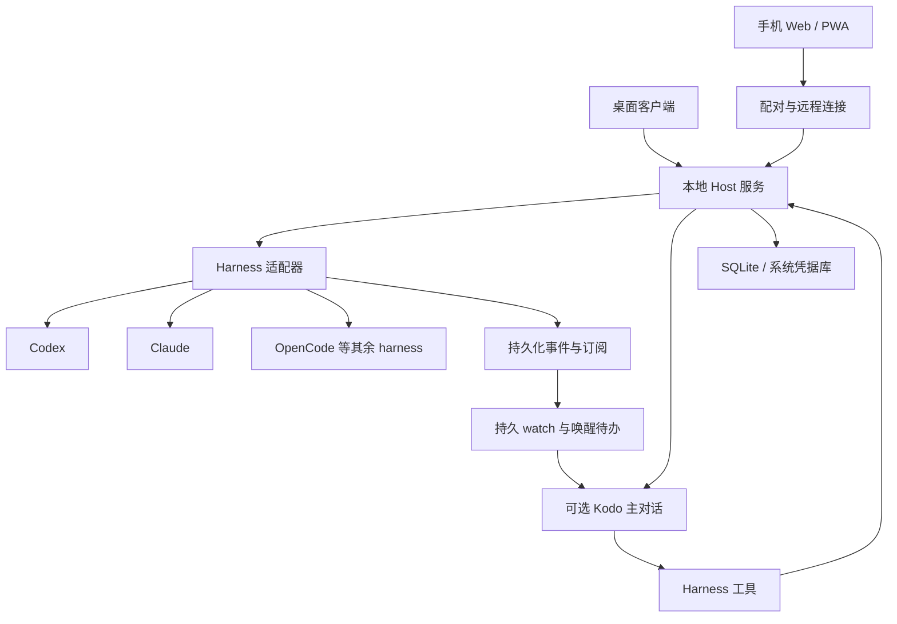

# Kodo Desktop 重新设计方案

日期：2026-11-10。状态：设计基线 + 开发实现中。工程、Host、React/PWA 与 Electron 源码已建立并构建通过；四种 harness 已通过真实对话与恢复，Kodo 六工具的 Codex 委派/事件唤醒闭环已通过。2026-11-12 新增 Provider 一键绑定：十种原生 Harness 中九种已有隔离配置映射，九种完成新绑定双轮真实回复；Gemini 经本地 Google→Chat 网关完成真实双轮与原生文件工具，普通 Cursor Agent 自定义接口未证实并禁用。Electron 本机启动与五种新绑定/默认值操作通过；真实任务关窗/退出 UI 后继续运行已验证。首轮 10 种的全部能力、打包和完整桌面场景仍待验收。实际实现、测试与限制以 [implementation-status](implementation-status.md) 和 [provider-configuration-verification.json](provider-configuration-verification.json) 为准。

## 阅读索引

| 要了解的内容 | 入口 |
| --- | --- |
| 整体产品、架构与边界 | 本文，按下方目录阅读 |
| 五平台应用、原生移动端、连接认证与构建验收 | [多端应用实现](multiplatform-plan.md)（鸿蒙暂缓；各平台验证独立记录） |
| 项目、harness、会话和主对话如何组织/显示 | [会话模型](session-model.md) |
| 当前实现、真实验收与剩余限制 | [实现状态](implementation-status.md) |
| 按功能逐项测试、原生 harness 验收与结果记录 | [测试大纲](test-plan.md) |
| 本轮执行结果、缺陷与未验收项 | [首批测试记录](test-results-2026-11-11.md) / [启动与消息操作复测](test-results-2026-11-11-fixes.md) |
| 模型/思考切换、待发修改与立即发送的实现和真实矩阵 | [最新模型与待发消息复测](test-results-2026-11-11-models.md) |
| 窗口/思考能力自动读取、字段来源与本轮十种状态矩阵 | [模型自动参数](model-parameters.md) / [验证记录](model-parameter-verification.json) |
| 本轮可靠性修复、GC、凭据与 Electron 环境诊断 | [修复记录](reliability-hardening.md) |
| 收件箱、时间线、接管、交接、预算等具体行为 | [功能设计](product-features.md) |
| 首轮 10 种 harness 范围与接入证据 | [接入清单](harness-catalog.md) |
| 从哪些目录和接口开始实现、哪些代码已存在 | [代码骨架设计](code-skeleton.md) |
| 交给其他 agent 的完整实现要求 | [实现 prompt](implementation-prompt.md) |
| UI baseline 的选择与源码提取边界 | [桌面 baseline](desktop-baseline.md) |
| 参考项目的源码分析与取舍 | [项目调研](research.md) |
| Provider、多协议、模型库参数来源与配置改造 | [配置专项调研](provider-configuration.md) / [专项来源清单](provider-configuration-sources.json) |
| 三层配置代码审计、公开模型库与独立在线更新 | [模型库来源实测](model-catalog-sources.md) / [抓取证据](model-catalog-sources.json) |
| 三层配置已实现范围、真实对话与网关限制 | [Provider 实现与验证](test-results-2026-11-12-providers.md) / [机器可读结果](provider-configuration-verification.json) |
| 固定提交、许可证和源码证据路径 | [参考源码清单](research-sources.json) |
| pi 来源、版本与 SDK 集成约束 | [pi 上游基线](upstream.md) |

## 本文目录

- [1. 产品与核心原则](#product)
- [1.1 项目、harness 与会话层级](#session-hierarchy)
- [2. 系统结构](#architecture)
- [3. Harness 适配器](#adapters)
- [4. 最小模型工具面](#tools)
- [5. 持续监控与自主推进](#supervision)
- [6. 已有会话的读取、恢复与监控](#existing-sessions)
- [7. 模型与 API 配置](#providers)
- [8. 用量、费用与额度](#usage)
- [9. 手机远程连接](#mobile)
- [10. 存储与代码目录](#storage)
- [11. 实施顺序与验收](#delivery)
- [12. 产品功能与交付边界](#scope)
- [13. 参考项目、协议文档与待验证项](#references)

<a id="product"></a>

## 1. 产品与核心原则

一个以 session 为中心的本地多 harness 桌面工作台：首轮完整接入 pi、Codex、Claude Code、DeepSeek Harness、ZCode、OpenCode、Gemini CLI、Cursor、Kimi Code、Grok Build，共 10 种，全部具有独立的新建、输入和会话入口。用户直接与任意 harness 对话，也可以让产品主 agent Kodo 监控已有会话、在其停止后继续，或从主对话发起委派。手机是同一工作台的远程客户端。范围与证据见 [接入清单](harness-catalog.md)。

Kodo 是产品主 agent，内核基于 pi SDK、SessionManager 和原生 agent loop；独立 pi harness 仍单独列出，属于首轮 10 种直接聊天入口之一。Kodo 使用独立的 kodo 身份，不冒称原生 pi。Session Host 负责进程与持久状态。直接聊天不经过 Kodo 推理。托管的主要工作是跟踪会话、等待真实事件、持久保存续接意图，按需唤醒 Kodo。无需先建立任务板、任务树或多代理工作流。

例如：“继续完成这个项目，用 Codex 实现，必要时让 Claude 帮忙审查。”Kodo 自己判断是否委派、如何拆分、如何核验。宿主只执行这些调用、保存状态并把完成事件送回来。目标是否完成由模型结合结果判断，用户随时可以接管。

保留 pi 的 agent loop、会话和上下文处理。产品不再增加任务分类器、角色推断、计划强制检查、工作流 DAG、多级记忆代理、自动审查代理或每轮注入的调度提示。额外规则只处理真实的进程、连接、并发和用户授权边界。

具有明确工作位置的 pi 会话默认获得 `read`、`write`、`edit` 和一种 shell 工具（Windows 优先评估 `powershell`，其他平台 `bash`）；主对话再装配小型 harness 工具。全局主对话无需项目或 cwd 就能管理会话，调用文件/命令工具时从已选定或已授权目标解析明确的 host/工作位置，不继承当前 UI 恰好打开的目录。检索类工具和扩展在实际需要时启用。用户可以配置提示词与 skills，宿主不通过持续改写提示词控制模型思考过程。

<a id="session-hierarchy"></a>

### 1.1 项目、harness 与会话层级

采用 **项目 → 会话** 的默认导航；harness 是会话的执行引擎属性，在列表中以标签和筛选显示。项目内可切换为“按 harness 分组”，形成项目 → harness → 会话的显示结构；harness 不拥有项目，分组不复制会话。

| 会话类型 | 放置位置 | 使用范围 |
| --- | --- | --- |
| 全局主对话 | 顶层“主对话”，不属于项目 | Kodo 管理用户选定的跨项目、跨 harness 会话 |
| 项目主对话 | 对应项目内 | Kodo 管理该项目内的会话；用户需要时才创建 |
| 普通会话 | 所属项目，或“未归属” | 任意一种 harness 直接聊天，pi 也可作为普通执行端 |

主对话可以按目标创建多个，管理关系独立于会话归属。例如全局主对话同时跟进项目 A 的 Codex 和项目 B 的 Claude，两个目标仍留在自己的项目中；主对话只展示关联卡片和简短事件，不生成“子会话副本”。

一个项目可绑定多个工作位置（host、目录或 worktree）；会话最多归属一个项目，实际执行位置单独记录。主对话的“全局”表示无项目归属，不表示自动取得全库托管权限。一个目标可被多个主对话观察，但同时最多由一个主对话自动续聊；用户直接输入会暂停该目标的自动续聊。

默认桌面为导航、会话列表、对话三栏。顶层主对话显示全局 Kodo 主对话；项目列表显示项目主对话与普通会话；全部会话、未归属、待处理和 harness 筛选提供不同查询入口。具体界面、创建流程、导入与归档语义、数据约束见 [会话模型](session-model.md)。

<a id="architecture"></a>

## 2. 系统结构

建议第一版采用 **Electron + React + TypeScript + 独立 Node Session Host + SQLite**。优先服务当前 Windows 环境，后续发布 macOS/Linux。选 Electron 是为了复用 pi 的 TypeScript SDK、Node 子进程和终端生态。UI 以 Craft Agents 的 tokens、消息组件和布局为 baseline 做有边界的提取；宿主参考 bb 的客户端／状态服务／执行边界，首版合并为一个本地 host，不搬入其完整平台。



桌面主进程负责窗口、托盘及 host 的发现/启动入口。host 独立于窗口存活，避免随 Electron 窗口或父进程退出被意外清理；Windows 进程树与打包后的实际行为必须单独验证。渲染进程只接收产品协议，不直接启动程序或持有 API key。host 持有 Kodo 主对话和独立 pi 会话、harness 进程、事件连接、配置和用量记录。桌面、手机、Kodo 工具共用同一套命令和事件语义，不给 Kodo 另开隐式写入通道。

直接选择 Codex 发送消息时，消息直接到 Codex 适配器，不额外消耗 Kodo 模型调用。只有打开主对话、启用托管，或事件需要模型判断时才唤醒 Kodo。

关闭窗口只断开 UI，可保留托盘与 host；“退出并停止任务”才显式停止运行。开机自动启动由用户设置。必须区分：UI 重连、host 重启后恢复原生 session、恢复终端布局、复活原执行进程。后三者不互相蕴含；电脑休眠或关机时本地主机无法继续执行，手机显示离线。

<a id="adapters"></a>

## 3. Harness 适配器

适配器只翻译协议，不替外部 harness 再造工具循环或上下文。保留各自的 thread/session ID、模型选择、原生工具信息和需要用户处理的交互。

每个适配器声明自身能力：创建、列出、读取、恢复、发送、运行事件、运行中引导、取消、审批响应、配置绑定、用量、额度。能力缺失时 UI 和模型明确看到“不支持”，不能把普通终端封装宣称为完整托管。

| Harness | 首选接入方式 | 首版范围与限制 |
| --- | --- | --- |
| 内置 Kodo | 基于 pi SDK、SessionManager 和原生 agent loop | 产品主 agent，装配六个产品工具；不计入以下 10 种原生 harness |
| pi | `@earendil-works/pi-coding-agent` SDK | 独立 pi 直接会话与基础工具，不装配 Kodo 管理工具 |
| Codex | 官方 `codex app-server`，本地 stdio | 初始化握手，thread 列表/读取/恢复，turn 输入和事件，原生交互；按安装版本探测协议 |
| Claude | Claude Agent SDK；本地 Claude Code CLI 另做适配 | SDK 支持流式事件与会话；CLI 历史和续接单独验证，不承诺可直接接管任意现有进程 |
| OpenCode | 官方 headless server / SDK | 根据已安装版本的 OpenAPI 接入；已核对页面为 V1，不能直接套给其他大版本 |
| DeepSeek Harness | `deepseek-ai/deepseek-harness` 原生 TS SDK / stdio JSON-RPC | 已核对 `DeepSeekHarness`、`run`、通知、`resumeSession`；采用 native SDK 的事件与状态语义。ACP 可选，但该快照不支持 `session/load` |
| ZCode | `zai-org/ZCode` 的 `app-server --stdio` | 已核对进程管理、能力协商与 v4 conversation/session 事件；固定协议版本。不是仅有终端的占位适配器 |
| Gemini CLI | 原生 ACP，经公共 ACP adapter | 注册表已确认入口；会话恢复、运行状态、交互与计量仍须实际验收 |
| Cursor | Cursor Agent CLI 的 ACP 入口 | 接 CLI harness；不把嵌入 Cursor 编辑器作为前提。已核对注册表的平台分发信息，未运行验证 |
| Kimi Code | 当前 Kimi Code 的 ACP 入口 | 使用当前产品标识 `kimi-code`；不混用注册表中标为 legacy 的旧 Kimi CLI |
| Grok Build | Grok CLI 的结构化 agent stdio 入口，经 ACP adapter | 已核对注册表；不是仅添加 xAI 模型 API 配置 |

Claude SDK 与本地 Claude Code CLI 在产品中区分展示和配置。SDK 集成默认走 API key；不把用户 Claude 订阅登录视为第三方 SDK 产品可直接共享的能力。

仅有交互式 CLI 的工具可以先通过 PTY 提供终端页。它能被人直接操作，但在缺少结构化完成信号、会话恢复和可验证输入接口时，不开放自动续聊。后续获得可靠协议后逐项增加能力。

一个安装可启动多个实例。实例绑定版本、Harness 配置和进程；会话绑定原生 ID、项目目录及实例。相同会话的写入通过同一队列串行化，多个独立会话可以并行。模型按需选择独立 Git worktree；不默认让多个实现任务同时修改同一个工作区。

统一的是会话控制和展示语义，不强迫所有原生协议走 ACP。能力表至少区分 `directChat`、`historyRead`、`resume`、`observeLive`、`observeExternal`、`steer`、`cancel`、`interaction`、`usage`、`quota`。每项包含支持状态、来源、已验证版本和限制；历史可读不能自动开启外部活动会话接管。

<a id="tools"></a>

## 4. 最小模型工具面

先采用六个产品工具，作为 pi `customTools` 或一个产品扩展注册；下表是拟定产品 API，不是 pi 上游现成接口。

| 工具 | 语义 |
| --- | --- |
| `harness_list` | 查询项目/工作位置、可用实例与能力；按项目、harness、状态分页查询会话 |
| `harness_open` | 在明确 project/workspace/host 上创建会话，或按原生 ID 恢复已有会话；返回统一 ID 与真实能力 |
| `harness_read` | 按游标读取会话消息、运行状态和结果；允许按需展开原始输出 |
| `harness_send` | 向指定会话发送消息；返回 accepted/queued 和 command ID，异步关联原生 run ID |
| `harness_watch` | 添加、更新或撤销管理关系与订阅；选择观察、用户通知或唤醒 Kodo，保存控制者和目标范围 |
| `harness_stop` | 明确选择取消本轮或停止并暂停托管；使相关自动待办失效，转发原生取消并跟踪结果 |

`harness_send` 明确发送方式：新一轮、支持时的 steer、或等待当前轮结束。调用回执不等于任务完成。`harness_watch` 注册时从指定游标重放已有事件，或补发目标 run 的已完成状态，避免先 send、后 watch 之间丢失快速完成的事件。

事件本身只携带来源、run ID、状态、简短结果和读取游标。完整对话和长日志由模型按需读取，避免每次唤醒复制所有子会话。普通直接聊天不安装调度订阅，也不触发额外模型评审。

模型可以决定再次委派、自己检查文件、回复用户或停止。宿主不强制“实现→审查→验收”的固定流程，也不根据关键词判定目标已完成。

<a id="supervision"></a>

## 5. 持续监控与自主推进

“持续”靠事件递送和状态恢复实现，不靠模型每隔几秒询问一次。一个托管记录只需要 Kodo 主对话、目标文本、目标会话、订阅游标、启停状态和用户设定的运行范围。

典型流程：

1. 用户在主对话提出目标，Kodo 打开 Codex 会话、发送任务并注册 watch。
2. Codex 输出实时进入 UI；Kodo 主对话可以结束当前轮并等待事件，不消耗空转推理。
3. 适配器收到对应 turn 的完成或失败事件，先记录，再递送一次待处理通知。
4. Host 唤醒原 Kodo 主对话：空闲时 prompt，执行中按 follow-up 语义排队；模型读取需要的上下文。
5. Kodo 根据结果选择继续发送、使用基础工具核验、请求用户输入，或解除 watch 并说明完成情况。

这里的“任务完成”不是原生 turn completed：后者只表示一轮结束，不能证明用户的整个目标已经完成。

只对用户启用托管的会话自动发送后续消息。监控有“仅观察”“通知我”“自动继续”三种模式；前两者不调用模型。明确的用户停止、订阅撤销和用户预算在宿主执行；不会因为模型再次请求而自动恢复。外部 harness 的审批和用户输入请求保持原生状态并展示到桌面/手机；启用托管不等于自动确认所有交互。

用户可设置结束时间、最大自动续聊次数和连续失败暂停阈值。达到限制后暂停新的自动调用并进入待处理收件箱；是否取消当前回合是单独设置。全局与项目主对话共享这些机制，首轮不让主对话自动续聊另一个主对话，避免相互唤醒循环。

工程上保留最小可靠性机制：

- SQLite 中保存事件收件箱、发送记录和消费游标，以 provider 原生事件标识去重；没有事件 ID 时使用可稳定定位的会话/运行/消息标识。
- watch 的消费状态与唤醒待办在同一事务提交，避免重启漏掉唤醒；模型输入附带稳定 event ID。
- 进程和网络边界不能承诺 exactly-once。发送后若崩溃而无法确认回执，标记结果未知，先读取原生会话对账；无可靠对账接口时交给用户处理，不盲目重复发送。
- 同一原生会话只有一个自动写入拥有者，可有多个只读观察者；用户发送新消息时暂停该目标自动续聊，显式重新启用前不恢复自动发送。
- 重连时从游标补齐事件，按原生状态重新对账。断线、超时或文本停止增长不代表完成。
- pi 本身以 `agent_settled` 判断已静止，不能把 `agent_end` 当作最终停止信号。

用户的“停止并暂停托管”首先在事务内暂停对应 supervision、递增 generation、撤销尚未发送的自动命令和唤醒待办，再向原生运行发送 cancel。所有迟到回执和出队命令校验 generation；已发往外部进程的命令不能假称撤回成功。用户显式重新启用才建立新 generation。单纯“取消本轮”与“停止并暂停托管”分别呈现，避免取消后自动续聊的歧义。依赖被停止目标的其他托管订阅也不能重新启动它。

每个 watch 保存目标 session、可选 run、起始游标、触发条件、通知目标、模式、generation 和消费位置。默认按指定 run 单次触发，持续监控由用户/模型显式选择；到期仅产生“超时/未知”事件，不能算完成。多个目标事件可以合并一次唤醒，但保留各自来源和消费记录。

这些机制属于消息递送和进程管理，不承担任务推理。第一版不增加定时“检查进度”的模型心跳；没有推送协议时，只允许适配器轻量查询状态。

<a id="existing-sessions"></a>

## 6. 已有会话的读取、恢复与监控

分开实现并展示三种能力：

| 模式 | 实际承诺 |
| --- | --- |
| 历史查看 | 通过官方 thread 列表与读取接口展示可见的已保存会话；读取不到不等于没有历史 |
| 恢复继续 | 用户选择会话，确认原生运行状态和工作目录后，在本软件拥有的 app-server 中恢复并继续 |
| 监控托管 | 对能获得可靠运行状态与事件、且写入拥有者明确的会话订阅完成事件并启用自动续聊 |

官方文档确认 `thread/list`、`thread/read`、`thread/resume`、`turn/start`、`turn/steer`、`turn/completed` 等接口；不据此假设一个独立 app-server 可以订阅另一个 Codex Desktop 进程的全部实时事件。

“监控我先前在 Codex 中启动、目前还在运行的任务”需要专项验证：该版本是否提供跨客户端状态和订阅，是否能确认任务最终状态，以及能否在原有写入者结束后安全取得续聊控制。如果不具备，则 UI 标明只读或需结束原运行后在本软件恢复。不能通过修改 Codex 内部数据库或直接追加会话文件实现续聊，也不能把文件不再变化当成成功完成。

第一版保证本软件启动/恢复的 Codex 会话可以闭环；外部正在运行的会话接管作为单独验收项，不与历史导入混在一起。

同样的三层能力适用于全部 harness。参考 Codeg，仅在原生协议覆盖不足时增加有版本约束的只读历史观察器，并标记信号来源；文件静默无法证明后台任务 settled。参考 ZCode，客户端 ACK/replay 只解决连接中断，不替代 host 的持久化。参考 CodexHost，可用通用 read/send 实现监控，但不能因其他产品能操作 Codex Desktop 就宣称官方 app-server 天然支持跨进程接管。

<a id="providers"></a>

## 7. 模型与 API 配置

配置目标为：**独立添加 Provider → 选择接口格式和 endpoint → 获取模型 → 从模型库补齐参数 → 应用到选定 harness**。Provider、模型目录和 Harness 绑定是唯一配置路径；会话直接固定绑定 ID 与修订。十种原生 Harness 中九种已有隔离映射，普通 Cursor Agent 的自定义 endpoint 仍无可靠证据并禁用。详细字段、实际双轮与待验证范围见 [配置专项调研](provider-configuration.md) 和 [最新验收](test-results-2026-11-12-providers.md)。

Provider 可有 OpenAI Chat Completions、OpenAI Responses、Anthropic Messages、Google Gemini 等明确协议的 endpoint，以及独立模型列表 URL。模型库逐字段保存窗口、最大输入/输出、modalities、思考类型/合法档位/映射、价格及来源/版本/时间。按最新要求，添加 Provider 的模型后自动补参，并允许手工修改；自动值与用户覆盖分层保存，刷新不覆盖手工值，可恢复自动。没有可靠值或覆盖值时保持未确认，不用产品默认数值冒充规格；运行必需参数缺失则阻止启动。原生本机配置、用户覆盖、聚合目录与官方运行报告明确区分来源。列表通常仅返回模型 ID，不能据此编造窗口、思考档位、调用授权或价格。

公开模型库采用 models.dev 的规范模型与 Provider 目录，并按路由补充原生协商资料。Host 独立刷新和保存目录修订，目录数据更新不依赖应用发版；已有会话绑定具体修订，不随刷新静默改变。可获取来源与边界见 [模型库来源实测](model-catalog-sources.md)。

协议匹配时使用原生直连；不匹配时通过经过验证的本地网关转换。网关只负责模型传输，不接管原 harness 的 agent loop、工具执行或压缩；转换方向和 text/tools/stream/cancel/reasoning/usage 等特性分别验收。没有可用路径时明确阻止应用，不能静默替换模型或路由。普通 Cursor Agent 的任意 Provider 注入仍待查证。

绑定顺序为：会话显式配置 > 项目为该 harness 设置的默认绑定 > 本机该 harness 的默认绑定 > 原生配置与登录。显式选择原生配置可覆盖默认值。会话固定引用创建时的绑定修订；更新绑定只影响后来创建的会话。

已有绑定会话可在声明范围内修改思考档位；原生会话按 harness 能力修改模型和思考档位，保留项目、工作位置及原生 ID。Host 以修订和稳定请求回执保存设置，在下一普通发送时冻结；当前轮/直接引导保持原设置，普通待发使用递送时的最新设置。各 harness 通过原生协议应用，不统一虚构模型目录或档位。能力与实测边界见上述最新复测矩阵。

宿主从固定的 Harness 绑定及 Provider 修订即时生成各 harness 支持的环境变量、启动参数或实例专用配置目录。需要全局状态的 harness 在适配器中明确限制多实例能力，不悄悄改写用户现有全局配置。提供商能力不兼容时直接说明原因，不偷偷替换模型。

API key 放入操作系统凭据库，SQLite 只存引用。传给子进程时只传该实例需要的凭据；手机、渲染进程、模型工具结果和常规日志均不返回原始 key。绑定归属一个 Harness；同一 Provider/模型可为多个 Harness 分别创建绑定，同一 Harness 也可开多个隔离实例。

<a id="usage"></a>

## 8. 用量、费用与额度

| 数据 | 来源与展示 |
| --- | --- |
| token 用量 | 原生事件或官方统计；分别记录 input、output、缓存和可用的其他分类 |
| API 费用 | 供应商实际金额优先；其次按已记录的模型价格修订估算，并标明“估算” |
| 本地预算 | 用户在产品设置的金额/token 限制；说明它是本产品的控制范围 |
| 供应商额度 | 有官方查询接口时显示额度窗口、剩余比例和重置时间；否则显示未知 |
| 订阅使用情况 | 独立展示原生订阅限额；不把按 API 标价估算的钱说成订阅实际账单 |

统计维度包含 harness、实例、绑定、模型、项目、会话和时间。Kodo 主模型自己的调度开销单独计入。统一事件有明确来源与计数范围，区分单轮增量和会话累计快照，重放、恢复及导入不会重复累计。

执行费用计入执行会话及发生时的项目；项目主对话费用归项目，全局 Kodo 管理费用单列。主对话关联多个项目时只提供引用汇总，不重复计费。项目、绑定 与托管预算共同约束自动调用，达到限制后暂停新调用并提醒用户。

费用估算按价格版本和计费分类计算；缺失类别保持未知，不能用零填充。共享账号在其他软件产生的用量可能影响供应商余额，因此本软件累计费用不能推算全账户剩余额度。

已核对 Codex app-server 提供 token usage 通知和账户 rate limits 接口，但仍应按版本及登录方式确认字段可用性。其他 harness 没有数据时保留空值和来源说明。预算控制是在发起下一次调用前执行，流式用量延迟可能造成超额，不能承诺精确到 token 的硬停止。

<a id="mobile"></a>

## 9. 手机远程连接

第一版做响应式 Web/PWA，共用桌面端的会话 UI。手机连接桌面 host，不直接连接各 harness，也不在手机保存供应商 API key。

先实现用户主动开启的局域网/自有安全隧道连接：配对二维码、短时配对码、可撤销设备凭据、加密传输。默认 host 只绑定本地；远程访问经过认证网关，不直接暴露原生 app-server 或 harness 端口。跨公网中继和通知推送留到后续按需求增加。

消息命令携带请求 ID，断线重试先查询接收状态；事件流使用服务端游标补齐。第一版离线手机不自动排队发送指令，避免恢复网络后过时任务突然执行。桌面和手机看到相同的运行状态、待处理交互和用量。

手机最小功能：查看与搜索会话、发送消息、选择主对话或直接 harness、处理原生交互、停止运行、启停托管、查看配置绑定及额度。应用离线时明确显示桌面未连接。

手机沿用同一会话归属与全局/项目主对话结构。远程执行 host 为单独扩展：若要求本机休眠后持续调度，执行会话和负责续接的 Kodo 主对话均需运行在可用 host 上。多 host 的路径、凭据与状态边界见 [功能设计](product-features.md)。

<a id="storage"></a>

## 10. 存储与代码目录

第一版以 SQLite 保存项目/工作位置、连接和实例、会话映射与类型、Provider/模型/绑定、事件/发送记录、管理关系/watch、设备配对和 usage。无需为每个概念建立独立服务。pi 原生会话文件和外部 harness 原生会话仍是各自上下文的权威来源；产品数据库仅保存索引、UI 投影和递送状态，不拼接替代原生历史。

最小持久化对象如下（拟定产品结构，不是上游接口）：

| 对象 | 关键字段与约束 |
| --- | --- |
| project / workspace | 项目独立于 harness；workspace 保存 `projectId? / hostId / rootPath / worktreeIdentity?`，路径不能跨 host 混用 |
| session | `id / harness / nativeSessionId / instanceId / hostId / projectId? / workspaceId? / kind / scope / ownerEpoch`；原生 ID 连同 host/安装或存储身份去重，恢复使用显式 ID |
| command | `id / sessionId / origin / generation / bindingRevision / nativeRunId / status`；状态含 accepted、dispatched、confirmed、unknown、rejected、cancelled |
| event | `sequence / sessionId / nativeEventId / runId / type / payloadRef / source`；稳定去重键与消费游标 |
| supervision / watch / wake | 控制者与目标、订阅范围、模式、generation、限制、消费位置和递送状态；目标的有效自动控制者唯一，事件消费与 wake 创建同事务 |
| session link | 交接/来源关系；不改变项目归属，不授予自动操作权限 |
| usage | 原生计数范围、来源 ID、计数类型、绑定修订、请求模型、实际计费模型、价格修订；未知字段允许 null |

session 的运行状态（idle/running/waiting-input/unknown）、连接状态（connected/reconnecting/offline）独立。每条管理关系保存模式 observe/notify/continue 与状态 active/paused/revoked；无关系显示未启用托管。每轮另存 completed/failed/cancelled 等结果；“用户目标完成”属于 Kodo 的判断，不覆盖执行事实。

发送顺序为：先持久接受命令 → 取得本 session 写入权并校验 generation → 发送到原生协议 → 保存回执与事件。持久接受不表示原生已收到。若崩溃发生在发送与回执之间，恢复进入 unknown，查询原生状态/历史后再决定；没有幂等能力时不自动重发。独占租约只能约束本 host 管理的写入者，不能凭本地锁排除另一个应用的写入。

日志和长输出按需引用或缓存；缓存可以重建。凭据独立于日志和会话保存。普通工作目录通过项目选择指定，产品状态写入用户应用数据目录，不能混入用户项目源码。

目标代码结构如下。当前已有根工程、`packages/protocol`、`packages/host`、`apps/desktop` 与 `apps/web` 的实现。以下结构为设计分层，不要求每个概念拆为独立服务；实际实现与未验收能力见 [实现状态](implementation-status.md)。接口和交接边界见 [代码骨架设计](code-skeleton.md)。

```text
apps/desktop/             Electron 窗口、托盘、生命周期
apps/web/                 桌面与手机共用的 React 界面
packages/host/            pi 集成、适配器、事件、配置与存储
  src/pi/                 SDK 装配和最小 harness 工具
  src/harnesses/          原生 adapters、公共 ACP adapter 与 10 种 harness 定义
packages/protocol/        客户端与 host 的命令、事件类型
vendor/pi/                固定版本上游源码
docs/                     设计和接入说明
```

先保持一个 host 包，不把调度、记忆、预算、消息分别做成框架，也不在未出现第二种实现前设计通用插件市场。

现有 SQLite/Host 初稿已扩展，应用包、锁文件、原生 adapters、pi SDK、事件/watch/wake、React/PWA 与 Electron 源码已建立。构建和领域/UI 测试通过不代表 10 种实机验收完成；最新证据与剩余工作见 [实现状态](implementation-status.md)。

<a id="delivery"></a>

## 11. 实施顺序与验收

| 阶段 | 范围 | 可验证的完成条件 |
| --- | --- | --- |
| 1 | Desktop + host + pi SDK | 配置一套模型，真实流式对话，基础工具可用，关闭重开可恢复，取消生效 |
| 2 | Codex 直接对话 | 新建/列出/读取/恢复 thread；消息、工具、交互和停止显示正确；保持原生 ID |
| 3 | 全部 10 种 harness 的直接聊天 | 原生 adapters 加公共 ACP adapter；分别验收新建、流式、工具展示、原生交互、停止、历史与恢复能力；不能只接模型 API 冒充原 harness |
| 4 | Kodo 监控与持续运行 | 可监控任意具备对应能力的会话；完成/失败事件唤醒 Kodo，模型决定下一步；仅通知不调用模型 |
| 5 | 托管持久化与已有会话 | 重启不盲目重发；停止后迟到事件不能重启托管；外部正在运行的会话逐 harness 验证 |
| 6 | 多绑定 + 用量 | 两实例不同配置互不污染；重连不重复计费；未知费用/额度不伪装成零 |
| 7 | 手机远程 | 10 种 harness 共用移动端聊天入口；配对、流式、断线补齐、交互、停止、暂停托管 |
| 8 | 会话中心与工作台完善 | 全局/项目主对话归属、搜索与收件箱、时间线、能力诊断、工作位置与成果、交接及预算按功能设计验收 |

以上阶段是同一轮交付内的工程依赖顺序，不是分批发布 harness。首轮完成标准为 10 种 harness 均可直接聊天，用户无需通过 Kodo 才能使用其他 harness。可以用 Codex 验证技术纵切，但不能以该纵切代替完整交付。实施时先核对 Craft 组件最小提取、原生协议与 ACP 版本，再按每种 harness 的能力分别验收监控、恢复和计量。

实现阶段重点验证：快速完成先于 watch 注册、重复完成事件、发送后崩溃、宿主重启、原生审批等待、用户与模型同时发送、多个配置隔离、停止后迟到事件，以及累计 token 快照重复投递。只在实际适配器与可靠性边界增加有价值的测试，不复刻旧运行时测试集合。

<a id="scope"></a>

## 12. 产品功能与交付边界

首轮完整交付除 10 种 harness 聊天外，还包含项目会话中心、全局/项目主对话、待处理收件箱、运行时间线、用户接管、健康/能力面板、工作位置与成果查看、配置隔离、三种监控模式、运行限制、跨 harness 交接、预算与手机访问。具体行为与验收见 [功能设计](product-features.md)。

跨 harness 交接创建新的原生会话，保留来源链接；不修改旧会话的 harness，也不宣称等同于原生恢复。项目整理不修改 cwd，管理关系不改变会话归属。原生能力缺失时明确显示限制。

首轮以一个本地独立 host 运行，手机作为同一 host 的客户端。多执行 host、电脑休眠后的远端持续调度作为明确设计的独立扩展；schema 保留 host 身份，但不以字段存在宣称已经支持。首轮不增加插件市场、固定任务工作流或完整 IDE。

<a id="references"></a>

## 13. 参考项目、协议文档与待验证项

### 13.1 参考项目链接与采用方式

以下为本轮研究的 12 个参考项目及 pi 内核。链接用于访问项目；具体源码事实以 [固定提交清单](research-sources.json) 为准，不假定上游 main 永远与本次检出一致。

| 项目 | 仓库链接 | 主要借鉴点与边界 |
| --- | --- | --- |
| pi | [earendil-works/pi](https://github.com/earendil-works/pi) | 智能内核、SDK、会话与基础工具；复用原生 agent loop |
| DeepSeek Superagent | [deepseek-ai/dsh-superagent-prototype](https://github.com/deepseek-ai/dsh-superagent-prototype) | 持久 effects、可靠递送、恢复与低干扰通知；不整体移植 ticket 工作流 |
| DeepSeek Harness | [deepseek-ai/deepseek-harness](https://github.com/deepseek-ai/deepseek-harness) | DSH 原生 SDK、session 事件与状态；优先原生集成 |
| ZCode | [zai-org/ZCode](https://github.com/zai-org/ZCode) | app-server、session 生命周期和重连；固定协议版本 |
| Magpie | [yetone/magpie](https://github.com/yetone/magpie) | 绑定、配置隔离、实际模型路由与计量来源 |
| bb | [get-bb/bb](https://github.com/get-bb/bb) | 客户端、状态和执行宿主边界，harness bridge 与统一时间线 |
| Codeg | [spacering-net/codeg](https://github.com/spacering-net/codeg) | 多 harness 接入、原生历史补充观察、桌面/web 共享传输边界 |
| CodexHost | [BytePioneer-AI/codex-host](https://github.com/BytePioneer-AI/codex-host) | read/send/watch、通知聚合、发送结果未知；补足撤销和停止语义 |
| Pebrel | [Kuddev/pebrel](https://github.com/Kuddev/pebrel) | 终端、窗口驻留和会话恢复的区别；不作为结构化聊天 UI 底座 |
| Craft Agents | [craft-ai-agents/craft-agents-oss](https://github.com/craft-ai-agents/craft-agents-oss) | 推荐 UI baseline：tokens、选定聊天组件与布局；保留许可归属、替换品牌 |
| Harnss | [OpenSource03/harnss](https://github.com/OpenSource03/harnss) | Claude SDK、Codex app-server、ACP 适配参考；重做窗口关闭时的运行生命周期 |
| Orca | [stablyai/orca](https://github.com/stablyai/orca) | daemon、客户端 detach、PTY 重连及远程执行边界 |
| CC Switch | [farion1231/cc-switch](https://github.com/farion1231/cc-switch) | provider 配置与多 harness 历史用量解析 |

源码复用前核对对应文件的许可证、NOTICE 和品牌要求；参考架构不等于复制整个项目。Craft、CodexHost、Pebrel 的代码复用边界尤其需要按各自许可处理，详见 [调研报告](research.md) 和 [baseline 决策](desktop-baseline.md)。

### 13.2 原生协议与接入文档

- [pi 上游 README](../vendor/pi/README.md)：最小可扩展 harness，扩展/skills，SDK 与 RPC。
- [pi SDK](../vendor/pi/packages/coding-agent/docs/sdk.md)：SessionManager、工具配置、事件与 settled 语义。
- [Codex App Server 官方文档](https://developers.openai.com/codex/app-server)，本次请求跳转到 [官方现址](https://learn.chatgpt.com/docs/app-server)：线程、运行、事件、原生交互和账户统计。
- [Claude Agent SDK 官方文档](https://code.claude.com/docs/en/agent-sdk/overview)：流式工具循环、会话、授权和第三方认证范围。
- [OpenCode V1 Server 文档](https://opencode.ai/v1/docs/server/)：headless HTTP、OpenAPI、配置和事件；实施时锁定版本后重新核对。
- [ACP 注册表](https://cdn.agentclientprotocol.com/registry/v1/latest/registry.json)：Gemini、Cursor、Kimi Code、Grok Build 等分发入口，已保存 [本轮四个条目的快照](harness-registry-snapshot.json)。存在注册条目不等于集成已通过。

### 13.3 实施前需要验证的边界

DeepSeek Harness 和 ZCode 已按用户给定仓库确认，原生协议已做源码核查。尚待实现阶段验证：各 harness 安装版本及协议兼容性；已有外部活动会话的观察与写入权转移；Windows 打包后 host 独立生命周期；手机局域网或隧道部署方式。源码存在接口不等于本产品已经集成通过。

其他参考与固定提交详见 [调研报告](research.md)、[baseline 决策](desktop-baseline.md) 和 [源码清单](research-sources.json)。
