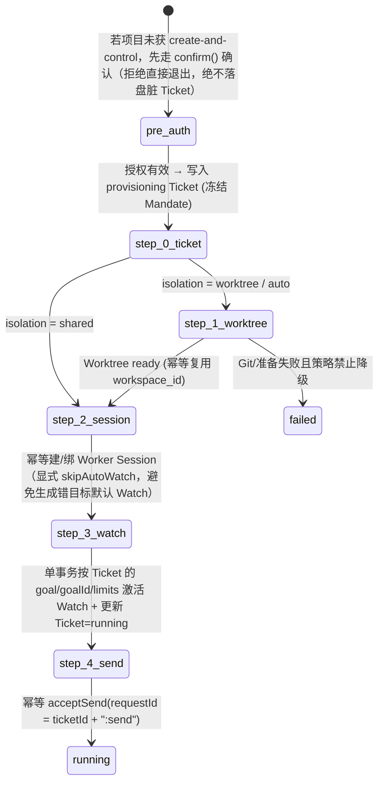

# Kooyu 下一代「一主多辅 · 端边协同」Agent 平台工程施工详单（Rev 2.2 定稿）

- **日期**：2026-11-19（Rev 2.2：完成 Phase 1A 编码前终审，补齐外键/软撤销联动、Monorepo 依赖防串库、`skipAutoWatch` 原子建联、批次接管重算与后台退出唤醒等全部工程边界）
- **状态**：施工定稿（可直接启动 **Phase 1A** 编码）
- **代码基线核实**：
  - 数据库：[schema.ts](../packages/host/src/storage/schema.ts) 当前为 `SCHEMA_V9`（`PRAGMA user_version = 9`），协议常量 `PROTOCOL_VERSION = 2`（[packages/protocol/src/index.ts](../packages/protocol/src/index.ts)）
  - 托管与授权现状：[session-service.ts](../packages/host/src/session-service.ts) 已持有 `watches`（含 `one_controller` 部分唯一索引）、`wakes`（`drainWakes`）、`records(kind='grant' | 'project-grant')`、`goals`；[permissions.ts](../packages/host/src/applications/permissions.ts) 持有 `authorization_grants`；[actions.ts](../packages/host/src/execution/actions.ts) 持有 `ActionJournal`
  - 线上 Relay：独立只读容器化 `kooyu-relay` + Caddy HTTPS 反向代理（详见 [deploy/kodo-relay/README.md](../deploy/kodo-relay/README.md)）

---

## 1. Rev 2.2 核心架构收敛总表（5 大阻断项 + 5 处施工终审补丁）

针对源码级交叉审查暴露的重叠与边界冲突，本版统一收敛如下，**严禁在现有系统外长出第二套平行状态机**：

| 决策域 | 源码核验暴露的冲突 / 暗坑 | Rev 2.2 最终工程决议 |
| :--- | :--- | :--- |
| **1. 模型收敛与 `SCHEMA_V10`** | `delegation_tickets` 与 `watches`/`goals`/`project-grant` 重叠；`worker_session_id UNIQUE` 阻断二次返工；`project-grant` 软撤销会污染 `snapshot()` 与 `createManagedDraft`；`workspace_worktrees.project_id` 外键会炸毁 `deleteProject()` | ① **`watches` 继续作为运行期控制权的唯一权威源**，`delegation_tickets` 仅作工单契约与汇报归档（外键关联 `watch_id`）；<br>② 去掉 `worker_session_id` 全局唯一约束，改为**活跃态部分唯一索引** `WHERE status IN ('provisioning','running','awaiting-review')`；<br>③ `workspace_worktrees.project_id` 显式加 `ON DELETE SET NULL` 并在 `deleteProject()` 中同步解绑与取消活跃 Ticket；<br>④ 为 `project-grant` 补齐单调递增 `revision`/`generation` 与 `revoked` 软撤销标记，`snapshot().projectGrants` 与 `createManagedDraft` 统一过滤 `!revoked`，`deleteProject()` 同步改为软撤销；<br>⑤ 同步扩展 [index.ts](../packages/protocol/src/index.ts#L450-L457) `watchSchema.shape.limits` 与 [tools.ts](../packages/host/src/kodo/tools.ts#L142-L153) TypeBox `limits`，加入 `maxTotalTokens` 熔断上限。 |
| **2. `noWait`、进程树排空与汇报边界** | 对 pi SDK 内置 shell 包 `Promise.race` 会打坏 `ActionJournal`；自动转后台后若无退出唤醒则结果静默丢失；重启后用旧 PID `taskkill` 会因 Windows PID 复用误杀进程；外部 Harness 无统一测试退出码 | ① 仅针对 `kodo` 主对话（保留独立 `pi` 原貌），以自建 **`BackgroundJobManager`**（`shell_exec` + `job_status`/`job_output`/`job_kill`）替代内置 `powershell`/`bash`，默认前台等待阈值 **`12s`**；自动转后台的一次性命令默认 `notifyOnExit = true`（退出时单次轻量唤醒主对话汇报结果），显式 `background: true` 常驻服务默认 `false`；<br>② Host 重启初始化时将遗留 `running` 作业一律标为 `lost`（**严禁拿重启前旧 PID 执行 `taskkill`**）；`kodo-tools-read` 严禁放行 `shell_exec` 与 `job_kill`；<br>③ 运行期内 Windows 采用 **`taskkill /PID <pid> /T /F`** 终止进程树；Worktree 清理遇 `EBUSY/EPERM` 标为 `deleting` 交由后台定时 GC 重试；<br>④ `DelegationReport` 严格区分 **Host 确定性事实**（分支、`git diff --stat`、`goal.check` 真实退出码）与 **Worker 自述摘录（显式标记 `unverified`）**。 |
| **3. Worktree 准备、同盘短路径与远程权限矩阵** | 放 `C:\...\AppData` 跨盘且超 260 字符；**Monorepo（含 Kooyu 自身）直接 Junction `node_modules` 会静默串库且 `npm ci` 会毁主仓**；旧 `createWorktree` 未整合；远程权限未定义 | ① **同盘短路径默认策略**：默认在主仓库同盘父级创建 `<repoParent>/.kooyu-wt/<repoSlug>-<8charId>`（零跨盘、路径 `<60` 字符），支持项目自定义 `worktreeRootPath`；<br>② 收编旧 [artifacts.ts:createWorktree](../packages/host/src/workspaces/artifacts.ts#L68-L76)，引入 `preparing → ready → failed → deleting → archived` 状态机；依赖策略默认安全模式 `none`，支持项目显式配置 `none | junction | prepare-command`，**检测到 Monorepo（`workspaces`/仓内软链）强制禁止 `junction`**；<br>③ 工作区写操作加互斥锁 `WorkspaceMutex`，Worktree 合入前强制校验主工作区干净；<br>④ 全部新能力纳入 [clients/access.ts](../packages/host/src/clients/access.ts) 三级权限矩阵（破坏性 `Discard` / 强删需显式二次确认与审计）。 |
| **4. Phase 2 沙盒源隔离、单 Context 接管与 PTY 打包** | 同域代理开发服撞死 Relay/Host CSP 且静态绝对路径 404；浏览器接管重启 Context 丢登录态；`node-pty` 原生编译踩坑 | ① **Artifact 与本地端口预览强制走独立沙盒 Origin**：本机采用独立随机 loopback 端口（`http://127.0.0.1:<sandboxPort>`）+ Electron 隔离 `partition`；公网 Relay 采用独立泛解析沙盒域名（如 `<token>.preview.example.com`，绝不与 `relay.example.com` 共享 Cookie/Origin）；<br>② 浏览器改为 **同一 Persistent `BrowserContext` 内基于 CDP Screencast 无重启切换控制权**，网络路由仅限制主文档（`request.isNavigationRequest() && frame === page.mainFrame()`）白名单并放行静态子资源；录制严格脱敏 `password`/Cookie/Token；<br>③ Phase 2 开工前先做 Node 24 + Electron 39 下 `node-pty` / Windows ConPTY 打包独立验证（PoC）。 |
| **5. Phase 3 Relay v2 二进制分流、离线鉴权与 Intake 收敛** | JSON+Base64 单连接跑流媒体触发 `4013` 断线风暴；离线信箱无鉴权可被 DoS 且存在离线期设备撤销窗口；`Intake` 与 `WebhookService` 重复造轮子；WebPush 平台限制 | ① Relay v2 升级为 **二进制多路复用帧（Control 高优通道 + Stream 可丢帧背压通道）**；<br>② 配对时向 Relay 同步注册轻量 **设备投递验证公钥（Device Mailbox Key）**，未签名请求拒绝入箱；**Host 重连拉取信箱时按本机最新有效设备表二次过滤，直接丢弃离线期间已撤销设备的密文**；挂载独立卷持久化 VAPID 密钥；诚实界定 Web PWA vs 原生 App 的 E2EE 威胁边界与各平台免证推送主备通道；<br>③ **不新建平行 Webhook 表**：`IntakeFilter` 直接收编现有 [webhooks.ts](../packages/host/src/automations/webhooks.ts)，`propose` 复用现有 `Inbox`，回发复用现有 [outbox.ts](../packages/host/src/messaging/outbox.ts)，IM 严格校验 `ownerExternalUserId` 白名单；语音先落地带 WebRTC/浏览器 AEC 回声消除的流式对话轨。 |

---

## 2. 数据库 `SCHEMA_V10` 与状态机精确规格

### 2.1 `SCHEMA_V10` DDL（追加至 [schema.ts](../packages/host/src/storage/schema.ts) 并在 [store.ts](../packages/host/src/storage/store.ts) `version < 10` 执行迁移前备份）

```sql
-- Managed Git worktrees with explicit preparation & deferred GC lifecycle
CREATE TABLE IF NOT EXISTS workspace_worktrees (
  workspace_id TEXT PRIMARY KEY REFERENCES workspaces(id),
  parent_workspace_id TEXT NOT NULL REFERENCES workspaces(id),
  project_id TEXT REFERENCES projects(id) ON DELETE SET NULL,
  branch_name TEXT NOT NULL,
  base_ref TEXT,
  base_commit TEXT,
  lifecycle_state TEXT NOT NULL CHECK (
    lifecycle_state IN ('preparing', 'ready', 'failed', 'deleting', 'archived')
  ),
  last_error TEXT,
  created_at TEXT NOT NULL,
  updated_at TEXT NOT NULL,
  data TEXT NOT NULL
);
CREATE INDEX IF NOT EXISTS workspace_worktrees_parent
  ON workspace_worktrees(parent_workspace_id, lifecycle_state);

-- Structured delegation tickets bound to authoritative watches (multiple sequential tickets per worker allowed)
CREATE TABLE IF NOT EXISTS delegation_tickets (
  id TEXT PRIMARY KEY,
  batch_id TEXT,
  controller_session_id TEXT NOT NULL REFERENCES sessions(id),
  worker_session_id TEXT REFERENCES sessions(id),
  watch_id TEXT REFERENCES watches(id),
  goal_id TEXT,
  status TEXT NOT NULL CHECK (
    status IN ('provisioning', 'running', 'awaiting-review', 'completed', 'blocked', 'cancelled', 'failed')
  ),
  wait_policy TEXT NOT NULL DEFAULT 'all' CHECK (wait_policy IN ('any', 'all')),
  mandate TEXT NOT NULL,
  provisioning_step TEXT NOT NULL,
  report TEXT,
  created_at TEXT NOT NULL,
  updated_at TEXT NOT NULL
);
-- Only ONE active ticket may drive a given worker session at a time; historical tickets remain for audit
CREATE UNIQUE INDEX IF NOT EXISTS one_active_ticket_per_worker
  ON delegation_tickets(worker_session_id)
  WHERE worker_session_id IS NOT NULL AND status IN ('provisioning', 'running', 'awaiting-review');
CREATE INDEX IF NOT EXISTS delegation_tickets_controller
  ON delegation_tickets(controller_session_id, created_at);
CREATE INDEX IF NOT EXISTS delegation_tickets_batch
  ON delegation_tickets(batch_id) WHERE batch_id IS NOT NULL;

-- Durable background shell jobs managed by Host (replaces raw SDK shell blocking in kodo supervisor)
CREATE TABLE IF NOT EXISTS background_jobs (
  id TEXT PRIMARY KEY,
  session_id TEXT NOT NULL REFERENCES sessions(id),
  workspace_id TEXT REFERENCES workspaces(id),
  status TEXT NOT NULL CHECK (status IN ('running', 'exited', 'killed', 'lost')),
  created_at TEXT NOT NULL,
  updated_at TEXT NOT NULL,
  data TEXT NOT NULL
);
CREATE INDEX IF NOT EXISTS background_jobs_session ON background_jobs(session_id, status);

-- Unified intake deduplication & IM channel bindings (Phase 3, created in V10 to avoid back-to-back DB migrations)
CREATE TABLE IF NOT EXISTS intake_events (
  id TEXT PRIMARY KEY,
  source_kind TEXT NOT NULL,
  source_id TEXT NOT NULL,
  external_id TEXT NOT NULL,
  disposition TEXT NOT NULL CHECK (disposition IN ('context-only', 'observed', 'proposed', 'dispatched', 'dropped')),
  created_at TEXT NOT NULL,
  data TEXT NOT NULL,
  UNIQUE(source_kind, source_id, external_id)
);
CREATE INDEX IF NOT EXISTS intake_events_created ON intake_events(created_at);

CREATE TABLE IF NOT EXISTS im_channels (
  id TEXT PRIMARY KEY,
  kind TEXT NOT NULL,
  status TEXT NOT NULL,
  data TEXT NOT NULL
);

PRAGMA user_version = 10;
```

> **数据迁移补丁（`migrateV10`）与联动改造点**：
> 1. 扫描 `records` 表中所有 `kind = 'project-grant'` 的记录，原地补齐默认值 `{ revision: 1, generation: 1, revoked: false }`；
> 2. 升级 [session-service.ts](../packages/host/src/session-service.ts#L3466-L3491) 的 `grantProject()`：撤销时软更新 `{ revoked: true, revision: prev.revision + 1, generation: prev.generation + 1 }`，不再物理删除记录；
> 3. **消费端全量同步过滤**：[snapshot()](../packages/host/src/session-service.ts#L390) 中 `projectGrants` 必须 `.filter((g) => !g.revoked)`（防止已撤销授权污染 Web/Android/iOS 客户端）；[createManagedDraft()](../packages/host/src/session-service.ts#L3525) 必须同时校验 `!policy?.revoked`；[deleteProject()](../packages/host/src/session-service.ts#L1747-L1761) 必须同步将关联 `project-grant` 软撤销（不再物理 `remove`）、置空 `workspace_worktrees.project_id` 并取消该项目下活跃 `delegation_tickets`；
> 4. **协议 Schema 同步**：在 [packages/protocol/src/index.ts](../packages/protocol/src/index.ts#L450-L457) 的 `watchSchema.shape.limits` 与 [tools.ts](../packages/host/src/kodo/tools.ts#L142-L153) 的 TypeBox `limits` 同步新增 `maxTotalTokens`（避免 `watchSchema.strict()` 校验报错）。

---

## 3. 核心工程机制详细规格（消除全部实现盲区）

### 3.1 `harness_delegate` 分段幂等状态机与崩溃恢复
一条 `harness_delegate` 调用可能跨越文件系统与 SQLite 操作，绝不能裸写无回执的串联调用。采用以 `ticketId = stableRequestId(controllerId + ":delegate", toolCallId)` 为主键的 **4 阶段可重入状态机**：



- **与 `createManagedDraft()` 的原子收敛**：核实 [session-service.ts](../packages/host/src/session-service.ts#L3525-L3533)，现有 `createManagedDraft()` 在 `project-grant.mode === "create-and-control"` 时会隐式自动建一条仅带 `policy.goal` 的 Watch。`harness_delegate` 在 `step_2_session` 必须传 `skipAutoWatch: true`（或将 Ticket 的 `goal / goalId / limits / trigger` 原子传入同一建联事务），杜绝“先建错 Watch 再覆盖”或撞上 `one_controller` 冲突；`watch.trigger` 按目标适配器能力声明自动选择（仅对支持 `settled` 的适配器用 `settled`，其余保持 `turn-ended`）。
- **崩溃恢复对账**：Host 启动或工具重试时，若发现 `status = 'provisioning'` 的 Ticket：
  - 若停在 `step_1_worktree`：检查 `<wtPath>` 是否已存在有效 Git worktree，不完整则 `git worktree prune` 后清理并标为 `failed`（不盲目静默继续未确认的半成品副作用）。
  - 若停在 `step_2_session` 或 `step_3_watch`：凭确定性子键 `${ticketId}:open` 找回已建会话，补完 Watch 事务或安全回滚。
  - 若停在 `step_4_send`：检查 `commands` 表是否已存在 `${ticketId}:send`，未入队则补齐或将 Ticket 标为待主控确认。

### 3.2 多任务合并唤醒（Batch Coalescing Wake）与 `Mandate` 复核
升级 [session-service.ts](../packages/host/src/session-service.ts#L3392-L3457) 中的 `drainWakes()`：
1. **恢复前强制 `revalidateMandate(ticket)`**：
   - 核验对应 `project-grant` 当前 `revoked === false` 且 `generation === ticket.mandate.projectGrantGeneration`（若用户曾撤销又重新授权，旧代次工单自动暂停等待人工确认）；
   - 核验 `SupervisionLimits`：**同时检查 `endAt`、`maxContinuations`、`maxFailures`、`budgetUsd`（仅在已知价格时）以及新增的 `maxTotalTokens`（累加 `input + output + cacheRead + cacheWrite`，对任何自定义/中继模型 100% 生效！）**。
2. **批次合并唤醒机制（`batchId` + `waitPolicy` + 去抖合并 + 接管重算）**：
   - 当主 Agent 一次派发多个并行子任务（如 `harness_delegate` 传入 `tasks: [...]` 数组生成同一 `batchId`，默认 `waitPolicy = "all"`）时：
     - **异常直通**：任一子会话进入 `waiting-input`（需审批/提问）或超限 `failed`，立即优先唤醒或推入收件箱，不傻等慢任务；
     - **全员汇合与人工接管重算（`waitPolicy = "all"`）**：其余正常结束回合的 `wake` 保持 `pending`，仅等待同 `batchId` 下仍处于 **`state === 'active'`** 的活跃 `watch` 均抵达回合终点（或达到最长汇合等待上限 `30m`），即**一次性打包为单条 `type: "harness-batch-report"` 命令唤醒主对话**，内含每个子会话的 `DelegationReport` 数组。**若中途任一子任务的 `watch` 因用户手动发言转为 `paused` 或被 `revoked`/`cancelled`，立即触发一次 `drainWakes()` 重算批次完成条件（并在报告中注明该成员已由人工接管，绝不白等 30 分钟）！**
     - **持久时间戳 + `workTimer` 刷出 + 确定性合成幂等键**：在 `wakes.data` 中持久化 `createdAt`，由现有 `workTimer`（1s tick，[session-service.ts](../packages/host/src/session-service.ts#L270-L282)）驱动 `1500ms` 同主控瞬时去抖到期与 `30m` 批次汇合上限刷出（Host 重启不丢失状态）；合并 N 条 `wake` 为单条命令时，使用 `stableRequestId("batch-wake", sortedWakeIds.join(","))` 作为合成 `commandId`，并在**同一 SQLite 事务**内写入该合成命令且将全部 N 条 `wake` 标为 `dispatched`。

### 3.3 `DelegationReport` 事实分级结构（严守验证铁律）
宿主为每次唤醒生成的 `DelegationReport` 严格划分可信等级：
```ts
export interface DelegationReport {
  ticketId: string;
  workerSessionId: string;
  harnessId: HarnessId;
  branchName: string | null;
  isolation: "worktree" | "shared";
  /** Deterministic facts computed directly by Host via Git */
  gitFacts: {
    git: boolean;
    baseCommit: string | null;
    headCommit: string | null;
    dirtyCount: number;
    diffStat: { filesChanged: number; insertions: number; deletions: number; paths: string[] };
  };
  /** Authoritative checks executed by Host (goal.check) — ONLY these prove verification */
  hostVerifications: { id: string; command: string; exitCode: number; passed: boolean }[];
  /** Untrusted worker output summary — NEVER treated as verified completion */
  workerClaim: {
    verification: "unverified-worker-claim";
    nativeStatus: string;
    lastOutcome: string | null;
    lastError: string | null;
    replyExcerpt: string | null;
    openInteractions: number;
  };
}
```

### 3.4 `BackgroundJobManager`（主 Agent `noWait` 护栏）与 Windows 进程树治理
1. **替换 `kodo` 内置阻塞 Shell（[kernel.ts](../packages/host/src/kodo/kernel.ts#L258-L276)）**：
   - 仅针对 `productSession.harnessId === "kodo"`（独立 `pi` 保持 SDK 原生行为不变），移除 SDK 内置 `powershell`/`bash`，注入宿主受管工具：
     - `shell_exec({ command, cwd?, background?: boolean, yieldMs?: number, notifyOnExit?: boolean })`：默认 `yieldMs = 12000`（12 秒，避免 Windows 上常规 `git`/`tsc --version` 误转后台；模型明知是长测试/dev server 可直接传 `background: true` 0 秒返回）。
     - 若在 `yieldMs` 内退出：直接通过 `ActionJournal` 确认并返回完整退出码与输出；
     - 若超 `yieldMs` 仍在运行：持久化写入 `background_jobs` 表（环形缓冲区保留最近 `256 KB` 输出），`ActionJournal` 确认记录 `{ spawnedJobId }`，向主 Agent 返回 `{ status: "running", jobId, pid, recentOutput, notifyOnExit }`，主 Agent 立刻恢复空闲响应用户！
     - **后台作业完成自动唤醒（`notifyOnExit`）**：超 `yieldMs` 自动转后台的一次性命令默认 `notifyOnExit = true`（退出时向所属主对话投递单次轻量唤醒命令，附退出码与末尾输出，避免主对话静默忘记汇报结果）；显式 `background: true` 启动的常驻服务（如 dev server）默认 `notifyOnExit = false`。
     - 配套只读/控制工具：`job_status({ jobId })`、`job_output({ jobId, tailBytes? })`、`job_kill({ jobId })`。
   - **权限模式与重启安全收敛**：
     - 对齐 [kernel.ts](../packages/host/src/kodo/kernel.ts#L312-L329) 的 `setPermissionMode`：`kodo-tools-none` 禁用全部工具；`kodo-tools-read` 仅放行只读工具（`read` / `job_status` / `job_output`），**绝不放行 `shell_exec` 与 `job_kill`**；
     - **重启后旧作业只标 `lost`、绝不复用旧 PID 强杀**：`BackgroundJobManager` 启动初始化时将 `background_jobs` 中残留的 `status = 'running'` 一律置为 `'lost'`，**严禁拿重启前记录的旧 PID 调用 `taskkill`**（Windows 会快速复用 PID，存在误杀系统或其他进程风险）。
2. **运行期 Windows 进程树终止与 Worktree 延迟垃圾回收（Deferred GC）**：
   - 仅针对**当前 Host 进程生命周期内亲自 spawn 且仍存活**的子进程终止：POSIX 使用负 PID 进程组 `process.kill(-pid, "SIGTERM" -> "SIGKILL")`；Windows 调用 `execFile("taskkill", ["/PID", String(pid), "/T", "/F"], { windowsHide: true })`。
   - `WorktreeService.cleanup(workspaceId)` 执行顺序：
     1. 检查是否有绑定该 `workspaceId` 的运行中 `Session`、`BackgroundJob` 或 `PTY`，若有且非强制取消则返回 `CONFLICT`；
     2. 状态置为 `deleting`，若存在宿主创建的 `node_modules` 软链，先 `lstat` 校验 `isSymbolicLink()` 再 `unlink`/`rmdir` 仅解除软链本身（**绝不穿透删除源仓库 `node_modules` 内容**）→ `git worktree remove --force <wtPath>` → 删除残余空目录；
     3. 若因外部防病毒/LSP 句柄触发 `EBUSY` / `EPERM`，保留 `lifecycle_state = 'deleting'` 不抛致命异常，由 `SessionService.maintenance()` 及每 `60s` 轻量 GC 队列自动重试清理。

### 3.5 `WorktreeService` 同盘短路径、安全依赖准备与写锁保护
1. **同盘短路径算法**：
   - 默认路径：`resolve(dirname(primaryRoot), ".kooyu-wt", `${slugify(basename(primaryRoot)).slice(0, 16)}-${shortId8}`)`（例如主仓 `D:\dev\agent-harness` → Worktree `D:\dev\.kooyu-wt\agent-harness-7f3a9c12`）。同盘符保证低开销、零 C 盘占用、总长 `<60` 字符；同时支持项目级设置覆盖 `worktreeRootPath`。
2. **环境准备约定（`preparing → ready`）与 Monorepo 防串库红线**：
   - **依赖准备策略（默认安全保守，支持 `dependencyMode: "none" | "junction" | "prepare-command"`）**：
     - **默认 `none`**：不自动修改 `node_modules`，防止跨仓污染；
     - **Monorepo 自动禁链保护**：检测到主仓存在 `package.json#workspaces`、`pnpm-workspace.yaml`、`lerna.json`，或主仓 `node_modules` 中含指向仓库内部的符号链接（包括 Kooyu 本仓）时，**强制禁止 `junction` 模式**（否则 Worktree 内 `import` 会静默加载主仓旧构建，且 Worker 执行 `npm install`/`npm ci` 会直接删改主仓及其他并行 Worktree 的依赖！），引导改用项目显式配置的 `prepareCommand`（如 `npm ci --offline` / `pnpm install --prefer-offline`）；
     - **非 Monorepo 显式 opt-in `junction`**：仅在非 Monorepo 项目由用户显式开启时创建 Windows Junction（`symlink(src, dst, "junction")` 免管理员权限；POSIX `symlink(src, dst, "dir")`），并在派发任务书中注入只读提示（若需增删依赖，须先移除软链再独立安装）。
   - **环境文件白名单**：默认不复制任何未跟踪隐私文件；项目可在设置中显式勾选允许同步至 Worktree 的配置文件名列表（如 `.env.local`、`.npmrc`）。
   - **非 Git 目录处理**：若 `isolation = "auto"` 且目录非 Git 仓库，自动回退为 `shared` 并在 `DelegationReport` 标注；若用户显式要求独立 Worktree 则明确报错提示先 `git init`。
3. **并发写锁与安全合并护栏**：
   - 内存级 `WorkspaceMutex` 按 `workspace.id` 串行化 Git Stage / Hunk Apply / Discard / Commit / Merge 操作；若该工作区当前有 `running` 态会话正在写入，拒绝手工 Hunk 修改并提示先暂停会话。
   - `mergeWorktree` 前强制检查主工作区 `git status --porcelain --untracked-files=no` 必须为空；若主工作区存在未提交修改，拒绝直接合并并返回 `PRIMARY_WORKSPACE_DIRTY`（引导用户先提交主工作区，或直接将 Worktree 分支推送远端创建 PR）。

---

## 4. 远程访问权限矩阵更新（扩展 [clients/access.ts](../packages/host/src/clients/access.ts)）

严守现有 Host 安全分级（`LOCAL_ONLY` 本机管理员、`EXPLICIT_DELEGATION` 需桌面显式勾选授予某台手机、`PAIRED` 已配对设备默认可用）：

| 新增操作权限键 | 级别 | 安全理由 |
| :--- | :--- | :--- |
| `mcp.local.manage` | `LOCAL_ONLY` | 本地 `stdio` MCP 可在宿主机执行任意 `npx`/`node`/`python` 命令，严禁从远程设备新增或篡改命令参数；且 Phase 1 **仅挂载给 Kooyu 主 Agent**（经 `AuthorizationGrant` + `ActionJournal` 审计），不绕过宿主直接注入外部 CLI 配置 |
| `terminal.access` | `EXPLICIT_DELEGATION` | 交互式 PTY 等同宿主机 Shell，配对手机默认关闭，必须在本机「手机连接 → 设备权限」显式为该手机开启后方可使用 |
| `workspaces.git.push` | `EXPLICIT_DELEGATION` | 向远端仓库推送分支与创建外部 PR 涉及外部凭据副作用，需设备获授委托或通过 `Outbox`/对话审批执行 |
| `workspaces.git.local` | `PAIRED` | 在已绑定项目工作区内执行本地 Stage / Hunk 采纳 / 本地 Commit / 本地新建隔离 Worktree，允许已配对手机直接操作（受 `WorkspaceMutex` 保护）；不可逆的 `Discard` 与强制清理 Worktree 须要求显式二次确认与审计日志 |
| `preview.read` | `PAIRED` | 查看隔离沙盒 Artifact 与已在本机显式开启共享的本地开发端口预览 |
| `im.manage` | `LOCAL_ONLY` | 绑定/解绑微信 ClawBot、企微、飞书、Telegram 凭据及修改 `ownerExternalUserId` 白名单仅限本机操作 |

---

## 5. Phase 2 & Phase 3 关键安全护栏规格

### 5.1 独立沙盒源（Artifact & 本地开发服预览零 XSS 泄露）
- **本机 Desktop / Web**：启动一个绑定 `127.0.0.1:0`（随机独立端口）的纯预览 HTTP 服务，配置独立 Origin CSP（允许沙盒内脚本与自身静态资源 `/assets/*`，严禁携带主 API 端口 Cookie）；Electron 额外使用独立内存 `partition="sandbox:preview"`。
- **公网 Relay（Phase 3）**：绝不在 `relay.example.com/h/<id>/...` 下放开脚本执行；Caddy 单独配置泛域名（如 `*.preview.example.com`）映射到短时一次性预览令牌路由，从浏览器同源策略根源隔离主站凭据。

### 5.2 受管浏览器单 Context 无重启接管与脱敏录制
- **单 Context 控制权流转**：废除人工接管时 `closeContext()` 重启的做法，保持单一持久无头/后台 `BrowserContext`，通过 CDP `Page.startScreencast` 向前端推流，并将前端鼠标/键盘事件仅在 `lease.owner === "user"` 时转发至 `Input.dispatchMouseEvent` / `dispatchKeyEvent`。
- **精准网络拦截**：`context.route` 仅对顶层文档导航（`route.request().isNavigationRequest() && route.request().frame() === page.mainFrame()`）校验 Origin 白名单（静态 JS/CSS/图片/字体 CDN 子资源随主页面正常加载）；当 `lease.owner === "user"` 接管登录时临时放行第三方 SSO/OAuth 域名跳转，交还 `agent` 时校验当前停留域名并恢复锁死。
- **示教录制脱敏铁律**：忽略一切 `input[type="password"]`、`autocomplete="one-time-code"`、Authorization Header 及 Cookie 值，在生成的 `SKILL.md` 中统一替换为占位符 `{{需要人工登录或授权环境}}`。

### 5.3 Relay v2 二进制多路复用、离线信箱验签与免证推送分级
1. **二进制分流帧与背压丢帧**：WSS 升级 `/v2/host` 二进制协议帧 `[1B frameType][4B streamId][1B priority][payload]`：
   - `Control/API` 帧走高优先级可靠队列；
   - `Screencast / Voice` 媒体流走独立有界环形缓冲（超出阈值直接在发送端丢弃旧画面帧，**绝不阻塞控制通道或触发 `4013` 断开整条 Host 隧道**）。
2. **离线信箱防 DoS 鉴权与重连吊销核验**：设备在本机完成配对时，Host 通过控制通道向 Relay 同步注册该设备的轻量 `mailboxVerifyPubKey`（撤销设备时同步下发吊销指令）。Host 离线期间，Relay 仅接收能通过 Ed25519 验签且带唯一 `commandId` 的加密小包（每 Host 上限 32 条、单条 ≤32 KB、TTL 12 小时）。**Host 唤醒重连拉取信箱时，必须先按本机最新有效设备表二次核验发信设备 ID，对离线期间已被本机撤销的设备密文直接丢弃不执行**。
3. **E2EE 边界与各平台免证推送诚实分级**：
   - 明确声明：端到端加密对 **Android / iOS / Desktop 原生客户端** 提供完整防中继窃听保护；对于通过 Relay 打开的 **手机浏览器/PWA**，因前端静态 JS 由 Relay 托管，仅防被动流量监听与磁盘泄露，不防被篡改的恶意 Relay 服务端。
   - 免证书推送真实通路分级（Relay 挂载独立小容量读写卷 `/var/lib/kooyu-relay` 持久化自动生成的 VAPID 密钥，推送载荷仅含无意义唤醒信号）：
     - **Android 原生 App**：应用内前台常驻轻连接服务 + 微信 ClawBot / IM 兜底；
     - **iOS 原生 App**：Bark 自建/公开端点 + 微信 ClawBot / IM 兜底（iOS PWA 添加主屏后亦支持 WebPush）；
     - **桌面浏览器 / 海外安卓 PWA**：标准 VAPID WebPush。

### 5.4 `IntakeFilter` 收编现有 `WebhookService` 与语音 AEC
- **架构收敛**：不废弃、不重复建设 [webhooks.ts](../packages/host/src/automations/webhooks.ts) 与 [outbox.ts](../packages/host/src/messaging/outbox.ts)——将 `WebhookService` 与新增的 `IMChannelService`（个人微信 ClawBot `@tencent-weixin/openclaw-weixin`、企微智能机器人长连接、飞书长连接、Telegram）统一接入 `IntakeFilter`；`propose` 模式直接写入现有 `Inbox`，对外回复统一经由现有 `Outbox` 幂等投递；`intake_events` 表接入 `SessionService.maintenance()` 自动清理超过 30 天的去重记录。
- **双工语音演进**：先落地基于浏览器/移动端原生 `echoCancellation: true` + `noiseSuppression: true`（硬件/系统级 AEC）的 **自动断句流式语音通话轨**，验证外放不自激后再开放播报中抢话打断。

---

## 6. 重新切片后的分阶段实施计划（拆分为稳健可验收的 4 步）

### Phase 1A：DSH 净室主辅双模内核 + 自动 Worktree 隔离 + Web 主对话实时子卡片（首战必胜闭环）
- **范围**：
  1. `SCHEMA_V10` 迁移（`workspace_worktrees.project_id ON DELETE SET NULL` + `deleteProject` 联动）+ `project-grant` 版本号软撤销（同步过滤 `snapshot().projectGrants` 与 `createManagedDraft`）+ 协议层/Tool 层 `SupervisionLimits.maxTotalTokens` 熔断；
  2. 双池人机保底 `ExecutionCapacity`（修复前台交互饥饿）+ `BackgroundJobManager`（`shell_exec` 12s 非阻塞转后台 + `notifyOnExit` 自动唤醒 + `job_status/output/kill` + 启动残留标 `lost` 不杀旧 PID + `kodo-tools-read` 权限收敛 + 运行期 Windows `taskkill /T /F`）；
  3. `WorktreeService`（同盘 `.kooyu-wt` 短路径、`none | junction | prepare-command` 安全依赖策略与 Monorepo 自动禁链保护、非 Git 降级、延迟 GC 清理，收编旧 `createWorktree`）；
  4. `DelegationTicket / Mandate / Revalidate` + 先授权再落盘的 4 阶段幂等 `harness_delegate`（`skipAutoWatch` 原子建联）+ 批次合并唤醒（`drainWakes` 人工接管重算 + `workTimer` 去抖刷出 + 确定性合成 `commandId`）+ 分级可信 `DelegationReport`；
  5. Web / Desktop 主对话内嵌 **Sub-Harness Live Card**、子会话/独立会话顶部双向流转横幅（「下钻直控 / 交还主控 / 一键转交主控」）、新建页主控剧本胶囊。
- **Phase 1A 验收标杆**：在主对话下达复合任务 → 自动切出独立同盘 Worktree 派 `Codex` 编码 → 回合结束自动合并/流转 `Claude Code` 只读审查 → 主控调用 `goal.check` 跑真实测试验证退出码 → 主对话干净上下文输出验收报告；期间前台随时向主对话发消息 0 排队秒回，且全量 Host / Web 测试 100% 通过。

### Phase 1B：Git / Hunk / PR 完整交付面板 + 本地 `stdio` MCP 进程池 + Android 全面对齐
- **范围**：
  1. `WorkspaceMutex` 写锁保护下的 `/api/workspaces/:id/git/*`（Stage / Unstage / **Hunk 级逐块采纳或回滚** / Commit / 主工作区干净预检下的 Worktree Squash/FF 合入 / `gh` 或 GitHub 应用一键创建 PR）+ `clients/access.ts` 权限矩阵；
  2. Web [WorkspacePanel.tsx](../apps/web/src/components/WorkspacePanel.tsx) 与 Android [InspectorSheet.kt](../apps/android/app/src/main/java/app/kooyu/android/ui/conversation/InspectorSheet.kt) / [ChatTranscript.kt](../apps/android/app/src/main/java/app/kooyu/android/ui/conversation/ChatTranscript.kt) 同步落地 Git/PR 交付面板与移动端 **Sub-Harness Live Card**（BlueStacks 实机截图验收）；
  3. 本地 `stdio` MCP 常驻进程池（最小化环境变量隔离、空闲自动回收、`LOCAL_ONLY` 权限锁死，挂载给 Kooyu 主 Agent）与内置热门 MCP 连接器一键启用目录。

### Phase 2：独立沙盒预览工作台 + PTY 终端 + 单 Context 浏览器实时接管/脱敏录制
- **范围**：`node-pty` Windows/Electron 打包 PoC → 桌面 `xterm.js` 与移动端受权 PTY 终端 → 独立沙盒端口 Artifact & `localhost:<port>` 实时预览 → 本机 Chrome/Edge 免安装自动回退 + 单 Context CDP Screencast 实时画面登录接管 + 密码脱敏示教录制转定时计划。

### Phase 3：Relay v2 二进制加密隧道 + `IntakeFilter`/微信 ClawBot + 流式双工语音与批注
- **范围**：Relay v2（X25519 E2EE + 二进制分流丢帧背压 + 设备验签离线信箱 + 挂载卷 VAPID WebPush）本地回归与线上滚动发布 → 收编 `WebhookService` 的 `IntakeFilter` + 个人微信 ClawBot（`@tencent-weixin/openclaw-weixin` 扫码）/ 企微 / 飞书 / Telegram 接入 → 带系统 AEC 的实时流式语音对话与截图画圈批注。
