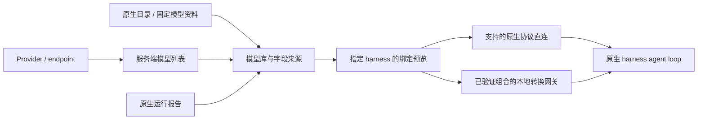

# Provider、模型库与 Harness 配置

源码抓取：2026-11-11；实现更新：2026-11-12。状态：**Provider / 多端点、模型库自动填写与覆盖、在线更新、Harness 绑定已实现；已验证的真实对话与转换方向见专项矩阵。** 当前配置只保留这三层；移除旧入口见 [最新记录](test-results-2026-11-12-binding-only.md)。原有只读调研证据保持历史记录，不混入新模型调用。

用户要求的流程是：添加 Provider → 选择接口格式与地址 → 获取模型 → 从模型库补齐参数 → 选择模型与思考强度 → 应用到指定 harness。协议不匹配时，再选择已验证的本地网关转换路径。

自动填参后**允许手工修改**，覆盖层独立保存、可恢复自动，目录更新不会覆盖用户值或改写旧会话。界面入口为“Harness 与配置 → Provider 与模型”的三个标签；绑定保存后出现在新对话模型配置中。公开目录与官方接口的区别见 [来源记录](model-catalog-sources.md)。

这里把“上下文端口”理解为**上下文窗口，单位 token**。网络端口、模型列表 URL、上下文窗口是三个独立字段。三层使用独立实体和修订。SQLite v5 仅将可确定的旧配置引用映射到绑定；无法安全恢复配置的旧会话保留历史、禁止继续发送。

固定提交和新增上游证据见 [research-sources.json](research-sources.json)、[本轮来源与内容摘要](provider-configuration-sources.json)。`.local/research` 和下载的发布包只用于只读核对，不进入运行依赖。CC Switch、Magpie、pi、DSH、ZCode 均使用原定提交，没有改用 main。补充的 OpenCode/Gemini 源码固定到对应版本的 commit；官方网页单独记录抓取时间和 SHA-256，网页不是版本锁定的源码。

## 1. 先区分三种事实

| 事实 | 主要来源 | 不能据此声称 |
| --- | --- | --- |
| 当前账号/endpoint 列出哪些模型 | 该 Provider 的模型列表接口，或 harness 原生目录 | 模型调用必定成功、账号必定有余额 |
| 模型支持哪些上下文、输出和思考参数 | endpoint 的明确元数据、原生模型目录、已核实的模型资料 | 同名模型在所有转发服务上具有相同参数 |
| 当前 harness 能接受哪些参数 | 实际安装版本的协议、配置 schema 和运行协商 | 有 `reasoning: true` 就接受任意 effort，或有网关就支持任意模型 |

常见 OpenAI `GET /models` 返回模型 ID、创建时间、owner 等，通常不包含窗口和思考档位。Responses 与 Chat Completions 可以共享列表格式，但**列出模型不证明两个推理接口都能使用它**。扩展 `/models`、Gemini、Kimi、DSH 的目录可能带更多字段，只读取它们明确声明的能力。

上下文窗口、最大输入、最大输出、工作窗口和自动压缩阈值也要分开。`limit.context` 不能总用 `limit.input` 替代；最大窗口不能直接等同于客户端默认工作窗口；压缩仍由原 harness 执行。模型库只提供事实和配置建议。

## 2. CC Switch 与 Magpie 实际怎样做

| 方面 | CC Switch 固定快照 | Magpie 固定快照 | Kodo 采用方式 |
| --- | --- | --- | --- |
| Provider | Provider 配置及各应用配置形状，记录 API 格式和额外元数据 | 独立 Provider；同一提供商可分别配置 Chat、Responses、Anthropic、Gemini 地址；保留用户选定的 `BaseAPI` | 一个 Provider 下有多个明确协议的 endpoint，不靠模型名猜协议 |
| 获取模型 | `model_fetch.rs` 支持 Base URL、完整 URL、独立 models URL、协议认证和 headers；`FetchedModel` 主要为 ID/owner | `catalog/live.go` 保存实时列表、实际 base、按协议分开的列表、首次出现时间 | 保存“来自哪个 endpoint/凭据修订、什么时候获取”；刷新失败不清空旧列表 |
| 自动填参 | `modelMetadata.ts` 逐字段合并同地址人工预设、models.dev 对应服务条目、原厂候选 | `catalog` 合并在线目录、编译内置 models.dev 快照、实时列表、原生目录和人工修订 | 逐字段来源和覆盖；不同路由不按同名强行合并 |
| 模型库维护 | 前端共用 models.dev 查询缓存；人工 provider 预设；价格目录单独同步 | 内置 `api.json.gz`，记录真实快照时间，在线刷新和离线回退；原生目录补特殊供应商 | 发布时固定快照；在线刷新产生新修订；保留最后有效版本，不自动改已绑定会话 |
| 应用到 harness | 各应用的配置服务生成原生格式 | `internal/agent` 按 agent/版本映射目录和字段 | 隔离实例目录/环境生成配置；会话绑定不可变修订 |
| 协议转换 | 独立 request/response 和 streaming 转换模块；包含 Responses↔Chat、Anthropic、Gemini 等路径 | gateway 解析客户端协议，再路由/转换；Gemini 有 generate/stream/countTokens/models 入口 | 只采用经过验证的协议组合；模型循环、工具执行、压缩仍属于 harness |
| 凭据 | 参考其协议和配置映射 | 该快照 Provider key 保存在本地 JSON 文件 | Kodo 继续系统 keyring；SQLite、浏览器和手机不保存原始 key |

CC Switch 的补全顺序不是“模型名匹配到任意一行就复制”：先看 endpoint，再看模型；原厂候选不携带转售服务的价格。同域名下不同套餐路径也不能合并。它对部分原厂兜底窗口另作保守封顶，这是其产品策略，**不能作为 Kodo 的模型规格直接抄入**。

Magpie 的 live cache 用内容 hash 与抓取时间分别表示变化，避免每次刷新时间改变就重建历史索引。内置快照记录的是 2026-11-10 10:11 UTC，离线回退不能伪装成刚刚从服务端获取。

关键源码：

- CC Switch：`services/model_fetch.rs`、`src/lib/modelMetadata.ts`、`src/lib/modelsDev.ts`、`FetchedModelPicker.tsx`、`services/model_pricing.rs`、`proxy/providers/adapter.rs`、`transform_codex_chat.rs`、对应 streaming 模块。
- Magpie：`internal/provider/provider.go`、`internal/catalog/{catalog,live,bundled,gemini_list}.go`、`internal/agent/nativemodels.go`、各 harness 的 agent 映射与 `internal/gateway/{chat,anthropic,gemini}.go`。
- 完整固定链接列在 [来源清单](provider-configuration-sources.json)；本页仅分析职责，没有复制其网关或登录实现。

## 3. 十种 Harness 的模型库与字段来源

下表是**源码/协议证据**，不是十种真实 Provider 接入通过矩阵。第三方适配器证据与官方源码/文档分开说明。

| Harness | 模型库怎样维护、从哪里取列表 | 上下文和输出参数 | 思考参数与应用边界 |
| --- | --- | --- | --- |
| pi | `pi-ai/catalog/generate.ts` 汇总 models.dev、OpenRouter、Vercel 等来源，加供应商专用规则；生成带 schema/结构校验的目录并发布；用户 `models.json` 可补充/覆盖。Kodo 运行时读取实际安装 SDK 的 `ModelRuntime` | 模型 `contextWindow`、`maxTokens`、`input`；以安装 SDK 解析后的记录为准 | `reasoning`、`thinkingLevelMap`、协议 compat；用 SDK 的 `getSupportedThinkingLevels` 得到可选档位，不能只看布尔值 |
| Codex | 官方 app-server `model/list`，含分页、默认模型、`supportedReasoningEfforts` 等；原生版本另有内置目录和 `models_cache.json`；自定义目录由 `model_catalog_json` 指定，schema 随版本变化 | `model_context_window` 是配置覆盖；目录还可能区分 `context_window` / `max_context_window`。`model/list` 不能视为完整规格表 | 使用原生返回的 effort；每轮可传 model/effort。自定义模型服务使用原生 Responses provider 配置；不能复制任意原生模型条目来假授工具能力 |
| Claude Code | Agent SDK 0.3.322 的 `supportedModels()` 返回 `ModelInfo`；原生别名、可用模型和策略由实际 CLI/服务决定；闭源内部目录维护流程未查证 | SDK `ModelInfo` 本身没有窗口字段；结果 `ModelUsage` 含 `contextWindow` / `maxOutputTokens`，属于原生运行报告，不能据此证明自定义 endpoint 规格 | `supportsEffort` / `supportedEffortLevels` / `supportsAdaptiveThinking`；自定义服务为 Anthropic Messages。思考开关、effort 与 token budget 不混成一个数值 |
| DeepSeek Harness | 两条路径：原生 DeepSeek 插件读取其扩展 `GET /models`；`llm-pi-ai` 路由则从安装 pi-ai 目录继承，再逐字段接受原生配置覆盖。自定义路由可查询兼容列表；目录候选不自动成为持久配置 | DeepSeek listing 可声明 `contextWindow` / `maxOutputTokens` / modalities；pi-ai 路由需模型 `contextWindow` / `maxTokens` 等 | 原生 DeepSeek 适配器提供它自己的档位；pi-ai 路由有 `reasoningEfforts` 的档位→wire 值映射。配置插件与 SDK `initialize` 是不同层，不能只传 provider 名便宣称自定义 endpoint 已装配 |
| ZCode | 当前固定提交已在 2026-08-24 **移除 models.dev**。来源是 ZCode Built-in Config、Account/Personal Overlay 和 Effective Model Config Rules；内置 release 有 revision、bundled/active/remote 及最后有效版本 | 有效规则 `properties.contextWindow`，`optionSpecs.maxOutputTokens.max`；自定义模型规则与用户手工规则分开 | `optionSpecs.reasoningLevel.values` 和 `map` 声明合法档位及 wire 映射；模型选择读取活 registry。3.14+ 使用 `provider_config.json`，不能只写旧 `config.json` |
| OpenCode | 已固定 v1.18.30 对应源码：models.dev 格式目录，实际从 `models.opencode.ai/api.json` 获取，支持缓存/内置快照/自定义目录；再叠加 config、插件及已连接 provider。原生 `/provider` 返回有效配置 | `limit.context` / `limit.input` / `limit.output`、modalities；自定义配置覆盖这些字段 | 原生 `variants` 由 reasoning options/ProviderTransform 与用户配置合并而来；API 调用使用 variant ID。Magpie 对 OpenCode 2 有另一种 `providers/package/settings` 结构，不能套给本机 1.18.30 |
| Gemini CLI | 固定 0.67.0：模型常量/别名与 `defaultModelConfigs.ts` 维护默认生成参数；`tokenLimits.ts` 维护客户端窗口表，注释指向 Google 模型文档。Google `models` API 是另一来源，含 generation methods 及输入/输出上限 | API `inputTokenLimit` / `outputTokenLimit`；CLI token table 有 fallback，fallback 不代表任意自定义模型真实规格 | 原生 `thinkingConfig.thinkingBudget` / `thinkingLevel`；Kodo 当前只按 ACP `thought_level` 的实际协商展示。Chat 网关实现 models、generate/stream；精确 countTokens 没有可靠上游来源时明确拒绝，不能伪造 |
| Cursor | 普通 Cursor Agent 的官方 CLI 提供 `--list-models` / `--model`；本产品读取 ACP 原生选项。模型目录内部维护和上下文规格来源未公开查证 | ACP 没有提供时保持未知；不能借同名模型或 Cursor 编辑器目录代替 CLI 事实 | 按 ACP 协商的选项。**尚未证实普通 Cursor Agent 可注入任意 Provider endpoint**。Magpie `cursorlocal.go` 对应 Cursor Private Inference 变体，不等于普通 Cursor Agent |
| Kimi Code | 已只读核对 npm 2.5.2 发布包并验证 integrity。bundle 包含 models.dev 内置快照和在线导入/缓存（10 分钟、失败回退），另有原生 `/models` 刷新账号模型；更新脚本 `catalog:update`。模型持久配置是最终执行依据 | `max_context_size`（内部 `maxContextSize`）；原生目录 `context_length` 映射 `contextLength`；不认识的窗口不能默认为已验证的 128K | `support_efforts` / `default_effort`，上游还可通过 `think_efforts.valid_efforts/default_effort` 声明；capabilities 区分 thinking/always_thinking。新产品使用 `KIMI_CODE_HOME` / `.kimi-code/config.toml`，旧 kimi-cli 路径不可直接复用 |
| Grok Build | 官方文档支持 `[model.<id>]` BYOK 模型表和 `[models].default`；内置/远程目录具体维护实现未查证。npm 1.0.80 是平台原生程序的安装器，不能据安装器推出内部模型库实现 | 官方字段 `context_window` 驱动 auto-compact，另有 `max_completion_tokens`；真实能力来自服务商资料/明确元数据 | 官方字段 `api_backend`（chat_completions/responses/messages）、`supports_reasoning_effort` / `reasoning_effort`、全局 `default_reasoning_effort`。Magpie 另写 `reasoning_efforts`，该字段仅为参考适配证据，须向实际版本核实 |

Kodo 主 agent 另列：使用本产品独立身份、配置和会话，底层可复用 pi 的协议/模型目录解析；不会因为使用 pi SDK 就把主 agent 命名成 pi。

### 3.1 版本与证据限制

- pi 参考源码固定 `058496b…`，实际 npm SDK 是 **1.5.2**。字段要以运行包 schema 为准，不直接把较新参考源码的类型写进旧 SDK。
- CC Switch 固定 `5e9812e…`；Magpie 固定 `6a450c4…`；DSH 固定 `fcc0ad4…`；ZCode 固定 `a9fe401…`。完整 hash 见机器可读清单。
- 补充 OpenCode v1.18.30 固定 `3104c1428ec91f809e5ab86631300de41eb6952e`，Gemini v0.67.0 固定 `dc6602cec4a6e823aa33937144245dc421e5165f`。
- Kimi 官方仓库对应 tag 本轮返回 404，因此使用 **2.5.2 发布包完整性锁定**，没有冒称查阅到对应 Git commit。仅下载/读取，没有安装或执行 postinstall。
- Grok 上下文、协议和 effort 字段有官方文档证据；闭源内置目录仍未知。发布包安装器声明的 Apache-2.0 不证明平台原生程序具有相同许可证；不导入其实现。
- 官方网页描述当前公开接口，不保证本机/注册表固定版本已经全部支持。所有配置映射仍须经过实际启动版本校验。

## 4. Kodo 应保存什么

这是待实现的产品数据模型；不要求新增独立服务，仍由同一 Host/SQLite 处理。

| 对象 | 保存内容 | 生命周期 |
| --- | --- | --- |
| Provider | 稳定 ID、名称、一个或多个 endpoint、每项明确 protocol/base URL、可选独立 models URL、认证/header 引用、revision | 不绑定单一模型；改地址/认证产生新修订 |
| Provider endpoint | 四种格式：OpenAI Chat、OpenAI Responses、Anthropic Messages、Google Gemini；完整请求 URL 与 base URL 明确区分 | 可分别拥有模型列表和可用性状态；不自动探测后永久改写用户所选协议 |
| Model catalog entry | Provider/endpoint/model ID，名称、上下文、最大输入/输出、modalities、工具支持、思考选项/映射、可选价格 | 自动目录与用户覆盖分层；每个字段记录来源，可修改并恢复自动 |
| Field provenance | value、source kind、来源 URL/原生版本、revision/hash、fetchedAt、verifiedAt（如有）、status | 每个字段独立，unknown 与 false/0/空数组有区别 |
| Harness binding revision | harness/安装版本、Provider 与目录修订、选定模型、工作窗口/输出配置、默认思考、直连或网关路径、兼容诊断 | 生成原生隔离配置；当前默认指向新修订，已有会话保留旧绑定 |
| Session/command settings | 会话期望 model/effort，发送时固定 binding/settings revision，原生实际 model 独立记录 | 排队消息和普通下一轮按明确的发送快照执行，不在投递途中偷换路由 |

模型键至少是 **Provider ID + endpoint ID + wire model ID**。模型 ID 为不透明字符串，不能无条件去掉 `/`、`:variant`、`[1m]`、fast 后缀或改写大小写。别名/原厂关联只提供补全候选，不改变实际发送的 ID；歧义让用户选择。

来源类型至少包括 `endpoint`、`native-runtime`、`bundled-catalog`、`remote-catalog`、`verified-preset`、`user`。模型的 `listed`、`configured`、`verified-call`、`unavailable` 分别显示；连通性检查与实际对话验证分开。

### 4.1 自动填写规则

1. 窗口、输入/输出上限和思考能力自动读取，允许用户手工覆盖并记录来源，提供恢复自动入口。刷新只更新自动层，不覆盖用户值；已绑定会话的模型与绑定修订保持不变。覆盖模型资料不能绕过 harness 实际协议限制。
2. 优先使用当前路由明确声明的参数和当前安装 harness 的有效原生配置。这两者发生冲突时保留各自来源，提示修正，不能自动取较大值。
3. 用同 endpoint、同服务套餐、同模型的已核实预设补缺；再用明确匹配的目录资料。原厂同名规格只能作为标注来源的候选，不能证明中转服务支持该上限或 effort。
4. 上下文、input/output、effort/toggle/budget、价格逐字段合并，不能拿一条猜测覆盖整行。`reasoning: true` 不能自动生成 low/medium/high；支持 budget 的模型保留 budget 范围与协议映射。
5. 未知保持未知。运行必需的窗口或输出上限缺失时提示，可等待可靠目录/原生元数据，也可由用户明确覆盖；没有可用值则阻止启动，不静默使用 128K/8192。用户覆盖不冒称官方参数，价格缺失不按零计费。
6. 有界缓存、分页、刷新超时和最后有效版本。缓存按 Provider/endpoint/认证修订隔离；换 key 后不可沿用“新账号已列出”的状态；失败不能抹掉已绑定配置。

已实现的更新器读取 `https://models.dev/catalog.json`，24 小时 TTL、ETag/304、内容 SHA-256、大小/超时/结构校验、事务替换与失败保留 LKG；配置页按需触发和 Host 维护检查均已接入。离线初始目录来自锁定的 pi SDK 1.5.2，标为发布目录而非新抓取。OpenRouter 可作为 Provider 模型列表入口，不是第二条独立后台 feed。用户覆盖独立保存，目录变化产生模型新修订，旧绑定不变。

## 5. 应用到 Harness 与本地网关

当前开放 **Claude Messages→Provider Chat Completions** 和 **Gemini Google API→Provider Chat Completions**。两条路径均完成双轮真实回复、原生 Read 工具及第二轮历史验证。Gemini 路径转换文本、函数工具、流式回复与上游 usage；本地临时 token 交给 CLI，上游 key 留在 Host 凭据库。精确 `countTokens`、图片、签名思考、Google Search、缓存/安全设置及不能等价的 thinking budget 明确拒绝。Responses→Chat 转换器有协议测试，但 Codex 0.161.0 的原生自定义工具无法完整转换，实测失败后已在预览/保存/启动边界禁用，Codex 使用 Responses 直连。其他多模态、托管工具、远端响应状态和压缩也不宣称支持。

绑定预览必须给出：harness 实际版本、下游原生协议、上游 endpoint、直连/转换、会改动的实例字段、缺失参数、已验证/待验证能力。协议不兼容且路径未实现时明确阻止应用；不偷偷回退到另一个服务、模型或登录账号。

网关属于 Host 的模型传输层，不能替代 harness 的 agent loop。需要覆盖：

- 多轮消息角色、system/developer 指令的正确映射、文本/受支持的多模态。
- tool schema、工具名/调用 ID、并发调用、arguments 增量、tool result 的往返关联。
- SSE 的事件顺序、终止/失败、背压和中途断开；客户端取消向上传播；已开始生成后的错误不自动重放请求。
- 请求的 reasoning、可见 summary 与原生 opaque/signed 状态分别处理；无法保留的签名状态、内置工具、远程 compact 等特性明确声明不支持，不能静默删除关键语义。
- usage 的原始来源、请求模型/实际模型、缓存类别；网关与原生 usage 对账后只统计一次。网关转发不产生第二份“执行费用”。
- 只在本机监听，给隔离实例独立的本地访问凭据；原始 Provider key 由 Host 取用，不能被另一个路由或客户端读取。上游凭据不跟随未确认的跨源重定向。

同协议优先直接交给原生 SDK/客户端，必要的同协议中继只处理隔离、凭据和观测。转换能力独立列出 text、tools、stream、cancel、reasoning、images、usage 的测试结果；没有某特性时绑定预览显示具体限制。

### 5.1 会话中途切换

**模型和思考强度**：原生允许时在同一原生会话的下一普通回合切换；正在运行的一轮继续使用其已固定参数。ACP 切模型后要重新获取当前模型的 `thought_level`，不能沿用前一个模型的档位。

**Provider/协议/认证**：不等同于改 model ID。需要新的隔离绑定，并核对原生 resume 能否迁移到该实例；原生不支持时创建新的原生会话并保留来源关系。不能把跨 Provider 交接伪装成 resume，也不能为了让界面立即显示新配置便篡改当前运行路由。

本轮绑定会话固定单一模型与参数来源，换模型/Provider 需新建绑定会话；思考强度可在已声明范围内设置下一轮。未绑定、使用原生配置的会话仍保留原有中途切模型能力。模型库可保存 effort/toggle/budget 与映射，但 toggle/budget 的通用操作控件和原生 wire 映射未完成，不把保存资料等同执行支持。

**等待队列**：显示将采用哪一修订；编辑或立即发送仍经过稳定请求 ID、发送权和 generation 检查。重启网关不能使停止或撤销后的消息重新发出。

## 6. 界面流程

界面统一从 Provider、模型库到 Harness 绑定创建配置。会话直接固定绑定修订；不再生成额外配置镜像。旧配置 API 和编辑入口已移除。旧会话历史保留，但无法安全映射运行配置时需新建会话继续对话。

1. **添加提供商**：名称、接口格式、Base URL、API key；高级项单独设置模型列表 URL、请求 URL 模式和非敏感 headers。密码类 header 同样进入 keyring。
2. **获取模型**：展示来源 endpoint、获取时间、失败原因；列表不等于调用成功。支持手动输入服务端未提供列表的模型，不把不支持列表当作不能对话。
3. **编辑模型**：自动填写窗口、输入/输出上限、支持的思考类型和档位，每项能看到来源并覆盖；没有可靠值时留空。
4. **应用到 harness**：选择目标 harness/安装、默认模型/思考、项目或全局新会话默认；预览直连/网关和隔离配置，显示具体阻塞项。
5. **验证**：先做配置检查和列表检查；用户主动发起真实小额验证时，经选定原生 harness 执行。只有真实返回才标记“对话已验证”，工具/取消另记结果。

桌面与手机共用 Host API；手机只提交配置意图与 keyring 写入请求，不读取保存的 key。保存成功后清空表单中的密钥，不能由 snapshot 回填原文。

## 7. 当前代码审计与实现差距

下表记录 2026-11-12 三层实现及后续一键绑定批次；源码、隔离协议测试与真实原生结果分别登记。

| 项目 | 当前实现事实 | 需要改造 |
| --- | --- | --- |
| Provider | 多 endpoint、独立 keyring 引用/修订、CAS、稳定保存回执 | 删除及更完整的保留/GC 策略 |
| 模型发现 | 四格式的认证列表、分页、去重、超时/大小限制、认证修订与跨源隔离、失败保留旧列表 | 四家官方账号列表实测、每个 Provider 定时重取 |
| 参数库 | models.dev 在线更新、离线 SDK、逐字段来源、显式 catalogKey、手工覆盖/恢复自动 | 第二独立 feed、toggle/budget 执行映射、冲突双来源完整展示 |
| 自定义 pi | 明确绑定参数可注册任意 Provider；窗口/输出/input/reasoning 缺失则拒绝；未声明档位禁用；价格未知 | 四格式都已实现 SDK 装配，真实只验 Anthropic 入口；其他协议模型待实测 |
| Codex / Claude | 固定绑定、隔离目录、明确参数；Responses/Messages 直连实测通过；Claude Chat 转换通过 | Codex 自定义工具转换不支持；更多模型、版本、原生工具/取消组合待测 |
| DSH | 独立 DSH_HOME、llm-pi-ai 插件配置与默认模型；Anthropic 新绑定双轮真实回复 | 其他协议、工具、用量和取消待验收 |
| ZCode / OpenCode | ZCode 独立 provider_config/有效规则与 Host 本地凭据中继，desktop runtime 新绑定双轮通过；OpenCode 1.18.30 独立 Provider、limits/modalities/variants、Anthropic `/v1` 映射及双轮通过 | 其他协议与版本、工具/恢复/取消待实测 |
| 四种 ACP harness | Gemini 0.67.0 经 Chat 网关双轮真实回复及原生文件工具通过；Kimi 2.5.2 / Grok 1.0.80 独立配置及 Anthropic 新绑定双轮通过；Cursor 绑定禁用 | Gemini Google 直连、普通 Cursor 自定义 endpoint 及其他协议/原生能力待验证 |
| 本地网关 | loopback 临时 token、单请求转换、SSE/工具/usage/取消协议测试；Claude/Gemini 原生双轮+Read 通过；错误不自动重发 | 其他转换方向、更多原生工具及真实取消；Codex 转换明确禁用 |

配置页的“按 Harness 一键配置”按目标协议筛选模型，预览通过后保存绑定并可原子设为新会话默认值。草稿的模型菜单只选择现有绑定或原生模型。它不会将任意协议自动转换为所有 Harness 可用的接口；普通 Cursor Agent 没有已确认的自定义 Provider 入口，仍使用原生登录与模型设置。详细实测见 [最新结果](test-results-2026-11-12-providers.md)。

## 8. 先前只读调研验证与初始验收清单

本轮执行：核对五个既定本地仓库的 HEAD；对新增 OpenCode/Gemini 版本解析 commit 并读取固定文件；Kimi/Grok 发布包按 npm SHA-512 integrity 校验，只读检查；官方配置页面抓取并计算 SHA-256；审查当前配置、pi 模型装配和原生模型适配代码。机器可读证据见 [来源清单](provider-configuration-sources.json)。

以下表格保留**调研时的初始状态**，不是最新结论。新实现、协议/浏览器及原生验收对应关系见 [最新结果](test-results-2026-11-12-providers.md)，完整目标继续纳入 [测试大纲](test-plan.md)：

| ID | 验收要求 | 方法 | 初始状态 |
| --- | --- | --- | --- |
| PROV-01 | 新建/编辑 Provider、多协议 endpoint、修订冲突，旧库迁移保留历史 | A/B | 调研时未执行；最新状态见验收报告 |
| PROV-02 | 四种格式模型列表的 URL/认证、分页、有界读取、超时；独立 models URL；协议不支持时手动模型可保存 | A/P/N | 未执行 |
| PROV-03 | 列表只有 ID 时窗口/effort/价格仍未知；不虚报模型可调用 | A/B | 未执行 |
| PROV-04 | 同名模型跨 endpoint/套餐/认证修订隔离，别名歧义不改 wire ID | A | 未执行 |
| PROV-05 | 快照离线可用、坏数据不替换 LKG、刷新不改既有绑定，来源/版本可见 | A/B | 未执行 |
| PROV-06 | context/input/output/工作窗口/压缩阈值分离；必填缺失提示；pi 不再固定覆盖模型参数 | A/P/N | 未执行 |
| PROV-07 | effort/toggle/budget/always-thinking 的合法值与 wire 映射；不支持档位明确拒绝 | A/P/N | 未执行 |
| PROV-08 | 每种 harness 配置预览与隔离目录，十种逐一记录；不改全局配置/登录 | A/N | 未执行 |
| PROV-09 | 原生支持的下一轮模型/思考切换，Provider 切换边界、队列设置快照与恢复身份 | P/N | 未执行 |
| PROV-10 | 同协议直连、每一转换方向的文本/工具/流/取消/错误语义；不支持特性明确失败 | A/P/N | 未执行 |
| PROV-11 | 网关崩溃/重连与停止 fence，未知生成结果不盲目重发；工具 ID 与多轮历史关联 | A/P/N | 未执行 |
| PROV-12 | keyring 轮换/删除、旧修订引用、headers 脱敏、跨源重定向、手机不回显 key | A/B | 未执行 |
| PROV-13 | 原生与网关 usage 去重、未知保持未知、实际/估算价格来源，Kodo 与执行成本分别计算 | A/P/N | 未执行 |
| PROV-14 | 桌面/手机完整添加→获取→补齐→应用→原生双轮对话；模型列表成功和真实调用失败分别展示 | B/N/M | 未执行 |

`A/P/N/B/M` 沿用测试大纲的方法定义。没有安装、登录或额度时，领域与协议测试继续执行，原生验证逐项登记阻塞，不能把模拟服务的测试结果标为真实接入成功。
