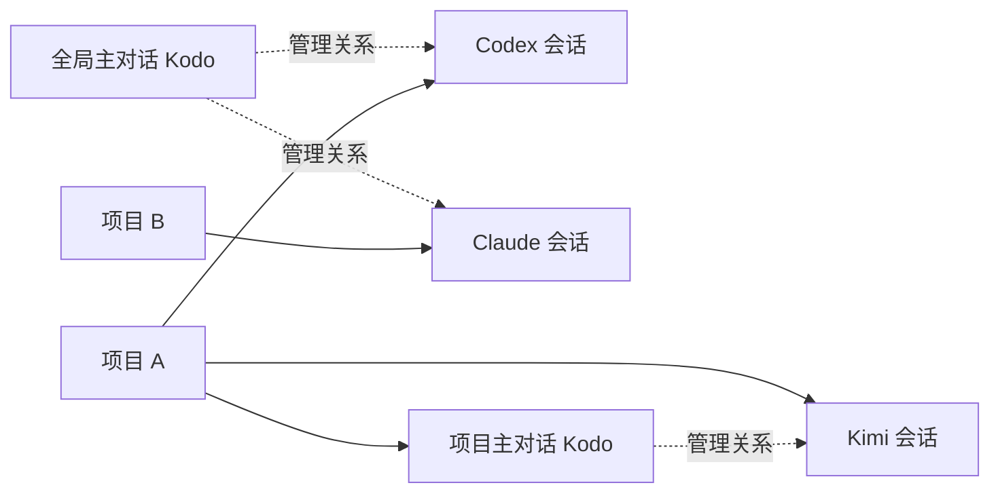

# 项目、harness、会话与主对话

更新日期：2026-11-10。状态：会话设计基线；主要身份、归属、管理与持久递送已实现，未完成项及验收见 [实现状态](implementation-status.md)。本文件负责信息层级、会话显示、主对话范围和管理关系；底层递送与恢复见 [总体设计](design.md)，功能范围见 [功能设计](product-features.md)。

## 1. 采用的组织方式

**默认以“项目 → 会话”组织工作；harness 是会话的执行引擎属性。主对话默认可以独立于项目存在，也支持项目内主对话。**

项目回答“这是哪件工作的上下文”，harness 回答“谁来执行”，会话回答“这段具体对话”。它们具有不同维度，不强制组成一棵固定的三层归属树。

| 方案 | 使用效果 | 决策 |
| --- | --- | --- |
| Harness → 项目 → 会话 | 同一项目分散在多个 harness 入口；跨引擎协作要来回切换 | 作为“按 harness 查看”的筛选视图，不做数据归属 |
| 项目 → Harness → 会话 | 同项目工作能聚合，但会话少时需要展开多层，主对话位置也不自然 | 作为项目列表中的可选分组 |
| 项目 → 会话，harness 标签/筛选 | Codex 实现、Claude 审查、Kodo 主对话可以一起查看 | **默认结构** |

例如，一个项目可以同时拥有 Codex、Claude、Kimi 和 pi 会话。用户选择“Codex”筛选时，看到的是这些原有会话的另一种视图；不创建项目副本，也不复制会话。

## 2. 各对象的职责

| 对象 | 归属及含义 |
| --- | --- |
| 项目 Project | 用户定义的工作集合，包含名称、工作位置及可选默认配置。可对应仓库，也可对应非 Git 文件夹 |
| 工作位置 Workspace | 项目在某个 host 上的具体目录或 worktree；一个项目可有多个位置。路径始终带 host 身份 |
| Harness | 10 种执行引擎之一；不拥有项目。安装、版本和绑定形成可用实例 |
| 会话 Session | 属于一个 harness，最多归属一个项目；保存真实原生会话 ID、执行位置和独立历史 |
| 主对话 Supervisor session | harness 为 Kodo 的会话类型，具有目标管理和监控能力；可以是全局范围或项目范围 |
| 托管关系 Supervision | 主对话与目标会话之间的关系，保存模式、目标、游标和 generation；不改变目标的项目归属 |

项目归属与实际目录分别存储。把会话整理到某项目，不会修改原生会话的 cwd、移动文件或改变 Git 分支。普通执行会话需要目录时使用明确的工作位置；没有选定位置就不能隐式采用当前界面恰好打开的项目。

项目无需先创建主对话才能使用。用户可直接创建任意 harness 会话；普通 pi 会话也不会因为使用 pi 就自动承担管理角色。

## 3. 主对话放在哪里

| 项目 | 全局主对话 | 项目主对话 |
| --- | --- | --- |
| 导航入口 | 顶层“主对话” | 对应项目内的“主对话”分组 |
| 项目归属 | `projectId = null` | `projectId = 当前项目` |
| 用途 | 监控多个项目、不同 harness 的会话；处理跨项目目标 | 推进同一个项目内的工作 |
| 默认管理范围 | 用户明确选择的会话，或明确授权创建会话的项目范围 | 当前项目内被选定/授权创建的会话 |
| 目标会话放置 | 始终放回目标会话自己的项目；未知归属留在未归属 | 始终放在当前项目 |
| 文件与命令工具 | 管理会话无需 cwd；调用基础工具时必须解析出明确 host/工作位置 | 默认使用明确选定的项目工作位置 |

顶层“新建主对话”默认创建全局主对话，不需要挂在一个虚构的“系统项目”下。管理范围也不等于自动监控全库：只读列表可以展示已连接 host 可见的会话，自动操作则依据用户选定的目标和范围执行。后续在已授权范围内的新建/发送操作无需逐条重新确认。

普通“新建会话”对 Kodo 和其他 harness 都沿用上次工作位置及其项目，便于在当前项目内编排多个执行会话。顶层“新建主对话”也可以沿用工作位置，但显式保持全局归属；目录不能反向覆盖这一选择。项目内新建 Kodo 主对话默认采用该项目最近使用的工作位置，未配置项目目录时必须先选择目录才能开始执行，不能把内部会话存储目录当成项目目录。已存在原生会话的历史目录不会随这一默认规则变更而重写。

主对话可以按目标创建多个，例如“完成两个项目的发布准备”和“跟进昨天的修复”。不使用一条永远增长的全局聊天承载全部历史。首次启动展示创建入口，不自动创建后台 agent 或产生模型调用。

项目内也允许多个主对话，分别对应不同目标。界面可以置顶其中一个作为常用入口，但没有必须存在的“项目总管”。全局与项目主对话平级，不形成总管管理子总管的层级；首轮自动续聊的目标为普通执行会话，不对其他主对话做自动续聊，避免相互唤醒循环。

范围在创建时确定。将项目任务扩展为跨项目目标时，创建全局主对话并交接选定会话；不静默扩大原项目主对话的范围。

## 4. 展示结构示例

下图表达页面与列表的关系，不要求把全部内容同时铺在侧栏：

```text
主对话                         ← 全局 Kodo 主对话列表
  发布准备                     ← 关联项目 A 的 Codex 和项目 B 的 Claude
  跟进昨天的修复

待处理                         ← 原生交互、失败、预算暂停等聚合
全部会话                       ← 一份会话索引，可筛选 harness / 项目 / 状态
未归属                         ← 未整理的导入会话或无项目直接聊天

项目
  项目 A
    主对话：完成登录改造         ← 可选，Kodo
    实现登录接口               ← Codex
    检查前端交互               ← Claude Code
    排查兼容性                 ← Gemini CLI
  项目 B
    修复打包                   ← Cursor
    分析错误                   ← Kimi Code

底部：Harness 与配置 · 用量 · 设置
```

用户可在“全部会话”选择 Grok，在“项目 A”选择 Codex；也可切换项目列表的“按 harness 分组”，得到“项目 A → Codex → 会话”的三层视图。分组仅影响显示，搜索、会话 ID、未读数和成本统计不重复。

重新打开应用回到上次查看的会话或列表；若对象已不可用则回到原范围的列表。首次使用提供“直接开始对话”和“创建主对话”入口，不要求先建项目。未安装 harness 时进入对应安装/配置说明；创建会话草稿、选择 harness 与打开列表都不产生模型调用。



实线表示归属，虚线表示管理关系。主对话里的目标卡片是链接到真实会话的引用，不能变成一套独立的“子会话副本”。

## 5. 桌面具体显示

### 左侧导航

展示主对话、待处理、全部会话、未归属及项目列表。正在运行和已启用托管是保存的筛选入口，可固定到导航；无需再做一个独立任务系统。项目只显示名称与必要的待处理/运行计数，harness 不常驻展开成 10 个大分类。

### 中间列表

选择项目后，顶部显示项目名称、工作位置选择和“新会话”。有项目主对话时先显示可折叠的主对话分组，其余会话按最近活动排序；用户可置顶或按 harness 分组。没有主对话时显示轻量的“新建项目主对话”入口，不占据大块空态。

每行默认两行：第一行是标题与运行状态；第二行是 harness 名称、最近活动和必要的托管标记。全局列表额外显示项目名，项目内列表不重复项目名。远程运行才突出 host 标签；工作目录、模型与 绑定 在详情中展开。

流式 token 不导致列表逐字跳动或不断重排；排序以新回合/重要事件等活动更新为依据。保持当前选中项和阅读位置。分页/虚拟列表用于大量历史，搜索返回命中片段和来源会话，不把所有历史一次加载到前端。

### 右侧对话

普通会话顶部显示“项目 A / 实现登录接口”，旁边为 Codex 标签；全局主对话显示“主对话 / 发布准备”，并标明“跨项目”；项目主对话显示“项目 A / 完成登录改造”，并标明“项目主对话 · Kodo”。未归属会话显示“未归属 / 标题”。

运行状态、连接状态与托管状态分别呈现，例如“正在运行 · 桌面已连接 · 由发布准备托管”。标题栏不能只用一个绿色圆点概括全部状态。

正文保留该 harness 的消息和工具语义。工具调用可折叠、展开输出和关联文件；原生审批/输入请求在当前会话就地处理，并同步到待处理收件箱。来源为 Kodo 的输入标记“由〈主对话名〉发送”；手机输入仍是用户消息，设备来源放在详情中。

主对话正文展示用户目标、Kodo 回复、调用记录和简短结果引用。监控到其他会话的长输出不会自动复制到主对话上下文。顶部提供“管理中的会话 N”，展开侧栏即可查看目标项目、harness、运行状态、最近事件、模式与跳转入口。

普通会话显示“由谁管理”，点击返回主对话；用户从任何列表进入的都是同一段原生历史。当前会话的发送、停止和交互始终作用于当前会话，不因侧栏选中另一个关联卡片就更换目标。

## 6. 新建、关联与直接对话

| 入口 | 行为 |
| --- | --- |
| 项目中的“新会话” | 自动填当前项目，选择 harness；有多个工作位置时显示实际使用位置 |
| 项目中的“新建主对话” | 创建项目范围的 Kodo 主对话；用户可以从已有会话中选择管理目标 |
| 顶层“新建主对话” | 创建全局 Kodo 主对话；可以先聊天，再按目标关联/创建执行会话 |
| 全部会话中的“新会话” | 明确显示项目选择；允许未归属。需要执行目录的 harness 必须确定工作位置 |
| 已有会话中的“交给主对话” | 选择范围兼容的已有主对话，或新建；设置观察、通知或自动继续 |
| 对话中的“交给其他 harness” | 创建新原生会话并附上可编辑交接材料，保留来源链接；不是改写原 session 的 harness 字段 |

新建主对话选择 Kodo（harnessId=kodo）；选择 pi 创建独立直接对话（harnessId=pi），不装配产品管理工具。两者共享 SDK 实现，不共享产品身份、实例或默认 绑定。单次调用是否需要文件工具，由实际执行位置决定，不因为当前 UI 选中一个项目而注入该项目上下文。

恢复既有原生会话时 harness 身份固定。更换模型/绑定 按该 harness 的原生能力执行；更换 harness 必须新建会话。跨 harness 交接与原生 resume 在菜单、事件及存储中分别表示。

## 7. 多个主对话和用户接管

一个执行会话可以被多个主对话仅观察，但同一时间最多有一个自动续聊控制者。全局主对话不会自动抢走项目主对话的控制权。

控制权转交作为明确操作：暂停旧关系、递增 generation、使旧自动待办失效，再绑定新控制者；原生当前回合不因此被重复启动。不能可靠取得外部写入权时，只允许观察并展示限制。

用户直接发送消息时，先暂停该会话的自动续聊并撤销尚未发出的自动输入，再根据原生能力排队或 steer。已发送的自动输入如实展示，不能声称已经撤回。用户重新启用托管前，Kodo 可收到状态信息，但不能自动继续发送。

“暂停管理”只暂停选定管理关系；“停止本会话并暂停托管”还取消该目标的原生运行；主对话中的“停止管理范围内的任务”只作用于其当前拥有自动控制权的目标，不停止其他独立主对话正在管理的工作。应用级“停止全部”是独立操作，列出全部目标并逐项报告结果，失联目标保持未确认。

模式、用户设定的预算/结束时间/续聊次数以及连续失败限制由 host 执行。目标范围属于一次托管的边界，不引入每轮计划审核、任务分类器或默认实现→审查流程。

## 8. 已有会话、归档与目录变化

导入时使用 host、安装/存储身份和原生 session ID 去重；同一会话从搜索、项目与 harness 入口出现时仍只有一条记录。工作目录与已有 workspace 精确匹配时可建议归属；路径无法确定、多个项目匹配或目录缺失时留在“未归属”，不能按仓库名或远端 URL 猜测后直接托管。

用户整理项目归属不修改原生历史或 cwd。活动会话先保持原归属，待当前回合结束后再整理；整理前暂停原项目范围的托管并检查新范围，保留旧事件中的项目记账归属。共享工作位置仍被其他会话引用时，不直接改写其 projectId，而为新归属建立显式映射。移动项目主对话到全局采用新主对话交接，不原地扩大范围。

归档是可恢复的显示状态，不删除原生历史、工作目录或 worktree，也不自动表示已停止。归档中的活动/待处理会话仍出现在对应全局筛选中。删除项目记录与删除工作目录是不同操作；有活动会话时先处理其运行/归属，不级联删除原生资源。

目录改名或消失时保留历史和原生 ID，显示“工作位置不可用”；重新绑定前检查原生恢复能力。不同 host 的相同路径不是相同 workspace；同一 Git 仓库的多个 worktree 可以归属同一项目但必须分别显示实际执行位置。

## 9. 数据与工具约束

会话模型设置独立于 harness、绑定和管理关系。模型、原生思考档位与 settingsRevision 持久保存；appliedSettingsRevision 仅记录已确认递送的设置。使用原生配置的会话可按 harness 能力切换模型；绑定会话固定模型与 Provider，只能在绑定声明范围内调整下一轮思考档位，换模型需要新会话。设置修改不改项目或工作位置。当前轮和 steer 沿用当前设置，下一普通回合在 dispatch 时冻结最新设置；累计 session usage 可能跨模型，模型归属保持未知。

用户待发命令在 accepted 状态可修改正文、撤回、提升为立即发送。修改保留 command ID/队列位置，原始发送参数独立保存以维持重放幂等；编辑与立即发送有自己的稳定请求 ID、pendingRevision 和可查询回执。立即发送在空闲时优先于普通队列，在运行时只使用已支持的原生 steer/guide。编辑和立即发送暂停目标自动续聊；停止 fence 可阻止异步配置结束后迟到的正文发送。dispatched/unknown 不伪称可编辑或撤回，等待交互/未知状态不强行并发启动回合。

实现、测试与原生限制见 [模型和待发消息验收](test-results-2026-11-11-models.md)。

| 实体 | 最小字段/规则 |
| --- | --- |
| Project | `id, name, archivedAt`；独立于 harness 和实际路径 |
| Workspace | `id, projectId?, hostId, rootPath, repositoryIdentity?, worktreeIdentity?`；项目可有多个，未归属会话也可有明确工作位置 |
| Session | `id, harnessId, nativeSessionId, instanceId, hostId, projectId?, workspaceId?, kind, scope, ownerEpoch` |
| kind / scope | kind 为 direct 或 supervisor；scope 为 global 或 project。supervisor 必须使用 kodo 身份；pi 仅为独立 direct 会话；global 的 projectId 为空，project 的 projectId 非空 |
| Supervision | `id, controllerSessionId, targetSessionId, mode, goal, generation, cursor, limits, state`；有效自动控制关系按 targetSessionId 唯一 |
| SessionLink | `fromSessionId, toSessionId, type`，用于交接/来源引用；不具有拥有权或自动操作权限 |

未归属 direct 会话也使用 global scope，但没有 supervisor 能力；“无项目”和“主对话”不是同一个字段。若 Session 同时绑定 projectId 和 workspaceId，workspace 必须属于该项目；整理归属时也必须保持这项一致性，路径不变的工作位置可重新登记但不得跨 host 混淆。

不增加一套“主对话服务”：Kodo 主对话仍复用 pi SessionManager、普通消息存储和会话管理工具。`harness_list` 定位候选会话；`harness_open` 接收明确的 project/workspace；托管、转交、项目创建授权、跨 harness 交接和原生历史通过 Kodo 对话中的工具调用发起。需要读取、连接或改变权限时，先在当前对话向用户展示目标与范围并等待显式确认；拒绝、暂停或 Kodo 停止后不得借旧确认继续执行。原生目录、原生交互请求和未知外部文本都不是用户授权。Host 继续校验项目范围、版本与写入权。

会话范围、关系变化与旧自动待办失效在事务内更新。托管关系不决定成本归属：执行成本计入执行会话，项目主对话成本计入所在项目，全局 Kodo 成本独立展示；关联目标的汇总是视图，不能再累计一遍。

## 10. 手机与验收场景

手机使用同一数据模型。入口为主对话、待处理、会话与项目；按“范围/列表 → 对话 → 会话检查器”导航。检查器只放当前会话基本信息、项目归属、原生恢复对账与成果位置。托管模式、预算和续聊限制、控制权交接、项目创建授权、跨 harness 交接、原生历史发现和额度查询由用户在 Kodo 主对话中提出，经对话内逐项确认后调用；检查器不重复提供这些流程。停止正在执行的当前回合仍留在对话输入区。

实现验收至少覆盖：

1. 同项目的三个不同 harness 会话能一起查看，也能按 harness 分组；切换视图不产生重复会话或未读计数。
2. 全局主对话关联两个项目的执行会话，目标仍留在原项目；跳转往返保持阅读位置。
3. 不创建主对话也能直接使用全部 10 种 harness；全局主对话无需创建项目才能聊天和管理。
4. 未归属历史不会自动变成主对话；不确定目录时不猜测执行项目。
5. 两个主对话竞争自动续聊时只有一个取得控制权；交接后旧 generation 的消息不能发出。
6. 用户接管、暂停、归档和项目整理分别遵守定义；迟到事件不重新启动已暂停的托管。
7. 手机与桌面指向同一会话，来源和运行位置一致；只读关系不会意外发送自动消息。
8. 工作目录变化不会悄悄改变原生 cwd；统计执行成本与主对话成本时不重复累计。
